# KẾ HOẠCH NGHIÊN CỨU VÀ TRIỂN KHAI ĐỒ ÁN TỐT NGHIỆP (PHIÊN BẢN v2)

**Đề tài:** Hệ thống so sánh phiên bản hợp đồng tiếng Việt theo cấu trúc điều khoản (Structure-Aware Vietnamese Contract Version Comparison System)  
**Phiên bản tài liệu:** v2.0 — Đã hiệu chỉnh toàn diện từ [ke-hoach-trien-khai-do-an.md](file:///C:/Users/Admin/orca/workspaces/contract-diff/weakfish/docs/ke-hoach-trien-khai-do-an.md) theo hai báo cáo phản biện [codex-phuong-phap-ky-thuat.md](file:///C:/Users/Admin/orca/workspaces/contract-diff/weakfish/docs/phan-bien/codex-phuong-phap-ky-thuat.md) và [antigravity-argon-hoi-dong.md](file:///C:/Users/Admin/orca/workspaces/contract-diff/weakfish/docs/phan-bien/antigravity-argon-hoi-dong.md).  
**Quy mô thực hiện:** 01 sinh viên — 16 tuần tương đối (`T1..T16`), ngân sách 20–25 giờ/tuần (tổng cộng 320–400 giờ).

---

## 1. Phát biểu Bài toán, Câu hỏi Nghiên cứu, Giả thuyết, Đóng góp và Phạm vi

### 1.1. Bối cảnh và Đối chiếu Hiện trạng Codebase Thực tế

Qua khảo sát trực tiếp mã nguồn trong workspace (`weakfish`), hệ thống hiện có 11 tệp mã nguồn Python trong `app/` và 3 tệp trong `tests/` với hiện trạng cụ thể như sau:

* **Trích xuất PDF cơ bản:** [pdf_extractor.py](file:///C:/Users/Admin/orca/workspaces/contract-diff/weakfish/app/extractors/pdf_extractor.py#L1-L17) dùng `pdfplumber` gọi `page.extract_text() or ""` cho từng trang và chỉ sinh 2 mã cảnh báo cấp trang: `NULL_CHARACTER` (khi có `"\x00"` trong chuỗi) và `EMPTY_TEXT` (khi `not text.strip()`).
* **Hợp nhất văn bản và cờ rà soát cấp tài liệu:** [comparison_service.py](file:///C:/Users/Admin/orca/workspaces/contract-diff/weakfish/app/services/comparison_service.py#L14-L33) nối văn bản các trang bằng `"\n\n"` rồi gọi `diff_words(old_text, new_text)`. Cần ghi nhận chính xác rằng baseline **đã có trường `needs_review` ở cấp tài liệu** ([comparison_service.py](file:///C:/Users/Admin/orca/workspaces/contract-diff/weakfish/app/services/comparison_service.py#L21-L24) và [comparison.py](file:///C:/Users/Admin/orca/workspaces/contract-diff/weakfish/app/schemas/comparison.py#L29)), bật `True` khi bất kỳ trang nào của một trong hai bản PDF có `warnings`. Tuy nhiên, hệ thống chưa có cơ chế gắn cờ `needs_review` ở cấp độ từng điều khoản hoặc từng thay đổi.
* **Hành vi thực tế của thuật toán `diff_words` (Baseline 1):** Trong [text_diff.py](file:///C:/Users/Admin/orca/workspaces/contract-diff/weakfish/app/engines/text_diff.py#L4-L54), hàm `tokenize_with_spans` tách token bằng biểu thức chính quy `re.finditer(r"\S+", text)` (bỏ qua hoàn toàn mọi ký tự khoảng trắng và xuống dòng), sau đó đưa danh sách chuỗi token vào `difflib.SequenceMatcher(a=old, b=new, autojunk=False)`.
  * **Đặc tính đối với khoảng trắng (đã kiểm chứng thực nghiệm):** Vì `r"\S+"` bỏ qua khoảng trắng và `diff_words` bỏ qua các opcode `tag == "equal"`, nên `diff_words("a b", "a  b") == []` và `diff_words("a b", "a\nb") == []`. Do đó, việc ngắt dòng hoặc ngắt trang đơn thuần chỉ làm thay đổi khoảng trắng giữa các từ **không tự động tạo ra diff giả** trong baseline.
  * **Mâu thuẫn logic sẵn có trong `compare_text`:** Trong [comparison_service.py](file:///C:/Users/Admin/orca/workspaces/contract-diff/weakfish/app/services/comparison_service.py#L4-L12), trường `"is_identical": old_text == new_text` so sánh chuỗi nguyên văn, trong khi `"changes": diff_words(old_text, new_text)` so sánh mức token. Khi `old_text = "a b"` và `new_text = "a  b"`, hàm trả về `is_identical = False` nhưng `changes = []`. Đồng thời, từ `old_text` và `changes = []` không thể tái tạo nguyên văn `new_text`.
  * **Bản chất thuật toán `SequenceMatcher`:** `difflib.SequenceMatcher` sử dụng thuật toán tìm khối khớp liên tiếp dài nhất (longest contiguous matching subsequence) rồi đệ quy hai phía theo hướng tiếp cận Gestalt pattern matching (Ratcliff & Obershelp, 1988), **không phải** thuật toán quy hoạch động tìm dãy con chung dài nhất (LCS) tổng quát của Hunt–McIlroy (1976) hay thuật toán đồ thị chỉnh sửa $O(ND)$ của Myers (1986), và không đảm bảo tạo ra edit script ngắn nhất.
* **Lỗ hổng kiểm tra đầu vào và hạ tầng kiểm thử:**
  * Tại [comparisons.py](file:///C:/Users/Admin/orca/workspaces/contract-diff/weakfish/app/api/routes/comparisons.py#L13-L20), `compare_document_endpoint` truyền trực tiếp `old_file.filename` (kiểu `str | None`) vào `DocumentExtractionResponse` (yêu cầu `filename: str` trong [document.py](file:///C:/Users/Admin/orca/workspaces/contract-diff/weakfish/app/schemas/document.py#L8-L9)), trong khi [documents.py](file:///C:/Users/Admin/orca/workspaces/contract-diff/weakfish/app/api/routes/documents.py#L8-L12) có fallback `file.filename or "document.pdf"`. Ngoài ra, API chưa kiểm tra tệp PDF hỏng/mã hóa, chưa giới hạn dung lượng tệp hay số trang, và `min_length=1` trong [comparison.py](file:///C:/Users/Admin/orca/workspaces/contract-diff/weakfish/app/schemas/comparison.py#L4-L6) vẫn chấp nhận chuỗi chỉ toàn khoảng trắng `"   "`.
  * Các tệp [health.py](file:///C:/Users/Admin/orca/workspaces/contract-diff/weakfish/app/api/routes/health.py), [requirements.txt](file:///C:/Users/Admin/orca/workspaces/contract-diff/weakfish/requirements.txt), [README.md](file:///C:/Users/Admin/orca/workspaces/contract-diff/weakfish/README.md), [test_comparison_service.py](file:///C:/Users/Admin/orca/workspaces/contract-diff/weakfish/tests/test_comparison_service.py), [test_comparison_api.py](file:///C:/Users/Admin/orca/workspaces/contract-diff/weakfish/tests/test_comparison_api.py) đang rỗng (0 byte), và [test_text_diff.py](file:///C:/Users/Admin/orca/workspaces/contract-diff/weakfish/tests/test_text_diff.py#L1-L12) chỉ mới chép lại hàm `tokenize_with_spans`, chưa có ca kiểm thử `test_*` nào.

**Bốn hạn chế thực sự của Baseline cần giải quyết (Motivation đã hiệu chỉnh):**
1. **Mù cấu trúc phân cấp (Structure-blindness):** Baseline coi toàn bộ hợp đồng là một mảng token phẳng, không biết một thay đổi thuộc *Điều* hay *Khoản* nào, dẫn tới việc người rà soát không thể định vị thay đổi theo cấu trúc pháp lý.
2. **Không biểu diễn được sự kiện đổi vị trí điều khoản (`MOVED` vs `RENUMBERED`):** Vì `SequenceMatcher` chỉ khớp theo thứ tự tuyến tính, khi một Điều hoặc Khoản bị đổi thứ tự tương đối giữa hai phiên bản, baseline không có nhãn `MOVED` mà buộc phải biểu diễn phần bị lệch thứ tự dưới dạng các thao tác `delete` và `insert` rời rạc, hoặc khớp nhầm các từ phổ biến giữa hai điều khoản khác nhau.
3. **Nhiễu từ văn bản bố cục trang và lỗi trích xuất PDF:** Khi hai bản PDF có dòng Header/Footer hoặc chuỗi đánh số trang khác nhau (ví dụ `"Dự thảo lần 1 - Trang 1/10"` vs `"Dự thảo lần 2 - Trang 1/12"`), hoặc khi một câu vắt qua hai trang bị chèn dòng Header/Footer vào giữa, các token bố cục này xuất hiện trực tiếp trong luồng so sánh và tạo ra thay đổi giả.
4. **Thiếu trích xuất tín hiệu định lượng có cấu trúc và mức ưu tiên rà soát:** Baseline tách token theo `r"\S+"` (làm dính dấu câu vào số tiền như `"100.000.000đ."`), không phân biệt được thay đổi hình thức (`"100.000.000 VNĐ"` $\rightarrow$ `"100.000.000 đồng"`) với thay đổi giá trị hoặc đơn vị tiền tệ (`"100 USD"` $\rightarrow$ `"100 VND"`, `"30 ngày"` $\rightarrow$ `"30 ngày làm việc"`), và không xếp hạng mức ưu tiên rà soát cho người dùng.

---

### 1.2. Phát biểu Bài toán Hình thức (Formal Problem Statement)

Cho hai tài liệu hợp đồng tiếng Việt đầu vào $D_{old}$ (phiên bản cũ) và $D_{new}$ (phiên bản mới) ở định dạng văn bản thuần hoặc PDF số một cột (digital-born single-column PDF). Hệ thống thực hiện chuỗi ánh xạ xác định sau:

1. **Tiền xử lý và Phân đoạn Cấu trúc Phân cấp (Layout Filtering & Structural Parsing):**
   * Trích xuất văn bản kèm thông tin trang nguồn (`SourceSpan`) và kiểm tra chất lượng trích xuất từng trang (phát hiện trang quét/ảnh hoặc lỗi ánh xạ font để bật cờ `needs_review`).
   * Đánh dấu các dòng nghi là Header/Footer/Số trang (bảo toàn văn bản gốc trong metadata để truy vết) và phân tích phần văn bản nội dung thành hai cây cấu trúc có thứ tự độ sâu tối đa 2 tầng điều khoản chính: $T_{old} = (V_{old}, E_{old})$ và $T_{new} = (V_{new}, E_{new})$.
   * Mỗi nút $u \in V$ thuộc một trong các loại `NodeType` $\in \{\text{PREAMBLE}, \text{ARTICLE}, \text{CLAUSE}, \text{PARAGRAPH}, \text{TABLE}, \text{SIGNATURE}\}$ và lưu tách biệt:
     * `own_text`: Văn bản thuộc trực tiếp nút $u$ (không chứa văn bản của các nút con). Mọi đoạn văn bản nội dung trong tài liệu thuộc `own_text` của **duy nhất một nút**.
     * `subtree_text`: Văn bản tổng hợp của nút $u$ và toàn bộ các nút con của nó theo thứ tự duyệt tiền thứ tự (pre-order), chỉ phục vụ tính tương đồng ở cấp `ARTICLE`.
2. **Ghép cặp Điều khoản Một–Một Phân cấp có Lựa chọn Không Ghép (Two-Stage One-to-One Clause Alignment with Unmatched Option):**
   * Tìm tập ánh xạ một–một $\mathcal{M} \subseteq V_{old} \times V_{new}$ giữa các nút cùng loại (`ARTICLE` với `ARTICLE`, `CLAUSE` với `CLAUSE`) qua hai tầng:
     * **Tầng 1:** Ghép các nút `ARTICLE` toàn cục, sau đó ghép cục bộ các nút `CLAUSE` con bên trong từng cặp `ARTICLE` đã ghép.
     * **Tầng 2:** Ghép thu hồi các nút `CLAUSE` chưa được ghép (orphan clauses) xuyên qua các `ARTICLE` khác nhau.
   * Lựa chọn **không ghép** (đưa $u \in V_{old}$ vào tập xóa $V_{del}$ hoặc đưa $v \in V_{new}$ vào tập thêm mới $V_{ins}$) được tích hợp trực tiếp vào bài toán tối ưu phân công thông qua các **nút giả (dummy nodes)** và ngưỡng cấm cạnh $\tau_{\text{min}}$ trước khi giải, thay vì cắt ngưỡng hậu kỳ sau khi chạy Hungarian.
   * *(Lưu ý phạm vi: Không thực hiện ghép một–nhiều hay tách/gộp điều khoản).*
3. **Xác định Quy ước Di chuyển và So sánh Cục bộ (Move Convention & Local Diff):**
   * Trên các cặp đã ghép $(u, v) \in \mathcal{M}$, xác định trạng thái cấu trúc $\in \{\text{UNCHANGED}, \text{MODIFIED}, \text{RENUMBERED}, \text{MOVED}, \text{MOVED\_AND\_MODIFIED}\}$ dựa trên việc có đổi nút cha (`parent_changed`) hay không và thuật toán **Dãy con tăng có tổng trọng số cực đại (Weighted LIS)** kèm quy tắc phá hòa tiền định (deterministic tie-break).
   * Thực hiện diff mức token pháp lý cục bộ trên `(u.own_text, v.own_text)`.
4. **Trích xuất Tín hiệu Thực thể Toàn Điều khoản và Gán Mức Ưu tiên Rà soát (Clause-level Entity Signal Extraction & Review Priority):**
   * Trích xuất các thực thể định lượng và tín hiệu tình thái trên **toàn bộ `own_text`** của cả nút cũ và nút mới (số tiền biểu diễn bằng `Decimal` + `currency`, ngày tháng/thời hạn kèm loại ngày làm việc/ngày lịch, tỷ lệ phần trăm kèm kỳ tính, cụm từ khóa tình thái có ngữ cảnh, và dẫn chiếu nội bộ), sau đó giao (intersect) các span thực thể với vùng thay đổi của diff cục bộ.
   * Gán **Mức ưu tiên rà soát (`ReviewPriority`)** $\in \{\text{LOW}, \text{MEDIUM}, \text{HIGH}, \text{CRITICAL}\}$ theo một bảng quyết định duy nhất, bật cờ `needs_review` kèm danh sách mã lý do (`ReviewReason`), và xuất kết quả ra JSON cùng **báo cáo HTML tĩnh** có ghi rõ số trang nguồn.

---

### 1.3. Câu hỏi Nghiên cứu (Research Questions — Đã hiệu chỉnh)

* **RQ1 (Làm sạch bố cục & Phân đoạn cấu trúc Điều/Khoản):** Phương pháp kết hợp biểu thức chính quy phân cấp, máy trạng thái hữu hạn (HFSM) và bộ lọc bố cục an toàn (soft-masking Header/Footer/Số trang) đạt độ chính xác phân đoạn ranh giới `ARTICLE`/`CLAUSE` như thế nào trên hợp đồng tiếng Việt định dạng văn bản thuần và PDF số một cột, đồng thời tỷ lệ xóa nhầm nội dung thực tế là bao nhiêu?
* **RQ2 (Ghép cặp phân cấp 2 tầng & Phát hiện đổi thứ tự):** Thuật toán ghép cặp hai tầng (ghép `ARTICLE` trước, ghép `CLAUSE` cục bộ rồi thu hồi `CLAUSE` mồ côi xuyên `ARTICLE`) sử dụng biểu diễn từ vựng TF-IDF kết hợp bài toán phân công có nút giả (dummy nodes) cải thiện độ chính xác ghép cặp ($F_{1,\text{align}}$) và phát hiện điều khoản đổi vị trí ($F_{1,\text{move}}$) ra sao so với (a) Baseline 1 (`diff_words` phẳng), (b) Baseline 2 (tách đoạn theo `\n\n` + ghép cặp TF-IDF phẳng), và (c) ghép cặp tuần tự đơn điệu (Greedy / Monotonic DP)? Việc bổ sung vector embedding ngữ nghĩa (trong thí nghiệm Ablation tùy chọn) có mang lại cải thiện đáng kể so với TF-IDF mặc định hay không?
* **RQ3 (Trích xuất tín hiệu thực thể toàn điều khoản & Chuẩn hóa có cấu trúc):** Việc trích xuất thực thể trên toàn điều khoản và chuẩn hóa có cấu trúc (`Decimal` + `currency` cho tiền tệ, giá trị + đơn vị + loại ngày cho thời hạn, cụm tình thái có ngữ cảnh) giúp tăng độ chính xác phát hiện thay đổi cần ưu tiên rà soát mức cao (`HIGH`/`CRITICAL`) và giảm tỷ lệ cảnh báo nhiễu (High-Priority False Alarm Rate) như thế nào so với việc chỉ khớp chuỗi thô trên các đoạn fragment thay đổi?
* **RQ4 (Hiệu quả phát hiện thay đổi End-to-End & Đánh đổi thời gian thực thi):** Trên tập kiểm thử chỉnh sửa do LLM sinh, pipeline so sánh theo cấu trúc cải thiện Precision/Recall/$F_1$ phát hiện sự kiện thay đổi như thế nào so với Baseline 1 và Baseline 2? Đồng thời, sự đánh đổi về thời gian thực thi được thể hiện ra sao khi tách riêng **(a) thời gian chạy pha Local Token Diff** và **(b) tổng độ trễ toàn bộ pipeline End-to-End**?

---

### 1.4. Giả thuyết Nghiên cứu (Hypotheses — Đã hiệu chỉnh)

> [!IMPORTANT]
> Toàn bộ các con số định lượng trong H1, H2, H3a, H3b dưới đây là **giả định mục tiêu cần được kiểm nghiệm bằng thực nghiệm (Target Hypotheses to be Empirically Tested)** trong Chương 4, tuyệt đối không phải là năng lực đã được chứng minh trước khi chạy thực nghiệm và không dùng để loại bỏ các ca kiểm thử khó.

* **H1 (Phân đoạn cấu trúc & Bảo toàn nội dung):** Trên tập kiểm thử hợp đồng tiếng Việt dạng văn bản thuần và PDF số một cột (`test_holdout`), bộ phân đoạn HFSM đạt mục tiêu kỳ vọng $\text{Span } F_{1,\text{seg}} \ge 0.88$ ở cấp `ARTICLE`/`CLAUSE`, với tỷ lệ xóa nhầm dòng nội dung hợp đồng do bộ lọc Header/Footer bằng $0\%$ (nhờ cơ chế soft-masking có điều kiện khắt khe).
* **H2 (Ghép cặp phân cấp & Giảm thay đổi giả do đổi vị trí):** Thuật toán ghép cặp hai tầng có nút giả dùng TF-IDF mặc định đạt mục tiêu kỳ vọng $F_{1,\text{align}} \ge 0.90$ và $F_{1,\text{move}} \ge 0.85$ trên tập Benchmark tổng hợp từ cây chuẩn, đồng thời giảm ít nhất $50\%$ số lượng span thay đổi giả (false-positive change spans trên các điều khoản chỉ bị di chuyển nguyên văn) so với Baseline 1 (`diff_words` phẳng), và vượt trội hơn Baseline 2 (tách đoạn `\n\n` phẳng) ở các trường hợp Khoản ngắn hoặc đổi vị trí xuyên Điều.
* **H3a (Chi phí pha Local Token Diff):** Xét riêng bước chạy `difflib.SequenceMatcher` trên các token văn bản, việc chia tài liệu dài ($N$ token) thành các cặp điều khoản đã ghép $(u_i, v_i)$ có độ dài $(a_i, b_i)$ giúp giảm tổng kích thước tích cặp $\sum a_i b_i \ll N_{old} \cdot N_{new}$, làm cho thời gian chạy của riêng pha Local Diff trên hợp đồng dài ($\ge 20$ trang) thấp hơn hoặc tương đương so với chạy `SequenceMatcher` một lần trên toàn văn bản phẳng.
* **H3b (Đánh đổi độ trễ End-to-End toàn cục):** Xét toàn bộ pipeline từ đầu vào đến khi xuất kết quả, tổng thời gian thực thi End-to-End của hệ thống đề xuất sẽ **cao hơn** Baseline 1 do chi phí trích xuất PDF, phân đoạn cấu trúc, tính ma trận tương đồng TF-IDF và giải bài toán phân công; tuy nhiên, ở chế độ mặc định (TF-IDF trên CPU tiêu chuẩn, không dùng GPU), độ trễ End-to-End mục tiêu cho một cặp hợp đồng PDF số 20 trang vẫn nằm dưới ngưỡng $3.0\text{ giây}$ (warm-run).

---

### 1.5. Đóng góp của Đồ án (Đã định vị lại trung thực)

1. **Đóng góp về mặt phương pháp và kỹ thuật tích hợp:**
   * Thiết kế quy trình đối sánh hợp đồng tiếng Việt theo cấu trúc hai tầng (`ARTICLE` $\rightarrow$ `CLAUSE`), giải quyết ba lỗ hổng kỹ thuật thường gặp khi áp dụng ghép cặp điều khoản: (i) tách biệt `own_text` và `subtree_text` để chống báo trùng thay đổi, (ii) đưa lựa chọn không ghép (dummy nodes) vào trước bước tối ưu phân công toàn cục kèm chuẩn hóa trọng số thích nghi khi thiếu tiêu đề, và (iii) hình thức hóa quy ước phát hiện di chuyển (`MOVED` vs `RENUMBERED`) bằng Weighted LIS có quy tắc phá hòa tiền định.
   * Thiết kế cơ chế trích xuất tín hiệu thực thể định lượng (`Decimal` + `currency`, thời hạn kèm loại ngày, tỷ lệ %) trên toàn điều khoản trước khi giao với vùng diff cục bộ, kết hợp cơ chế cảnh báo an toàn (`needs_review` + khoảng cách ứng viên thứ hai `second_best_gap`).
2. **Đóng góp về dữ liệu kiểm chuẩn và thực nghiệm có thể tái lập:**
   * Xây dựng bộ dữ liệu kiểm chuẩn mở có manifest nguồn gốc rõ ràng cho bài toán so sánh phiên bản hợp đồng tiếng Việt, bao gồm: 30 cây hợp đồng gốc do tác giả duyệt tay (`gold_tree.json`), bộ sinh biến đổi có kiểm soát hậu điều kiện (90 cặp phục vụ đo độ nhạy Alignment/Move), và bộ 20 cặp hợp đồng chỉnh sửa do LLM sinh theo kịch bản có kiểu, có kiểm tra tự động độ trôi nội dung và kiểm toán mẫu bởi tác giả (không phải IAA liên người).
   * Cung cấp bộ khung đánh giá định lượng tách bạch giữa chế độ đầu vào cây chuẩn (Oracle Tree Alignment) và chế độ toàn cục (End-to-End Pipeline), kèm phân tích lỗi chi tiết.
3. **Đóng góp phần mềm thực tiễn:**
   * Nâng cấp hệ thống `ContractDiff` từ nguyên mẫu ~185 dòng code thành dịch vụ backend ổn định, có kiểm soát giới hạn tài nguyên đầu vào, xuất JSON chuẩn hóa và báo cáo **HTML tĩnh (Static Redline HTML)** có số trang nguồn và bảng tổng hợp các điểm cần ưu tiên rà soát.

---

### 1.6. Phạm vi Đề tài Đã Chốt (In-Scope & Out-of-Scope)

#### Trong phạm vi bắt buộc (Mandatory Core In-Scope)
* **Ngôn ngữ:** Chỉ xử lý **hợp đồng tiếng Việt** (hợp đồng mua bán hàng hóa, dịch vụ, lao động, thuê tài sản). Bỏ hoàn toàn bộ dữ liệu tiếng Anh CUAD và cấu hình song ngữ khỏi phần thực nghiệm.
* **Định dạng đầu vào:** Văn bản thuần (Plain text UTF-8) và **PDF số một cột (Digital-born single-column PDF)**.
* **Xử lý trang quét / lỗi font (Fail-safe Detection):** Phần bắt buộc chỉ phát hiện trang quét/ít chữ bất thường hoặc lỗi ánh xạ font/bảng mã (`EMPTY_OR_SCANNED_PAGE`, `GARBLED_TEXT_ENCODING`) để tự động bật cờ `needs_review = True` ở cấp tài liệu và điều khoản liên quan, **không** bắt buộc chạy OCR trong luồng lõi.
* **Cấu trúc phân cấp:** Nhận diện `PREAMBLE`, `ARTICLE` (Điều, bao gồm ghi nhận nhãn Phần/Chương làm ngữ cảnh đường dẫn), `CLAUSE` (Khoản, với các Điểm `a), b)` được giữ bên trong `own_text` của Khoản và tách dòng rõ ràng khi diff), `PARAGRAPH`, `TABLE`, `SIGNATURE`.
* **Xử lý bảng biểu:** Chỉ giữ nguyên nội dung văn bản của bảng trong nút `TABLE`, chạy diff văn bản mức dòng/token thông thường và tự động gắn cờ `ReviewReason.TABLE_REQUIRES_MANUAL_REVIEW`. **Không** thực hiện diff cấp ô (cell-level table diff).
* **Ghép cặp và phát hiện thay đổi:** Ghép cặp một–một hai tầng (`ARTICLE` $\rightarrow$ `CLAUSE`) có lựa chọn không ghép bằng dummy node, mặc định dùng **TF-IDF**. Phân loại 5 trạng thái cặp ghép (`UNCHANGED`, `MODIFIED`, `RENUMBERED`, `MOVED`, `MOVED_AND_MODIFIED`) và 2 trạng thái đơn lẻ (`ADDED`, `DELETED`). **Không** xử lý tách/gộp điều khoản (`SPLIT`/`MERGE`).
* **Tín hiệu thực thể và ưu tiên rà soát:** Trích xuất trên toàn điều khoản đối với số tiền viết bằng chữ số (`Decimal` + `currency`), ngày tháng/thời hạn, tỷ lệ phần trăm, cụm từ khóa tình thái có ngữ cảnh, và dẫn chiếu nội bộ; gán mức ưu tiên rà soát (`ReviewPriority`). **Không** chuyển đổi số tiền viết bằng chữ sang số và **không** nhận diện tên riêng chủ thể tổng quát.
* **Đầu ra:** JSON qua FastAPI endpoint và tệp **báo cáo HTML tĩnh (Static HTML Redline)** có số trang nguồn (`page_numbers`) và danh sách cờ rà soát. **Không** làm Web UI tương tác và **không** xuất PDF.

#### Phần mở rộng tùy chọn (Optional Extensions — Chỉ thực hiện nếu hoàn thành toàn bộ phần lõi trước cuối tuần `T10`)
1. **Nhánh thí nghiệm Ablation Embedding (Ưu tiên tùy chọn 1):** Thử nghiệm kết hợp vector ngữ nghĩa từ một mô hình tiền huấn luyện cố định để so sánh với TF-IDF mặc định trong thí nghiệm Ablation A3.
2. **Nhánh tích hợp `Tesseract OCR (vie)` cơ bản (Ưu tiên tùy chọn 2):** Chạy OCR dự phòng bằng duy nhất `Tesseract` (`vie`) trên các trang bị gắn cờ `EMPTY_OR_SCANNED_PAGE` và đánh giá riêng độ suy giảm chất lượng trên một tập mẫu nhỏ.

#### Ngoài phạm vi (Out-of-Scope)
* Không tư vấn pháp lý tự động, không kết luận tính hợp pháp hay hiệu lực của hợp đồng.
* Không xử lý hợp đồng nhiều cột (multi-column layout), chữ viết tay, con dấu đè mất chữ, không tích hợp `VietOCR`.
* Không giải bài toán tách/gộp điều khoản (1-to-$N$, $N$-to-1), không diff bảng cấp ô, không parse số tiền viết bằng chữ tiếng Việt.

---

## 2. Khảo sát Tài liệu & Ma trận Khoảng trống Nghiên cứu

### 2.1. Bốn Nhóm Công trình và Công cụ Nền tảng

1. **Thuật toán So sánh Văn bản và Cấu trúc Phân cấp:**
   * **Hunt & McIlroy (1976):** Thuật toán tìm dãy con chung dài nhất (LCS) cổ điển trên dòng văn bản.
   * **Myers (1986):** Thuật toán tìm khoảng cách chỉnh sửa ngắn nhất (Shortest Edit Script) trong thời gian $O(ND)$, nền tảng của GNU `diff` và `git diff` (bao gồm tùy chọn `git diff --color-moved` dùng để tô màu các khối dòng di chuyển mức văn bản thuần).
   * **Ratcliff & Obershelp (1988) / Python `difflib.SequenceMatcher`:** Thuật toán khớp mẫu Gestalt tìm khối liên tiếp trùng khớp dài nhất rồi chia để trị đệ quy hai phía — chính là thuật toán đang dùng trong [text_diff.py](file:///C:/Users/Admin/orca/workspaces/contract-diff/weakfish/app/engines/text_diff.py#L20-L24).
   * **Zhang & Shasha (1989) và Chawathe et al. (1996 - *LaDiff*):** Các thuật toán tính khoảng cách chỉnh sửa cây có thứ tự (Ordered Tree Edit Distance) và phát hiện phép biến đổi `Insert`, `Delete`, `Update`, `Move` trên dữ liệu phân cấp. Đồ án tham khảo mô hình biểu diễn biến đổi cây của *LaDiff* nhưng thiết kế thuật toán ghép cặp 2 tầng chuyên biệt cho cấu trúc *Điều – Khoản* thay vì dùng Tree Edit Distance thuần túy.
   * **Kuhn (1955) / Munkres (1957) & Jonker–Volgenant (1987):** Thuật toán giải bài toán phân công tuyến tính (Linear Sum Assignment) trong thời gian đa thức $O(V^3)$. Thư viện `scipy.optimize.linear_sum_assignment` hiện cài đặt biến thể đường ngắn nhất tăng cường của Jonker–Volgenant.
2. **Trích xuất Bố cục PDF và Xử lý Văn bản Tiếng Việt:**
   * Công cụ trích xuất PDF dựa trên luồng ký tự và hình học: `pdfplumber` (dựa trên `pdfminer.six`).
   * Chuẩn hóa Unicode tiếng Việt (NFC vs NFD) theo chuẩn Unicode Consortium và đặc thù văn bản quy phạm pháp luật/hợp đồng Việt Nam (bố cục *Phần – Chương – Điều – Khoản – Điểm*).
3. **Xử lý Ngôn ngữ Tự nhiên Pháp lý (Legal NLP — Tham khảo phương pháp luận):**
   * Các bộ dữ liệu quốc tế như **CUAD** (Hendrycks et al., 2021), **ContractNLI** (Koreeda & Manning, 2021), **LexGLUE** (Chalkidis et al., 2022) được khảo sát ở Chương 2 để làm rõ bối cảnh nghiên cứu Legal NLP thế giới (lưu ý: các bộ dữ liệu này đánh giá trên từng hợp đồng đơn lẻ bằng tiếng Anh, không phải bộ dữ liệu cặp phiên bản hợp đồng tiếng Việt).
   * Biểu diễn văn bản tiếng Việt: TF-IDF word/character $n$-gram và mô hình bi-encoder tiếng Việt (`bkai-foundation-models/vietnamese-bi-encoder`, `underthesea`).
4. **Công cụ So sánh Tài liệu Thực tế:**
   * Thương mại: Microsoft Word (*Compare Documents*), Draftable Legal, Litera Compare.
   * Mã nguồn mở: `google-diff-match-patch`, `xmldiff`, `pdf-diff`.

### 2.2. Ma trận Khoảng trống Nghiên cứu (Research Gap Matrix — Đã hiệu chỉnh)

Bảng dưới đây phân biệt rõ giữa **hành vi đã kiểm chứng**, **hạn chế phạm vi** và **mục tiêu thiết kế cần kiểm nghiệm thực nghiệm** của đồ án (sửa F37 và Phát hiện 2):

| Phương pháp / Công cụ | Nhận biết phân cấp Điều/Khoản VN | Phát hiện đổi vị trí (`MOVE`) | Xử lý nhiễu Header/Footer PDF | Tín hiệu thực thể định lượng & Ưu tiên rà soát | Minh bạch / Chạy nội bộ (CPU) | Ghi chú về giới hạn & trạng thái kiểm chứng |
| :--- | :---: | :---: | :---: | :---: | :---: | :--- |
| **Baseline 1 hiện có** (`diff_words` phẳng trong [text_diff.py](file:///C:/Users/Admin/orca/workspaces/contract-diff/weakfish/app/engines/text_diff.py)) | Không | Không (chỉ có `insert`/`delete`/`replace`) | Không (bỏ qua khoảng trắng nhưng lẫn dòng Header/Footer) | Không (tách token theo `\S+`) | Có (100% xác định) | Đã kiểm chứng trực tiếp trên mã nguồn hiện tại |
| **Baseline 2 trung gian** (Tách đoạn `\n\n` + TF-IDF Hungarian phẳng) | Không (chỉ tách theo dòng trống) | Một phần (ở mức đoạn văn rời rạc) | Không | Không | Có | Baseline đối chứng được xây dựng trong đồ án để cô lập đóng góp của cây cấu trúc |
| **Công cụ Diff văn bản** (GNU diff, `git diff --color-moved`) | Không | Mức khối dòng văn bản thuần (`--color-moved`) | Không | Không | Có | Không hiểu cấu trúc Điều/Khoản hay thực thể tiền tệ/thời hạn |
| **Tree Diff tổng quát** (`Zhang-Shasha`, `xmldiff`) | Yêu cầu cây XML/DOM có sẵn | Hạn chế (trừ họ *LaDiff*) | Không (không xử lý PDF) | Không | Có | Không có bộ phân tích cú pháp văn bản hợp đồng tiếng Việt |
| **Công cụ thương mại** (MS Word Compare, Draftable) | Tốt trên `.docx`, hạn chế trên PDF | Có (tùy công cụ) | Một phần | Không gắn mức ưu tiên theo thực thể VN | Đóng (Proprietary) | Không mở mã nguồn/thuật toán, không tùy biến được quy tắc nghiệp vụ |
| **Prompting LLM trực tiếp** (GPT-4 / Claude toàn văn) | Có khả năng (không tiền định) | Có khả năng | Có khả năng | Có khả năng | **Không** (Chi phí cao, nguy cơ bịa đặt/bỏ sót trên văn bản dài, rò rỉ dữ liệu) | Không đảm bảo tính tất định (determinism) và khó kiểm toán từng span |
| **Hệ thống đề xuất (Đồ án này - Phiên bản v2)** | **Mục tiêu thiết kế** (Cấp Điều/Khoản cho văn bản & PDF số 1 cột; *cần kiểm nghiệm ở RQ1*) | **Mục tiêu thiết kế** (Ghép 2 tầng + Weighted LIS có tie-break; *cần kiểm nghiệm ở RQ2*) | **Mục tiêu thiết kế** (Soft-masking dòng lặp mép trang; *cần kiểm nghiệm ở RQ1*) | **Mục tiêu thiết kế** (Tiền `Decimal`+currency, Ngày/Thời hạn, Tỷ lệ %, Cụm tình thái; *cần kiểm nghiệm ở RQ3*) | **Có** (Mặc định dùng TF-IDF + quy tắc tất định trên CPU) | **Giới hạn rõ:** Không diff bảng cấp ô (chỉ gắn cờ), không tách/gộp điều khoản, không parse tiền bằng chữ, OCR chỉ là mở rộng tùy chọn |

---

## 3. Kiến trúc Hệ thống và Schema Dữ liệu Đã Chốt

### 3.1. Luồng Dữ liệu Tổng thể (Pipeline 6 Tầng Đã Tinh Gọn)

```mermaid
flowchart TD
    subgraph T1["Tầng 1: Ingestion, Guardrails & Layout Filtering"]
        A1["Đầu vào: Văn bản thuần / PDF số 1 cột (Cũ & Mới)"] --> A2["Input Validator & Resource Guardrails (Giới hạn dung lượng, số trang, kiểm tra PDF hợp lệ)"]
        A2 --> A3["PDF Extractor (pdfplumber: dòng văn bản, tọa độ, vùng bảng, SourceSpan)"]
        A3 --> A4{"Phát hiện trang quét / Lỗi Font?"}
        A4 -- "Có" --> A5["Bật cờ needs_review (EMPTY_OR_SCANNED_PAGE / GARBLED_TEXT_ENCODING)"]
        A4 -- "Không" --> A6["Layout Filter (Soft-masking Header/Footer/Số trang, chuẩn hóa NFC có ánh xạ)"]
        A5 --> A6
        A5 -. "Mở rộng tùy chọn sau T10" .-> A5_OPT["Tesseract OCR (vie)"]
        A5_OPT -.-> A6
    end

    subgraph T2["Tầng 2: Hierarchical Structural Segmentation"]
        A6 --> B1["HFSM + Regex Parser (Nhận diện PREAMBLE, ARTICLE, CLAUSE, PARAGRAPH, TABLE, SIGNATURE)"]
        B1 --> B2["Cây Cấu trúc T_old & T_new (Tách biệt own_text và subtree_text, lưu SourceSpan)"]
    end

    subgraph T3["Tầng 3: Two-Stage Clause Alignment with Dummy Nodes"]
        B2 --> C0["Bước 0: Exact Unique Content Hash Anchor (Khóa neo các nút cùng loại có nội dung duy nhất trùng khớp 100%)"]
        C0 --> C1["Tầng 1a: Ghép cặp ARTICLE toàn cục (Ma trận tương đồng thích nghi + Dummy Nodes + Jonker-Volgenant)"]
        C1 --> C2["Tầng 1b: Ghép cặp CLAUSE cục bộ bên trong từng cặp ARTICLE đã ghép"]
        C2 --> C3["Tầng 2: Ghép thu hồi CLAUSE mồ côi xuyên ARTICLE (Orphan Clause Recovery)"]
        C3 --> C4["Phân loại Cấu trúc: Weighted LIS + Deterministic Tie-break (UNCHANGED, MODIFIED, RENUMBERED, MOVED, ADDED, DELETED)"]
    end

    subgraph T4["Tầng 4: Local Token Diff & Clause-Level Entity Extraction"]
        C4 --> D1["Local Legal Token Diff trên own_text (diff_tokens_legal + Coalescing đối xứng)"]
        C4 --> D2["Trích xuất Thực thể trên toàn own_text cũ & mới (Tiền Decimal+Currency, Ngày/Thời hạn, Tỷ lệ %, Cụm tình thái, Dẫn chiếu)"]
        D1 --> D3["Giao Span Thực thể với Span Thay đổi & Đối chiếu Giá trị Chuẩn hóa"]
        D2 --> D3
    end

    subgraph T5["Tầng 5: Review Priority Decision Table & Confidence Flagging"]
        D3 --> E1["Bảng Quyết định Duy nhất gán Mức ưu tiên rà soát (ReviewPriority: LOW, MEDIUM, HIGH, CRITICAL)"]
        E1 --> E2["Tổng hợp needs_review & ReviewReason (Confidence Margin, Bảng biểu, Dẫn chiếu, Lỗi trích xuất)"]
    end

    subgraph T6["Tầng 6: API Response & Static HTML Exporter"]
        E2 --> F1["JSON Response (Pydantic Schema)"]
        E2 --> F2["Báo cáo HTML Tĩnh (Static Redline HTML có html.escape & Số trang nguồn)"]
    end
```



### 3.2. Chính sách Kiểm tra Đầu vào và Giới hạn Tài nguyên (Input Validation & Resource Guardrails)

Để khắc phục triệt để phát hiện F04, hệ thống áp dụng lớp kiểm soát đầu vào tại `app/core/config.py` và các route trong [comparisons.py](file:///C:/Users/Admin/orca/workspaces/contract-diff/weakfish/app/api/routes/comparisons.py) và [documents.py](file:///C:/Users/Admin/orca/workspaces/contract-diff/weakfish/app/api/routes/documents.py):

1. **Giới hạn dung lượng và kích thước tài liệu:**
   * Dung lượng tệp tải lên tối đa: `MAX_UPLOAD_FILE_BYTES = 15 * 1024 * 1024` (15 MB/tệp). Vượt ngưỡng trả về mã lỗi HTTP `413 Payload Too Large`.
   * Số trang tối đa cho một tài liệu PDF: `MAX_PDF_PAGES = 100` trang. Độ dài văn bản thuần tối đa: `MAX_TEXT_CHARS = 500_000` ký tự. Vượt ngưỡng trả về HTTP `422 Unprocessable Entity` kèm mã lỗi tường minh.
   * Thời gian xử lý tối đa cho một yêu cầu so sánh: `COMPARISON_TIMEOUT_SECONDS = 30.0` giây.
2. **Kiểm tra tính hợp lệ thực sự của tệp và văn bản:**
   * Với đầu vào văn bản (`TextComparisonRequest`): bổ sung validator kiểm tra `len(text.strip()) > 0` (từ chối chuỗi chỉ chứa khoảng trắng bằng HTTP `422`).
   * Với đầu vào PDF: chuẩn hóa tên tệp mặc định `old_file.filename or "old_document.pdf"` và `new_file.filename or "new_document.pdf"`. Kiểm tra magic bytes đầu tệp (`%PDF-`) và bắt các ngoại lệ của `pdfplumber` / `pdfminer.six` (`PDFSyntaxError`, `PDFPasswordIncorrect`, tệp rỗng 0 byte) để trả về HTTP `400 Bad Request` với cấu trúc lỗi chuẩn `{"error_code": "INVALID_OR_ENCRYPTED_PDF", "detail": "..."}` thay vì làm sập worker với lỗi `500 Internal Server Error`.

### 3.3. Thiết kế Schema Dữ liệu Đã Chốt (Pydantic Models)

Giữ nguyên các schema cũ trong [document.py](file:///C:/Users/Admin/orca/workspaces/contract-diff/weakfish/app/schemas/document.py) và [comparison.py](file:///C:/Users/Admin/orca/workspaces/contract-diff/weakfish/app/schemas/comparison.py) (có bổ sung `is_token_identical: bool` bên cạnh `is_identical: bool` để tương thích ngược và sửa lỗi F03), đồng thời chốt hệ thống schema cấu trúc mới như sau:

```python
from decimal import Decimal
from enum import Enum
from typing import Literal
from pydantic import BaseModel, Field, field_validator


class NodeType(str, Enum):
    PREAMBLE = "PREAMBLE"       # Quốc hiệu, tiêu ngữ, căn cứ, thông tin mở đầu
    ARTICLE = "ARTICLE"         # Cấp Điều (Điều 1, Điều 2...)
    CLAUSE = "CLAUSE"           # Cấp Khoản (1.1, 1., Khoản 1... bao gồm các điểm a, b bên trong)
    PARAGRAPH = "PARAGRAPH"     # Đoạn văn bản không có nhãn số hiệu cấu trúc
    TABLE = "TABLE"             # Khối bảng biểu (bảo toàn văn bản và gắn cờ rà soát)
    SIGNATURE = "SIGNATURE"     # Khối đại diện ký tên cuối hợp đồng


class ChangeCategory(str, Enum):
    UNCHANGED = "UNCHANGED"
    ADDED = "ADDED"
    DELETED = "DELETED"
    MODIFIED = "MODIFIED"
    RENUMBERED = "RENUMBERED"               # Giữ thứ tự tương đối & cùng cha, chỉ đổi nhãn số hiệu
    MOVED = "MOVED"                         # Đổi thứ tự tương đối (ngoài Weighted LIS) hoặc đổi Điều cha, nội dung giữ nguyên
    MOVED_AND_MODIFIED = "MOVED_AND_MODIFIED"  # Vừa đổi vị trí/đổi Điều cha vừa sửa nội dung


class SemanticSignalType(str, Enum):
    MONEY_CHANGE = "MONEY_CHANGE"                     # Thay đổi số tiền (Decimal) hoặc đơn vị tiền tệ (Currency)
    DATE_DURATION_CHANGE = "DATE_DURATION_CHANGE"     # Thay đổi ngày cụ thể, độ dài thời hạn hoặc loại ngày (lịch/làm việc)
    PERCENTAGE_CHANGE = "PERCENTAGE_CHANGE"           # Thay đổi tỷ lệ % hoặc kỳ tính lãi/phạt
    MODALITY_SIGNAL_CHANGE = "MODALITY_SIGNAL_CHANGE" # Thay đổi cụm từ khóa tình thái nghĩa vụ/quyền/miễn trừ trong ngữ cảnh
    CROSS_REF_CHANGE = "CROSS_REF_CHANGE"             # Thay đổi hoặc lệch dẫn chiếu nội bộ ("theo Điều...", "tại Khoản...")
    TEXT_EDIT = "TEXT_EDIT"                           # Chỉnh sửa từ vựng thông thường
    FORMATTING_ONLY = "FORMATTING_ONLY"               # Chỉ khác khoảng trắng, cách viết đơn vị tương đương hoặc đổi số hiệu


class ReviewPriority(str, Enum):
    LOW = "LOW"           # P4: Chỉ đổi số thứ tự (không có dẫn chiếu) hoặc thay đổi hình thức tương đương
    MEDIUM = "MEDIUM"     # P3: Sửa câu chữ thông thường hoặc di chuyển nguyên văn điều khoản trong cùng cấp
    HIGH = "HIGH"         # P2: Sửa ngày/thời hạn, thêm/xóa Khoản, di chuyển kèm sửa đổi, hoặc đổi Điều cha
    CRITICAL = "CRITICAL" # P1: Sửa giá trị/loại tiền tệ, tỷ lệ %, đảo chiều cụm tình thái nghĩa vụ, thêm/xóa toàn bộ một Điều


class ReviewReason(str, Enum):
    EMPTY_OR_SCANNED_PAGE = "EMPTY_OR_SCANNED_PAGE"
    GARBLED_TEXT_ENCODING = "GARBLED_TEXT_ENCODING"
    AMBIGUOUS_CLAUSE_ALIGNMENT = "AMBIGUOUS_CLAUSE_ALIGNMENT"
    CROSS_ARTICLE_CLAUSE_MOVE = "CROSS_ARTICLE_CLAUSE_MOVE"
    TABLE_REQUIRES_MANUAL_REVIEW = "TABLE_REQUIRES_MANUAL_REVIEW"
    INTERNAL_CROSS_REFERENCE_RISK = "INTERNAL_CROSS_REFERENCE_RISK"
    AMBIGUOUS_ENTITY_NORMALIZATION = "AMBIGUOUS_ENTITY_NORMALIZATION"
    CRITICAL_PRIORITY_CHANGE = "CRITICAL_PRIORITY_CHANGE"
    OCR_FALLBACK_USED = "OCR_FALLBACK_USED"  # Dành cho nhánh mở rộng tùy chọn


class BoundingBox(BaseModel):
    page: int = Field(ge=1)
    x0: float
    top: float
    x1: float
    bottom: float


class SourceSpan(BaseModel):
    """Lưu vết từ dòng/đoạn văn bản đã làm sạch ngược về trang và vị trí trong tài liệu gốc (Sửa F22)."""
    page_number: int = Field(ge=1)
    raw_char_start: int = Field(ge=0)
    raw_char_end: int = Field(ge=0)
    clean_char_start: int = Field(ge=0)
    clean_char_end: int = Field(ge=0)
    bbox: BoundingBox | None = None
    source_type: Literal["PLAIN_TEXT", "PDF_DIGITAL", "OCR_TESSERACT"] = "PDF_DIGITAL"


class StructuralNode(BaseModel):
    node_id: str
    node_type: NodeType
    parent_id: str | None = None
    section_context: str | None = None   # Ghi nhận ngữ cảnh PHẦN / CHƯƠNG nếu có
    number_label: str | None = None      # VD: "Điều 5", "5.1", "Khoản 2"
    number_tuple: tuple[int, ...] = Field(default_factory=tuple)  # VD: (5,) hoặc (5, 1)
    title: str | None = None             # VD: "Phương thức thanh toán"
    normalized_title: str | None = None  # Đã NFC, chữ thường, bỏ tiền tố số hiệu
    own_text: str                        # CHỈ chứa văn bản thuộc trực tiếp nút này (Single Ownership)
    subtree_text: str                    # Văn bản tổng hợp của nút và các nút con (chỉ dùng cho truy hồi cấp ARTICLE)
    full_path: str                       # VD: "Điều 5 > Khoản 5.1"
    page_numbers: list[int] = Field(default_factory=list)
    bboxes: list[BoundingBox] = Field(default_factory=list)
    source_spans: list[SourceSpan] = Field(default_factory=list)
    extraction_warnings: list[str] = Field(default_factory=list)


class NormalizedEntityValue(BaseModel):
    signal_type: SemanticSignalType
    raw_text: str
    char_start: int  # Offset trên own_text của nút
    char_end: int
    # Các trường chuẩn hóa có cấu trúc (Sửa F25)
    money_amount: Decimal | None = None
    money_currency: str | None = None             # VD: "VND", "USD", "EUR"
    duration_value: Decimal | None = None
    duration_unit: str | None = None              # VD: "DAY", "MONTH", "YEAR"
    calendar_type: Literal["CALENDAR", "WORKING", "UNSPECIFIED"] | None = None
    date_iso: str | None = None                   # VD: "2026-08-15"
    percentage_rate: Decimal | None = None
    percentage_period: Literal["DAY", "MONTH", "YEAR", "NONE"] | None = None
    modality_group: Literal["OBLIGATION", "PERMISSION", "PROHIBITION_EXEMPTION"] | None = None
    cross_ref_target: str | None = None           # VD: "ARTICLE:5|CLAUSE:2"
    is_ambiguous: bool = False


class EntityDelta(BaseModel):
    signal_type: SemanticSignalType
    old_entity: NormalizedEntityValue | None = None
    new_entity: NormalizedEntityValue | None = None
    is_value_changed: bool = True
    summary: str


class CandidateMatchInfo(BaseModel):
    candidate_node_id: str
    candidate_label: str | None = None
    similarity_score: float = Field(ge=0.0, le=1.0)


class AlignedClauseDiff(BaseModel):
    alignment_id: str
    alignment_stage: Literal["EXACT_ANCHOR", "STAGE1_ARTICLE", "STAGE1_INTRA_CLAUSE", "STAGE2_ORPHAN_CLAUSE", "UNMATCHED"]
    category: ChangeCategory
    similarity_score: float = Field(ge=0.0, le=1.0)
    alignment_confidence: float = Field(ge=0.0, le=1.0)  # Độ tin cậy heuristic kết hợp điểm & khoảng cách ứng viên thứ 2
    second_best_gap: float = Field(ge=0.0, le=1.0)       # Chênh lệch giữa ứng viên số 1 và số 2 (Sửa F11)
    parent_changed: bool = False                         # True nếu Khoản đổi Điều cha
    old_node: StructuralNode | None = None
    new_node: StructuralNode | None = None
    alternative_candidates: list[CandidateMatchInfo] = Field(default_factory=list)
    word_changes: list[dict] = Field(default_factory=list)
    entity_deltas: list[EntityDelta] = Field(default_factory=list)
    semantic_signals: list[SemanticSignalType] = Field(default_factory=list)
    review_priority: ReviewPriority = ReviewPriority.LOW
    needs_review: bool = False
    review_reasons: list[ReviewReason] = Field(default_factory=list)
```

---

## 4. Thiết kế Thuật toán Chi tiết (Đã Sửa Theo Phản Biện)

### 4.1. Tiền xử lý, Phát hiện Trang Quét/Lỗi Font và Bộ lọc Bố cục An toàn (`layout_cleaner.py`)

1. **Tách biệt Chuẩn hóa Unicode và Phát hiện Lỗi Bảng mã / Trang Quét (Sửa F17, F18):**
   * **Bước 1a (Chuẩn hóa NFC có bảo toàn ánh xạ):** Áp dụng `unicodedata.normalize("NFC", raw_text)` theo từng dòng để thống nhất các ký tự tiếng Việt tổ hợp (NFD) về dạng dựng sẵn (NFC). Lưu ý rõ: `NFC` **không phải** là bộ chuyển mã TCVN3/VNI và không sửa được lỗi ánh xạ glyph của PDF. Hệ thống tuyệt đối **không tự động chuyển mã đoán mò** khi chưa xác định chắc chắn bảng mã, nhằm tránh biến văn bản đúng thành văn bản sai.
   * **Bước 1b (Phát hiện tín hiệu trang quét và lỗi text layer PDF):** Thay vì chỉ đếm `< 20` ký tự/trang (dễ báo nhầm trang chữ ký cuối hợp đồng ít chữ - F18), hệ thống kết hợp 3 tín hiệu trên mỗi đối tượng `page` của `pdfplumber`:
     * **Tín hiệu 1 (`EMPTY_OR_SCANNED_PAGE`):** Trang có số ký tự văn bản `len(text.strip()) < 20` **VÀ** không chứa từ khóa kết thúc hợp đồng (`"ĐẠI DIỆN BÊN"`, `"KÝ TÊN"`, `"GIÁM ĐỐC"`) **HOẶC** trang chứa đối tượng ảnh lớn (`len(page.images) > 0` với diện tích ảnh bao phủ $\ge 50\%$ diện tích trang `page.width * page.height` nhưng mật độ chữ `< 50` ký tự).
     * **Tín hiệu 2 (`GARBLED_TEXT_ENCODING`):** Tỷ lệ ký tự lỗi gồm `\x00`, ký tự thay thế `\ufffd`, vùng Private Use Area (`\uE000`–`\uF8FF`), chuỗi `(cid:\d+)` vượt quá $1\%$, **HOẶC** phát hiện mẫu tổ hợp phụ âm-nguyên âm bất khả thi đặc trưng của bảng mã TCVN3/VNI chưa chuyển đổi (ví dụ chuỗi `µ`, `¸`, `¹`, `®`, `¬`, `­` nằm giữa các chữ cái Latin với tần suất $\ge 5$ lần/trang).
     * Khi trang có Tín hiệu 1 hoặc Tín hiệu 2: trong phần lõi bắt buộc, hệ thống giữ nguyên văn bản thô đã lấy được (nếu có), gắn cảnh báo vào trang đó và tự động bật `needs_review = True` kèm `ReviewReason.EMPTY_OR_SCANNED_PAGE` hoặc `ReviewReason.GARBLED_TEXT_ENCODING` cho toàn bộ tài liệu và các nút cấu trúc xuất phát từ trang đó.
2. **Khử Header, Footer và Số trang An toàn theo Cơ chế Soft-Masking (Sửa F20 và Phát hiện 10):**
   * Để tránh rủi ro xóa nhầm dòng nội dung hợp đồng thật nằm ở đầu/cuối trang (F20) và xử lý được cả hợp đồng ngắn $1–2$ trang (Phát hiện 10), bộ lọc hoạt động theo **2 quy tắc bảo thủ** và chỉ **đánh dấu ẩn (soft-mask)** dòng khỏi `own_text` (vẫn giữ nguyên trong `raw_page_lines` kèm nhãn `is_masked_layout = True` và có tham số cấu hình `enable_layout_cleaning: bool = True` để có thể bật/tắt):
     * **Quy tắc A (Mẫu số trang tường minh — áp dụng cho mọi tài liệu $P \ge 1$ trang):** Chỉ đánh dấu dòng nằm trong vùng $8\%$ đỉnh trang hoặc $8\%$ đáy trang nếu toàn bộ dòng khớp chính xác biểu thức chính quy số trang: `^(?i)(trang|page)\s+\d+(\s*(/|trên|of)\s*\d+)?$` hoặc `^-\s*\d+\s*-$`.
     * **Quy tắc B (Header/Footer lặp lại — chỉ áp dụng khi tài liệu có $P \ge 3$ trang):** Một dòng nằm trong vùng $7\%$ đỉnh trang (`top < 0.07 * page.height`) hoặc $7\%$ đáy trang (`bottom > 0.93 * page.height`) chỉ bị đánh dấu là `HEADER`/`FOOTER` khi thỏa mãn **đồng thời 4 điều kiện**:
       1. Mẫu dòng (chỉ thay các cụm số trang ở cuối dòng bằng `<PAGE_NUM>`, **không** thay thế mọi chữ số bất kỳ thành `<NUM>` để tránh gom nhầm các dòng có số tiền/ngày tháng khác nhau) xuất hiện lặp lại trên $\ge \max(3, \lceil 0.65 \times P \rceil)$ trang.
       2. Độ dài dòng ngắn ($\le 100$ ký tự) và không kết thúc bằng dấu chấm câu của mệnh đề văn bản (`.`, `;`, `:`).
       3. Không bắt đầu bằng bất kỳ mẫu đầu mục cấu trúc nào (`PHẦN`, `CHƯƠNG`, `ĐIỀU`, `Khoản`, số thứ tự `1.`, `1.1`, `a)`).
       4. Không chứa bất kỳ thực thể số tiền, tỷ lệ phần trăm hoặc từ khóa tình thái nghĩa vụ nào.

---

### 4.2. Phân đoạn Cấu trúc Hợp đồng (`contract_parser.py` — Sửa F21, F22, F23, Phát hiện 10)

Sử dụng **Máy trạng thái hữu hạn phân cấp (HFSM)** duyệt qua danh sách dòng văn bản không bị đánh dấu ẩn, xây dựng cây có độ sâu điều khoản chính gồm 2 cấp (`ARTICLE` và `CLAUSE`):

1. **Bộ mẫu nhận diện đầu mục đã mở rộng cho thực tế soạn thảo tiếng Việt (Sửa F21):**
   * **Ngữ cảnh `PART` / `CHAPTER`:** `^(?i)(PHẦN|CHƯƠNG)\s+([IVXLCDM]+|\d+)\b[\.:\-\s]*(.*)$` $\rightarrow$ lưu vào biến trạng thái `current_section_context` để gắn vào trường `section_context` và `full_path` của các `ARTICLE` bên dưới.
   * **Cấp `ARTICLE` (Điều):** `^(?:(ĐIỀU|Điều)\s+(\d+[a-zA-Z]?)[\.:\-\s]*(.*)|(ĐIỀU\s+[IVXLCDM]+)[\.:\-\s]+(.*))$` (hỗ trợ cả `"Điều 5"`, `"Điều 5a"`, `"ĐIỀU V: ..."` và trường hợp tiêu đề Điều nằm ở dòng kế tiếp nếu dòng đầu chỉ có `"Điều 5."`).
   * **Cấp `CLAUSE` (Khoản):** Hỗ trợ cả đánh số phân cấp có hoặc không có dấu chấm cuối (`"1.1 Nội dung"` và `"1.1. Nội dung"`), đánh số đơn (`"1. Nội dung"`, `"1) Nội dung"`), và tiền tố tường minh (`"Khoản 1. Nội dung"`):
     * Mẫu 1 (Số phân cấp $d_1.d_2$): `^(\d+\.\d+)\.?[\)\s]+(\S.*)$` (với phần nguyên $d_1$ bằng số hiệu Điều hiện tại hoặc $1 \le d_2 \le 50$).
     * Mẫu 2 (Từ khóa tường minh): `^(?i)(Khoản)\s+(\d+)[\.:\-\s]+(\S.*)$`.
     * Mẫu 3 (Số đơn đầu dòng bên trong một Điều): `^(\d+)[\.\)]\s+(\S.*)$`.
   * **Các Điểm con (`a)`, `b)`, `1.1.1`):** Để tránh làm phình không gian ghép cặp toàn cục và tránh vỡ cây khi OCR/PDF gãy dòng, các dòng bắt đầu bằng `^([a-zđ][\.\)]|\d+\.\d+\.\d+\.?)\s+` được giữ nằm trong `own_text` của nút `CLAUSE` cha hiện hành (hoặc `ARTICLE` nếu Điều đó không chia Khoản), nhưng được đánh dấu ngắt dòng chuẩn `\n` để bước diff cục bộ ở Tầng 4 đối sánh chính xác từng dòng Điểm.
2. **Quy tắc khử nhập nhằng số hiệu Khoản linh hoạt (Sửa F21 & Phát hiện 10):**
   * Khi xét Mẫu 3 (`^(\d+)[\.\)]\s+(\S.*)$`), không yêu cầu điều kiện cứng $k = k_{prev} + 1$ (vì bản dự thảo sửa đổi có thể xóa Khoản 2 mà quên đánh lại số Khoản 3, hoặc đánh trùng số). Thay vào đó, một dòng bắt đầu bằng số $k$ được công nhận là đầu mục `CLAUSE` khi thỏa mãn:
     1. Đang nằm trong phạm vi của một nút `ARTICLE` ($1 \le k \le 50$).
     2. Chuỗi theo sau dấu chấm/ngoặc **không** bắt đầu bằng đơn vị tiền tệ (`đồng`, `VNĐ`, `VND`, `USD`, `tỷ`, `triệu`, `nghìn`), đơn vị thời gian/tỷ lệ (`ngày`, `tháng`, `năm`, `%`), và chữ cái đầu tiên của từ tiếp theo phải viết hoa (hoặc là dấu ngoặc kép/ngoặc đơn mở).
     3. Thứ tự số hiệu thỏa mãn khoảng dung sai: $k = 1$ (nếu là Khoản đầu tiên của Điều) hoặc $k_{prev} \le k \le k_{prev} + 3$ (cho phép trùng số hoặc nhảy cóc tối đa 2 số do xóa khoản). Nếu $k > k_{prev} + 3$ nhưng tọa độ lề trái `x0` (trên PDF) lệch không quá $4.0\text{ pt}$ so với Khoản liền trước và câu trước đã kết thúc bằng dấu chấm `.` hoặc `;`, vẫn chấp nhận là `CLAUSE` và gắn cảnh báo nhẹ.
3. **Bảo toàn 100% văn bản và Xử lý Bảng biểu An toàn (Sửa F21, F23):**
   * **Không bỏ sót văn bản:** Mọi dòng văn bản không khớp đầu mục `ARTICLE`/`CLAUSE` đều được nối vào `own_text` của nút đang mở; nếu xuất hiện trước `ARTICLE` đầu tiên thì đưa vào nút `PREAMBLE`, nếu xuất hiện ở khối chữ ký cuối tài liệu thì đưa vào `SIGNATURE`, hoặc tạo nút `PARAGRAPH` độc lập.
   * **Xử lý vùng bảng (`NodeType.TABLE`):** Khi `page.find_tables()` phát hiện bảng trên trang PDF, hệ thống trích xuất các dòng của bảng (`table.extract()`), nối các ô trên cùng hàng bằng `" | "`. **Chỉ khi** chuỗi văn bản trích xuất từ bảng khác rỗng và chứa tối thiểu $80\%$ các từ nằm trong `table.bbox` thì mới tách riêng các từ đó thành một nút `TABLE` độc lập (đặt làm con của nút `ARTICLE`/`CLAUSE` hiện hành) và tự động gắn cờ `ReviewReason.TABLE_REQUIRES_MANUAL_REVIEW`. Nếu trích xuất bảng thất bại hoặc rỗng, giữ nguyên các dòng văn bản đó trong luồng văn bản thường để tuyệt đối không làm mất nội dung (sửa F23).
4. **Quy tắc `own_text` vs. `subtree_text` và Lưu vết `SourceSpan` (Sửa F06, F22):**
   * Với nút `CLAUSE` hoặc `TABLE` hoặc `PARAGRAPH`: `own_text` là nội dung văn bản của chính nút đó; `subtree_text = own_text`.
   * Với nút `ARTICLE`: `own_text` **chỉ chứa** tiêu đề và các dòng dẫn nhập nằm ngay dưới tiêu đề Điều trước khi bắt đầu Khoản 1. Trường `subtree_text` được tạo bằng cách ghép `own_text` của Điều với `own_text` của tất cả các nút `CLAUSE`/`TABLE` con theo thứ tự xuất hiện.
   * Mỗi nút lưu danh sách `source_spans: list[SourceSpan]` và `page_numbers: list[int]` (danh sách các số trang tăng dần không trùng lặp mà nút đó trải qua) cùng `bboxes: list[BoundingBox]` (mỗi trang 1 hộp bao các dòng của nút trên trang đó).

---

### 4.3. Thuật toán Ghép cặp Điều khoản Phân cấp 2 Tầng có Nút Giả (`clause_aligner.py`)

Thiết kế này giải quyết trọn vẹn các phát hiện F05, F06, F07, F08, F09, F10, F11, F12, F14 và Phát hiện 1, 8, 9.

#### Bước 0: Khóa Neo Nội dung Duy nhất (Exact Unique Content Hash Anchor — Sửa F08, F11)
Trước khi giải bài toán tối ưu, với hai tập nút cùng loại $U = \{u_1, \dots, u_m\}$ và $V = \{v_1, \dots, v_n\}$ (sử dụng `subtree_text` nếu ghép cấp `ARTICLE`, và sử dụng `own_text` nếu ghép cấp `CLAUSE`):
* Chuẩn hóa chuỗi văn bản của mỗi nút (chữ thường, chuẩn hóa NFC, gộp khoảng trắng, bỏ tiền tố `"điều x"`, `"khoản y"`).
* Cặp $(u_i, v_j)$ chỉ được khóa neo cứng ở Bước 0 (`alignment_stage = "EXACT_ANCHOR"`, `similarity_score = 1.0`, `alignment_confidence = 1.0`) khi thỏa mãn **đồng thời 3 điều kiện**:
  1. Chuỗi chuẩn hóa của $u_i$ và $v_j$ có độ dài $\ge 20$ ký tự và **trùng khớp 100%** (cùng mã băm SHA-256).
  2. Chuỗi chuẩn hóa đó xuất hiện **duy nhất 1 lần** trong $U$ và **duy nhất 1 lần** trong $V$ (nếu có từ 2 điều khoản trở lên trong cùng một bản hợp đồng có nội dung giống hệt nhau, tuyệt đối không khóa ở Bước 0 mà đưa xuống Bước 1–2 để xét thêm vị trí tương đối và ngữ cảnh cha).
  3. Không dùng `number_label` trùng nhau làm điều kiện khóa cứng (vì chèn/xóa điều khoản ở đầu sẽ làm trượt toàn bộ số hiệu).
* Loại các cặp đã khóa neo ở Bước 0 ra khỏi tập cần giải phân công, chỉ đưa các nút còn lại vào Bước 1.

#### Bước 1: Tính Ma trận Tương đồng có Miền giá trị $[0, 1]$ và Trọng số Thích nghi (Sửa F10, Phát hiện 8)
Với mỗi cặp ứng viên cùng `node_type` $(u_i, v_j)$, ta định nghĩa văn bản đại diện $t(u)$ là `u.subtree_text` nếu `u.node_type == ARTICLE` và là `u.own_text` nếu `u.node_type == CLAUSE`. Các đặc trưng thành phần đều có miền giá trị thuộc đoạn $[0, 1]$:

1. **Tương đồng Từ vựng $\text{Sim}_{\text{lex}}(u_i, v_j) \in [0, 1]$ (Mặc định chính):**
   * Fit hai bộ vectorizer `TfidfVectorizer` (với trọng số không âm) ngay trên tập văn bản $\{t(u) \mid u \in U\} \cup \{t(v) \mid v \in V\}$ của cặp hợp đồng đang xét:
     * $\text{Cosine}_{\text{word}}(u_i, v_j) \in [0, 1]$: Cosine similarity trên TF-IDF word $n$-gram ($n \in \{1, 2\}$).
     * $\text{Cosine}_{\text{char}}(u_i, v_j) \in [0, 1]$: Cosine similarity trên TF-IDF character $n$-gram (`analyzer="char_wb"`, $n \in \{3, 4\}$) để bắt các từ viết tắt, số liệu và lỗi chính tả nhẹ.
   * Kết hợp: $\text{Sim}_{\text{lex}}(u_i, v_j) = 0.60 \cdot \text{Cosine}_{\text{word}}(u_i, v_j) + 0.40 \cdot \text{Cosine}_{\text{char}}(u_i, v_j) \in [0, 1]$. (Nếu cả hai văn bản chỉ chứa ký tự không tạo được token TF-IDF nào, đặt $\text{Sim}_{\text{lex}} = 1.0$ khi hai chuỗi chuẩn hóa bằng nhau, ngược lại $= 0.0$).
2. **Tương đồng Tiêu đề $\text{Sim}_{\text{title}}(u_i, v_j) \in [0, 1]$ (Chỉ kích hoạt khi cả hai có tiêu đề):**
   * Chỉ đưa đặc trưng $\text{title}$ vào tập đặc trưng khả dụng $\mathcal{F}(u_i, v_j)$ khi **cả `u_i.normalized_title` và `v_j.normalized_title` đều khác `None` và khác rỗng**.
   * Khi khả dụng:
     $$\text{Sim}_{\text{title}}(u_i, v_j) = 0.5 \cdot \text{Jaccard}_{\text{token}}(\text{title}_i, \text{title}_j) + 0.5 \cdot \left(1 - \frac{\text{Levenshtein}(\text{title}_i, \text{title}_j)}{\max(|\text{title}_i|, |\text{title}_j|, 1)}\right) \in [0, 1]$$
3. **Tương đồng Vị trí tương đối $\text{Sim}_{\text{pos}}(u_i, v_j) \in [0, 1]$:**
   * Với chỉ số thứ tự $i \in \{0, \dots, m-1\}$ và $j \in \{0, \dots, n-1\}$ trong danh sách đang xét:
     $$\text{Sim}_{\text{pos}}(u_i, v_j) = 1.0 - \left|\frac{i}{\max(m - 1, 1)} - \frac{j}{\max(n - 1, 1)}\right| \in [0, 1]$$
4. **Tương đồng Ngữ nghĩa $\text{Sim}_{\text{sem}}(u_i, v_j) \in [0, 1]$ *(Chỉ bật trong cấu hình Ablation Embedding tùy chọn - Sửa F15)*:**
   * Chọn duy nhất một mô hình cho nhánh Ablation tùy chọn: `bkai-foundation-models/vietnamese-bi-encoder` (khóa cứng commit revision trên HuggingFace, bắt buộc chạy bước tách từ tiếng Việt bằng `underthesea.word_tokenize(..., format="text")` trước khi đưa vào encoder; với các điều khoản dài hơn 200 từ, chia thành các đoạn cửa sổ trượt 150 từ bước nhảy 75 từ và lấy trung bình có trọng số độ dài các vector embedding).
   * Ánh xạ về $[0, 1]$: $\text{Sim}_{\text{sem}}(u_i, v_j) = \max\left(0.0, \min\left(1.0, \cos(\mathbf{e}_{u_i}, \mathbf{e}_{v_j})\right)\right)$.

**Công thức Tổ hợp Trọng số Thích nghi (Adaptive Weight Normalization):**
$$S(u_i, v_j) = \frac{\sum_{k \in \mathcal{F}(u_i, v_j)} w_k \cdot \text{Sim}_k(u_i, v_j)}{\sum_{k \in \mathcal{F}(u_i, v_j)} w_k} \in [0, 1]$$
* Ở **Chế độ Lõi Mặc định (Lexical Default)**: $\mathcal{F}(u_i, v_j) \subseteq \{\text{title}, \text{lex}, \text{pos}\}$ với trọng số cơ sở khởi tạo $w_{\text{title}} = 0.25, w_{\text{lex}} = 0.65, w_{\text{pos}} = 0.10$ (sẽ kiểm tra trên tập `dev_val`).
* Khi một trong hai nút không có tiêu đề (`title is None`, ví dụ hầu hết các nút cấp `CLAUSE`), $\text{title} \notin \mathcal{F}(u_i, v_j)$, tổng mẫu số tự động là $w_{\text{lex}} + w_{\text{pos}} = 0.75$, chuẩn hóa lại thành $\tilde{w}_{\text{lex}} = \frac{0.65}{0.75} \approx 0.8667$ và $\tilde{w}_{\text{pos}} = \frac{0.10}{0.75} \approx 0.1333$. Nhờ vậy, hai Khoản giống hệt nhau không có tiêu đề vẫn luôn đạt $S(u_i, u_i) = 1.0$.

#### Bước 2: Giải Bài toán Phân công Toàn cục có Nút Giả (Dummy Nodes in Assignment — Sửa F07)
Thay vì chạy Hungarian trên ma trận $m \times n$ rồi mới lọc bỏ các cặp có $S(u_i, v_j) < \tau_{\text{min}}$ (gây ra lỗi chọn cạnh không hợp lệ làm mất cặp hợp lệ có tổng điểm cao hơn như đã chứng minh ở F07), hệ thống tích hợp trực tiếp lựa chọn **từ chối ghép (unmatched option)** vào bài toán phân công trước khi tối ưu:

* Cho $m$ nút cũ chưa ghép và $n$ nút mới chưa ghép. Đặt ngưỡng chấp nhận tối thiểu $\tau_{\text{min}} \in (0, 1)$ (giá trị khởi tạo $\tau_{\text{min}} = 0.40$ cho Tầng 1 và $\tau_{\text{orphan}} = 0.60$ cho Tầng 2, tinh chỉnh trên `dev_val`).
* Xây dựng ma trận lợi ích mở rộng $\tilde{S} \in \mathbb{R}^{(m+n) \times (n+m)}$, trong đó:
  * $n$ cột đầu đại diện cho các nút mới $v_1, \dots, v_n$; $m$ cột sau (cột $n+1 \dots n+m$) là $m$ **nút giả xóa (deletion dummy nodes)** $d_1, \dots, d_m$.
  * $m$ hàng đầu đại diện cho các nút cũ $u_1, \dots, u_m$; $n$ hàng sau (hàng $m+1 \dots m+n$) là $n$ **nút giả thêm mới (insertion dummy nodes)** $a_1, \dots, a_n$.
  * Giá trị các phần tử của $\tilde{S}$ (với hằng số cấm cạnh $M = 10^6$):
    1. **Khối ghép thật $(1 \le i \le m, 1 \le j \le n)$:**
       $$\tilde{S}_{i, j} = \begin{cases} S(u_i, v_j) & \text{nếu } S(u_i, v_j) \ge \tau_{\text{min}} \text{ và } \text{Sim}_{\text{lex}}(u_i, v_j) \ge \tau_{\text{lex\_floor}} \\ -M & \text{nếu } S(u_i, v_j) < \tau_{\text{min}} \text{ hoặc } \text{Sim}_{\text{lex}}(u_i, v_j) < \tau_{\text{lex\_floor}} \text{ (cấm ghép)} \end{cases}$$
       *(Điều kiện sàn từ vựng $\tau_{\text{lex\_floor}} = 0.15$ ngăn việc hai nút rỗng hoặc hoàn toàn khác nội dung vẫn vượt $\tau_{\text{min}}$ chỉ nhờ trùng vị trí và tiêu đề chung chung).*
    2. **Khối không ghép nút cũ — đưa vào `DELETED` $(1 \le i \le m, 1 \le i' \le m)$:**
       $$\tilde{S}_{i, n+i'} = \begin{cases} 0.0 & \text{nếu } i = i' \\ -M & \text{nếu } i \neq i' \end{cases}$$
    3. **Khối không ghép nút mới — đưa vào `ADDED` $(1 \le j' \le n, 1 \le j \le n)$:**
       $$\tilde{S}_{m+j', j} = \begin{cases} 0.0 & \text{nếu } j' = j \\ -M & \text{nếu } j' \neq j \end{cases}$$
    4. **Khối nút giả nối nút giả $(1 \le j' \le n, 1 \le i' \le m)$:** $\tilde{S}_{m+j', n+i'} = 0.0$.
* Giải bài toán phân công bằng `scipy.optimize.linear_sum_assignment(-S_tilde)` (thuật toán Jonker–Volgenant):
  * Nếu hàng $i \in \{1..m\}$ được ghép với cột $j \in \{1..n\}$, ta thu được cặp ghép hợp lệ $(u_i, v_j)$ (chắc chắn thỏa $S(u_i, v_j) \ge \tau_{\text{min}}$ vì các ô $< \tau_{\text{min}}$ mang giá trị $-10^6$, trong khi phương án nối vào dummy luôn có giá trị $0.0$).
  * Nếu hàng $i \in \{1..m\}$ được ghép với cột $n+i$, nút $u_i$ được xác định là **không ghép** (`UNMATCHED` $\rightarrow$ ứng viên `DELETED`).
  * Nếu cột $j \in \{1..n\}$ được ghép với hàng $m+j$, nút $v_j$ được xác định là **không ghép** (`UNMATCHED` $\rightarrow$ ứng viên `ADDED`).
* **Kiểm chứng trên phản ví dụ của F07:** Với $S = \begin{bmatrix} 0.95 & 0.65 \\ 0.65 & 0.39 \end{bmatrix}$ và $\tau_{\text{min}} = 0.40$, phần tử $(2, 2) = 0.39 < 0.40$ bị gán $-10^6$ trước khi tối ưu. Phương án ghép $(u_1, v_1)$ và để $u_2, v_2$ vào dummy có tổng điểm $0.95 + 0 + 0 = 0.95$; trong khi phương án ghép $(u_1, v_2)$ và $(u_2, v_1)$ có tổng điểm $0.65 + 0.65 = 1.30$. Bộ giải trên $\tilde{S}$ chọn ngay nghiệm tối ưu toàn cục $(u_1, v_2), (u_2, v_1)$ với tổng $1.30$!

#### Bước 3: Phối hợp Ghép cặp Phân cấp 2 Tầng và Đánh giá Độ tin cậy (Sửa F06, F09, F11, Phát hiện 1)
1. **Tầng 1a (Ghép `ARTICLE` toàn cục):** Chạy Bước 0 $\rightarrow$ Bước 1 $\rightarrow$ Bước 2 giữa tập các nút `ARTICLE` của $T_{old}$ và $T_{new}$.
2. **Tầng 1b (Ghép `CLAUSE` cục bộ trong cha đã ghép):** Với mỗi cặp Điều đã ghép $(A_p, B_q)$, lấy danh sách các nút con trực tiếp loại `CLAUSE` của $A_p$ và $B_q$, chạy Bước 0 $\rightarrow$ Bước 1 $\rightarrow$ Bước 2 cục bộ bên trong cặp Điều đó.
3. **Tầng 2 (Thu hồi `CLAUSE` mồ côi xuyên Điều — Cross-Article Orphan Clause Recovery):**
   * Tập hợp toàn bộ các nút `CLAUSE` chưa được ghép sau Tầng 1b (bao gồm các `CLAUSE` bị đẩy vào dummy node trong các `ARTICLE` đã ghép, và toàn bộ các `CLAUSE` thuộc các `ARTICLE` không được ghép ở Tầng 1a) thành hai tập $U_{\text{orphan}}$ và $V_{\text{orphan}}$.
   * Chạy Bước 0 $\rightarrow$ Bước 1 $\rightarrow$ Bước 2 giữa $U_{\text{orphan}}$ và $V_{\text{orphan}}$ với ngưỡng chặt hơn $\tau_{\text{orphan}} = \max(\tau_{\text{min}} + 0.15, 0.55)$ (và tắt trọng số vị trí cục bộ $w_{\text{pos}} = 0$ vì đã khác Điều cha).
   * Mọi cặp $(u, v)$ ghép thành công ở Tầng 2 được đánh dấu `alignment_stage = "STAGE2_ORPHAN_CLAUSE"`, `parent_changed = True`, và tự động thêm `ReviewReason.CROSS_ARTICLE_CLAUSE_MOVE`.
4. **Tính Khoảng cách Ứng viên Thứ hai và Độ tin cậy Heuristic (Sửa F11):**
   * Với mỗi cặp đã ghép $(u_i, v_j)$, tìm điểm tương đồng cao nhất với các ứng viên khác từ cả hai chiều:
     $$s_{\text{runner\_up}}(i, j) = \max\left(\max_{k \neq j} S(u_i, v_k),\ \max_{h \neq i} S(u_h, v_j),\ 0.0\right)$$
   * Khoảng cách biên: `second_best_gap` $\Delta S(i, j) = \max(0.0, S(u_i, v_j) - s_{\text{runner\_up}}(i, j))$.
   * Bật cờ `needs_review = True` kèm `ReviewReason.AMBIGUOUS_CLAUSE_ALIGNMENT` (và lưu tối đa 2 ứng viên cạnh tranh vào `alternative_candidates`) nếu xảy ra **một trong hai** điều kiện:
     * Điểm tương đồng tuyệt đối nằm trong vùng xám: $\tau_{\text{min}} \le S(u_i, v_j) < \tau_{\text{high}}$ (với $\tau_{\text{high}} = 0.65$).
     * Có cạnh tranh gần từ điều khoản lặp/tương tự: $\Delta S(i, j) < \delta_{\text{margin}}$ (với $\delta_{\text{margin}} = 0.08$) và nút không phải là neo trùng khớp duy nhất ở Bước 0.

#### Bước 4: Quy ước Biểu diễn `MOVED` vs. `RENUMBERED` bằng Weighted LIS có Tie-Break Tiền định (Sửa F12, F14, Phát hiện 9)
Để loại bỏ hoàn toàn sự nhập nhằng giữa lịch sử biên tập và đầu ra thuật toán:
1. **Định nghĩa quy ước:** Nhãn `MOVED` được định nghĩa là **quy ước biểu diễn thay đổi thứ tự tương đối hoặc đổi nút cha** giữa hai cây cấu trúc tĩnh $(T_{old}, T_{new})$ so với khung tham chiếu giữ nguyên thứ tự có tổng trọng số token lớn nhất.
2. **Trường hợp 1 (Đổi Điều cha — `parent_changed == True`):** Mọi nút `CLAUSE` ghép ở Tầng 2 (chuyển từ Điều cha này sang Điều cha khác) đều bắt buộc mang nhãn `MOVED` (nếu văn bản chuẩn hóa không đổi) hoặc `MOVED_AND_MODIFIED` (nếu văn bản có thay đổi), bất kể thứ tự chỉ số toàn cục.
3. **Trường hợp 2 (Cùng cấp và cùng cha):** Xét dãy các cặp đã ghép cùng cấp (cấp `ARTICLE`, hoặc các `CLAUSE` trong cùng một cặp `ARTICLE` cha) được sắp xếp theo thứ tự xuất hiện ở bản cũ: $(u_{i_1}, v_{j_1}), (u_{i_2}, v_{j_2}), \dots, (u_{i_k}, v_{j_k})$ với $i_1 < i_2 < \dots < i_k$.
   * Gán cho mỗi cặp thứ $r \in \{1, \dots, k\}$ một trọng số đối xứng dương:
     $$w_r = \text{len}(\text{tokens}(u_{i_r})) + \text{len}(\text{tokens}(v_{j_r})) \ge 1$$
   * Tìm tập con chỉ số $L = (r_1, r_2, \dots, r_q)$ với $1 \le r_1 < r_2 < \dots < r_q \le k$ sao cho dãy chỉ số đích tăng nghiêm ngặt $j_{r_1} < j_{r_2} < \dots < j_{r_q}$ (tức là một dãy con tăng hợp lệ) và cực đại hóa vector mục tiêu theo **thứ tự từ điển 4 thành phần (Deterministic Lexicographic Objective)** bằng quy hoạch động $O(k^2)$:
     $$\Phi(L) = \left( \sum_{r \in L} w_r,\ |L|,\ -\sum_{r \in L} \left|\frac{i_r}{m} - \frac{j_r}{n}\right|,\ (-r_1, -r_2, \dots, -r_q) \right)$$
     * **Ý nghĩa:** (1) Ưu tiên giữ các điều khoản có tổng lượng văn bản ($\sum w_r$) lớn nhất làm khung cố định (tránh lỗi chuyển 4 điều khoản ngắn qua 2 điều khoản dài làm 2 điều khoản dài bị báo `MOVED` - Phát hiện 9); (2) Nếu tổng số token bằng nhau, chọn dãy giữ được nhiều điều khoản hơn ($|L|$); (3) Nếu vẫn bằng nhau, chọn dãy ít lệch vị trí tương đối hơn; (4) Nếu vẫn hòa (ví dụ hoán đổi 2 điều khoản `A B C -> B A C` có cùng độ dài), chọn dãy có chỉ số xuất hiện sớm hơn ở bản cũ ($r_1$ nhỏ nhất, tức luôn giữ `A, C` làm khung và gán `B` là `MOVED` - sửa F12).
   * **Gán nhãn `ChangeCategory`:**
     * Nếu $r \in L^*$ (thuộc dãy con tăng tối ưu duy nhất):
       * Nếu nội dung token không đổi và `number_label` không đổi $\rightarrow$ `UNCHANGED`.
       * Nếu nội dung token không đổi nhưng `number_label` thay đổi $\rightarrow$ `RENUMBERED`.
       * Nếu nội dung token có thay đổi $\rightarrow$ `MODIFIED`.
     * Nếu $r \notin L^*$ (nằm ngoài dãy con tăng tối ưu):
       * Nếu nội dung token không đổi $\rightarrow$ `MOVED`.
       * Nếu nội dung token có thay đổi $\rightarrow$ `MOVED_AND_MODIFIED`.
4. **Kiểm tra rủi ro dẫn chiếu nội bộ khi `RENUMBERED` hoặc `MOVED` (Sửa F14):**
   * Quét biểu thức chính quy bắt các cụm dẫn chiếu nội bộ trong toàn bộ hợp đồng (`(?i)\b(theo|tại|quy định ở|nêu tại)\s+(?:(khoản\s+\d+[\.\d]*)\s+)?(điều\s+\d+[a-zA-Z]?)`).
   * Nếu một điều khoản bị `RENUMBERED`, `MOVED`, `MOVED_AND_MODIFIED`, hoặc `DELETED` mà số hiệu cũ của nó được dẫn chiếu ở bất kỳ điều khoản nào khác, hoặc chính bản thân điều khoản bị di chuyển có chứa cụm dẫn chiếu nội bộ, hệ thống bật cờ `needs_review = True` kèm `ReviewReason.INTERNAL_CROSS_REFERENCE_RISK`.

---

### 4.4. So sánh Chi tiết Mức Từ (`text_diff.py`) và Trích xuất Thực thể Toàn Điều khoản (`entity_extractor.py`)

#### 1. Bộ tách Token Pháp lý và Gom cụm Đối xứng (`diff_tokens_legal`)
* Giữ nguyên hàm `diff_words` cũ trong [text_diff.py](file:///C:/Users/Admin/orca/workspaces/contract-diff/weakfish/app/engines/text_diff.py#L14-L54) để chạy Baseline 1.
* Xây dựng hàm mới `tokenize_legal_spans(text)` cho luồng đề xuất:
  * Gom các cụm số có dấu chấm/phẩy phân cách hàng nghìn/thập phân (`\d+(?:[\.,]\d+)+`), ngày tháng (`\d{1,2}[/-]\d{1,2}[/-]\d{2,4}`), tỷ lệ (`\d+(?:[\.,]\d+)?%`) thành một token nguyên tử.
  * Tách riêng các dấu câu (`,`, `.`, `;`, `:`, `(`, `)`, `"`, `'`) thành token độc lập để việc thêm/xóa dấu câu không làm báo thay đổi từ đứng liền trước.
* **Coalescing đối xứng (Sửa Phát hiện 6):** Hai khối thay đổi liên tiếp chỉ được gom làm một nếu khoảng cách giữa chúng ở **cả văn bản cũ và văn bản mới** đều chỉ gồm khoảng trắng (0 token từ vựng xen giữa), đảm bảo kết quả gom cụm hoàn toàn đối xứng khi hoán đổi `(old_text, new_text)`.

#### 2. Trích xuất Tín hiệu Thực thể trên Toàn Điều khoản và Giao với Vùng Diff (Sửa F24, F25, F26, Phát hiện 11)
Thay vì chạy regex trên `old_fragment` / `new_fragment` rời rạc (dẫn đến mất đơn vị tiền tệ hoặc mất cụm `"làm việc"` như phản chứng ở F24), hệ thống thực hiện **3 bước bắt buộc**:

* **Bước 1 (Trích xuất thực thể trên toàn bộ `u.own_text` và `v.own_text`):**
  1. **`MONEY_CHANGE` (Sử dụng `Decimal` + `currency`, không dùng `float`, bỏ tiền bằng chữ):**
     * Bắt mẫu số đi kèm đơn vị tiền tệ hoặc hậu tố bậc độ lớn: `(?i)\b(\d{1,3}(?:[\.,]\d{3})+|\d+(?:[\.,]\d+)?)\s*(tỷ|triệu|nghìn|ngàn)?\s*(vnđ|vnd|đồng|đ|usd|eur|jpy)\b`.
     * Chuẩn hóa về `(money_amount: Decimal, money_currency: str)`. Ví dụ:
       * `"100.000.000 VNĐ"`, `"100.000.000 đồng"`, `"100 triệu đồng"` đều chuẩn hóa về `(Decimal("100000000"), "VND")`.
       * `"100 USD"` chuẩn hóa về `(Decimal("100"), "USD")`, khác với `"100 VND"` là `(Decimal("100"), "VND")`.
     * Nếu trong một câu có biểu thức tiền tệ nhập nhằng dấu phân cách (ví dụ `"100.000 USD"` không rõ 100 nghìn hay 100 chấm 000), bật `is_ambiguous = True` và gắn `ReviewReason.AMBIGUOUS_ENTITY_NORMALIZATION`.
  2. **`DATE_DURATION_CHANGE` (Bảo toàn loại ngày lịch vs. ngày làm việc):**
     * Ngày cụ thể: bắt `dd/mm/yyyy` hoặc `ngày dd tháng mm năm yyyy` $\rightarrow$ chuẩn hóa về `date_iso = "YYYY-MM-DD"`.
     * Thời hạn: bắt `(?i)\b(\d+(?:[\.,]\d+)?)\s*(ngày\s+làm\s+việc|ngày\s+lịch|ngày|tuần|tháng|năm|giờ)\b` $\rightarrow$ chuẩn hóa về `(duration_value: Decimal, duration_unit: str, calendar_type: Literal["WORKING", "CALENDAR", "UNSPECIFIED"])`.
     * Nhờ vậy, khi sửa `"15 ngày làm việc"` (`duration_value=15, calendar_type="WORKING"`) thành `"45 ngày"` (`duration_value=45, calendar_type="UNSPECIFIED"`) hoặc `"30 ngày"` thành `"30 ngày làm việc"`, toàn bộ cụm thời hạn trên câu được bắt trọn vẹn và phát hiện chính xác sự thay đổi cả về số lượng lẫn `calendar_type`!
  3. **`PERCENTAGE_CHANGE` (Bảo toàn kỳ tính lãi/phạt):**
     * Bắt `(?i)\b(\d+(?:[\.,]\d+)?)\s*(?:%|phần\s+trăm)(?:\s*/\s*(ngày|tháng|năm))?` $\rightarrow$ chuẩn hóa về `(percentage_rate: Decimal, percentage_period: Literal["DAY", "MONTH", "YEAR", "NONE"])`.
  4. **`MODALITY_SIGNAL_CHANGE` (Khớp cụm dài ưu tiên + Ngữ cảnh câu — Sửa F26, Phát hiện 11):**
     * Bước lọc loại trừ (Negative/Stop-phrase Masking): Che trước các cụm từ phổ biến chứa chữ `"phải"`, `"không"`, `"có thể"` nhưng không mang nghĩa tình thái pháp lý: `{"bên phải", "tay phải", "gặp phải", "vấp phải", "không quá", "không muộn hơn", "không ít hơn", "không vượt quá", "đường không", "hàng không", "không gian", "sớm nhất có thể", "nhanh nhất có thể", "nếu không"}`.
     * Bước khớp cụm dài trước (Longest-Phrase First Matching):
       * Nhóm `PROHIBITION_EXEMPTION` (Cấm đoán / Miễn trừ / Phủ định nghĩa vụ): `{"không phải chịu trách nhiệm", "không chịu trách nhiệm", "không phải bồi thường", "không có nghĩa vụ", "được miễn trừ", "miễn trách nhiệm", "không được phép", "không được", "không phải"}`.
       * Nhóm `OBLIGATION` (Bắt buộc / Nghĩa vụ): `{"bắt buộc phải", "có nghĩa vụ", "chịu trách nhiệm", "cam kết", "buộc phải", "phải"}`.
       * Nhóm `PERMISSION` (Cho phép / Tùy nghi): `{"có toàn quyền", "được quyền", "có quyền", "có thể"}`.
     * Điều kiện ngữ cảnh: Một từ đơn như `"phải"` hoặc `"có thể"` chỉ được tạo tín hiệu `MODALITY_SIGNAL_CHANGE` khi trong cùng mệnh đề câu (cửa sổ $\pm 8$ token) có xuất hiện danh từ chỉ bên (`Bên A`, `Bên B`, `Bên Mua`, `Bên Bán`, `Bên Thuê`, `Bên Cho Thuê`, `Nhà thầu`, `Chủ đầu tư`, `Các Bên`) hoặc động từ hành vi hợp đồng (`thanh toán`, `bồi thường`, `bàn giao`, `hoàn trả`, `chịu phạt`, `bảo mật`, `chấm dứt`, `thông báo`, `cung cấp`).
* **Bước 2 (Giao Span Thực thể với Span Thay đổi):**
  * Với mỗi thực thể $e_{old}$ trên `u.own_text`, kiểm tra xem đoạn ký tự `[e_old.char_start, e_old.char_end)` có giao khác rỗng với bất kỳ `old_span` nào trong `word_changes` hay không. Tương tự cho $e_{new}$ trên `v.own_text` với `new_span`.
  * Ghép cặp các thực thể nằm trong cùng vùng câu/opcodes thay đổi để tạo `EntityDelta`:
    * Nếu cả `old_entity` và `new_entity` cùng loại (ví dụ cùng là `MONEY_CHANGE`) và có cùng giá trị chuẩn hóa (`money_amount` và `money_currency` bằng nhau, như `"100.000.000 VNĐ"` $\rightarrow$ `"100.000.000 đồng"`), đánh dấu `is_value_changed = False` và gán tín hiệu `SemanticSignalType.FORMATTING_ONLY`.
    * Nếu giá trị chuẩn hóa hoặc đơn vị/loại ngày/nhóm tình thái thay đổi (hoặc một thực thể mới được thêm vào / xóa đi), đánh dấu `is_value_changed = True` và phát sinh tín hiệu `SemanticSignalType` tương ứng.

---

### 4.5. Bảng Quyết định Mức Ưu tiên Rà soát Duy nhất (`change_classifier.py` — Sửa F27)

Mức độ quan trọng trong toàn hệ thống được định nghĩa thống nhất là **Mức ưu tiên rà soát (`ReviewPriority`)** — tức gợi ý thứ tự ưu tiên để người rà soát kiểm tra trước, không phải kết luận rủi ro pháp lý cuối cùng. Khi một cặp điều khoản có nhiều tín hiệu thay đổi, hệ thống lấy mức ưu tiên cao nhất (`CRITICAL` > `HIGH` > `MEDIUM` > `LOW`) theo **Bảng Quyết định Duy nhất** sau đây:

| Thứ tự ưu tiên | Mức ưu tiên (`ReviewPriority`) | Điều kiện kích hoạt (Chỉ cần thỏa mãn 1 trong các điều kiện cùng hàng) | Cờ `needs_review` tự động |
| :---: | :---: | :--- | :---: |
| **1 (Cao nhất)** | **`CRITICAL`** | 1. Có `MONEY_CHANGE` với `is_value_changed == True` (thay đổi giá trị `Decimal` hoặc đổi `currency`).<br>2. Có `PERCENTAGE_CHANGE` với `is_value_changed == True` (thay đổi tỷ lệ % hoặc kỳ tính).<br>3. Có `MODALITY_SIGNAL_CHANGE` làm đổi nhóm tình thái giữa `OBLIGATION`, `PERMISSION`, và `PROHIBITION_EXEMPTION`.<br>4. Thêm mới (`ADDED`) hoặc xóa bỏ (`DELETED`) **toàn bộ một nút cấp `ARTICLE` (Điều)**. | `True` (`CRITICAL_PRIORITY_CHANGE`) |
| **2** | **`HIGH`** | 1. Có `DATE_DURATION_CHANGE` với `is_value_changed == True` (thay đổi ngày, độ dài thời hạn, hoặc đổi giữa ngày làm việc và ngày lịch).<br>2. Thêm mới (`ADDED`) hoặc xóa bỏ (`DELETED`) một nút cấp `CLAUSE` (Khoản) hoặc `TABLE`.<br>3. Điều khoản có trạng thái `MOVED_AND_MODIFIED` hoặc Khoản bị đổi Điều cha (`parent_changed == True`).<br>4. Có cảnh báo lệch dẫn chiếu nội bộ (`CROSS_REF_CHANGE` / `INTERNAL_CROSS_REFERENCE_RISK`). | `True` nếu `parent_changed`, `TABLE`, hoặc có rủi ro dẫn chiếu |
| **3** | **`MEDIUM`** | 1. Điều khoản có trạng thái `MODIFIED` với tín hiệu `TEXT_EDIT` (sửa từ vựng thông thường không chạm các tín hiệu mức `CRITICAL`/`HIGH`).<br>2. Điều khoản có trạng thái `MOVED` nguyên văn trong cùng cấp (`parent_changed == False` và nội dung không đổi). | Theo trạng thái confidence của Alignment |
| **4 (Thấp nhất)** | **`LOW`** | 1. Điều khoản có trạng thái `RENUMBERED` (giữ nguyên thứ tự tương đối, cùng cha, nội dung không đổi và không gây rủi ro dẫn chiếu).<br>2. Điều khoản chỉ có thay đổi `FORMATTING_ONLY` (ví dụ đổi `"100.000.000 VNĐ"` $\rightarrow$ `"100.000.000 đồng"`, hoặc chỉ khác khoảng trắng).<br>3. Điều khoản `UNCHANGED`. | `False` (trừ khi trang nguồn bị lỗi trích xuất) |

> [!NOTE]
> Bảng quyết định trên đã xóa bỏ hoàn toàn mâu thuẫn của Kế hoạch v1 (nơi `DATE_DURATION_CHANGE` được ghi là `HIGH` ở Mục 4.5 nhưng lại gọi là `CRITICAL` ở Kịch bản Demo Mục 8.2). Trong Kế hoạch v2 và Kịch bản Demo mới, `DATE_DURATION_CHANGE` luôn mang mức ưu tiên **`HIGH`**, trong khi `MONEY_CHANGE`, `PERCENTAGE_CHANGE` và `MODALITY_SIGNAL_CHANGE` mang mức ưu tiên **`CRITICAL`**.

---

## 5. Dữ liệu và Phương pháp Đánh giá (Dataset & Evaluation)

### 5.1. Nguồn Dữ liệu Hợp đồng Tiếng Việt và Manifest Bản quyền (Sửa F38)

Đồ án **chỉ sử dụng hợp đồng tiếng Việt** và tuyệt đối không đưa vào repository bất kỳ hợp đồng nội bộ doanh nghiệp nào chưa có quyền công bố hoặc còn chứa thông tin định danh thật (PII). Toàn bộ 30 hợp đồng mẫu gốc trong `data/raw_templates/` phải được quản lý bởi tệp `data/dataset_manifest.json` với cấu trúc trường bắt buộc:

* **Nguồn A (`PUBLIC_DOMAIN_VN_LAW` — 20 mẫu):** Các mẫu hợp đồng chuẩn được ban hành kèm theo Phụ lục của các Nghị định, Thông tư của cơ quan nhà nước Việt Nam (Bộ Tư pháp, Bộ Xây dựng, Bộ Công Thương, Bộ Lao động - Thương binh và Xã hội). Theo Khoản 2 Điều 15 Luật Sở hữu trí tuệ Việt Nam, văn bản quy phạm pháp luật và văn bản hành chính thuộc phạm vi công cộng (Public Domain), được phép sử dụng và phân phối lại.
* **Nguồn B (`CC_BY_4.0_SELF_AUTHORED` — 10 mẫu):** Các mẫu hợp đồng thương mại/dịch vụ (phát triển phần mềm, bảo trì hệ thống, thuê thiết bị, cung cấp dịch vụ tư vấn, NDA) do chính tác giả đồ án tự soạn thảo mới hoàn toàn dựa trên cấu trúc điều khoản thương mại thông dụng, sử dụng các định danh giả lập có tiền tố tường minh (`[CONG_TY_A_DEMO]`, `[CONG_TY_B_DEMO]`, `MST: 0000000001`, `STK: 000000000000`), và phát hành dưới giấy phép `CC BY 4.0`.

**Ví dụ cấu trúc bản ghi trong `data/dataset_manifest.json`:**
```json
{
  "template_id": "VN_LAW_001",
  "title": "Mẫu Hợp đồng Mua bán Hàng hóa",
  "domain": "COMMERCIAL_SALE",
  "source_origin": "Phụ lục Thông tư Bộ Công Thương (Văn bản quy phạm pháp luật VN)",
  "license_type": "PUBLIC_DOMAIN_VN_LAW",
  "redistributable_in_repo": true,
  "contains_real_pii": false,
  "pii_verification_method": "Placeholder substitution ([CONG_TY_A_DEMO], [CONG_TY_B_DEMO])",
  "root_family_id": "FAM_001",
  "assigned_split": "test_holdout",
  "sha256_text": "...",
  "sha256_pdf": "..."
}
```

---

### 5.2. Chia Tập Dữ liệu theo Họ Hợp đồng Gốc & Tách Bạch Vai trò 2 Tập Đánh giá (Sửa F28, F29, F30, Phát hiện 5, 7)

#### 1. Quy tắc Chia Tập theo Họ Hợp đồng Gốc (Template-Family Level Split — Chống Data Leakage)
Trước khi sinh bất kỳ cặp biến thể nào (ngay trong tuần `T2`), 30 hợp đồng gốc (`FAM_001` .. `FAM_030`) được phân hoạch cố định theo phân tầng lĩnh vực (stratified by contract domain) thành 3 tập rời nhau hoàn toàn:
* **`dev_train` (8 họ hợp đồng gốc: `FAM_001`..`FAM_008`):** Dùng để quan sát cấu trúc, viết biểu thức chính quy phân đoạn (`contract_parser.py`) và xây dựng danh sách cụm từ khóa tình thái/đơn vị thực thể (`entity_extractor.py`).
* **`dev_val` (7 họ hợp đồng gốc: `FAM_009`..`FAM_015`):** Dùng để chọn trọng số tương đồng $(w_k)$, ngưỡng $(\tau_{\text{min}}, \tau_{\text{high}}, \tau_{\text{orphan}}, \delta_{\text{margin}})$ và kiểm thử quy trình gán nhãn.
* **`test_holdout` (15 họ hợp đồng gốc: `FAM_016`..`FAM_030`):** **Tập kiểm thử khóa kín (Blind Holdout Test Set).** Mọi cặp hợp đồng kiểm thử (dù là Synthetic hay chỉnh sửa do LLM sinh) sinh ra từ 15 họ gốc này đều thuộc `test_holdout`. Sinh viên không được sửa biểu thức chính quy, từ điển hay ngưỡng cắt sau khi xem kết quả trên `test_holdout`.

#### 2. Thiết kế và Giới hạn Vai trò của 2 Bộ Dữ liệu Đánh giá

| Đặc điểm | Tập 1: Controlled Synthetic Benchmark (`data/synthetic_benchmark/`) | Tập 2: LLM-Generated Revision Dataset (`data/llm_revisions/`) |
| :--- | :--- | :--- |
| **Nguồn gốc cây cấu trúc ban đầu** | **Cây chuẩn do người duyệt tay (`gold_tree.json`)** trên 30 hợp đồng gốc. Tuyệt đối **không** dùng `contract_parser.py` tự động sinh cây gốc rồi tự chấm điểm (sửa F28, Phát hiện 5). | Văn bản do LLM viết lại từ `gold_tree` theo `edit_script.json` (Mục 5.3), sau đó script dựng PDF số 1 cột với nhiều kiểu lề/font/header khác nhau. |
| **Cách tạo phiên bản mới & Quy mô** | Script `experiments/generate_synthetic_dataset.py` áp dụng các toán tử cấp cấu trúc (`INSERT_CLAUSE`, `DELETE_CLAUSE`, `SWAP_CLAUSES`, `MOVE_CLAUSE_CROSS_ARTICLE`, `PARAPHRASE_LEXICAL_NOISE`) có kiểm tra hậu điều kiện và gán nhãn `MOVED`/`RENUMBERED` bằng đúng hàm quy ước `Weighted LIS + tie-break`.<br>**Quy mô:** 90 cặp (40 cặp trên `dev_val`, 50 cặp trên `test_holdout`). | Kịch bản chỉnh sửa có kiểu (viết lại chủ động/bị động, đổi điều kiện thanh toán, sửa thời hạn, thêm khoản phạt, dời khoản bảo mật sang điều khoản chung, đổi số hiệu), LLM diễn đạt tự nhiên; nhãn chuẩn là kịch bản, có Drift Check tự động.<br>**Quy mô:** 20 cặp hợp đồng (5 cặp trên `dev_val`, **15 cặp trên `test_holdout`**); 6 cặp được tác giả kiểm toán. |
| **Định mức số lượng mẫu tối thiểu (Quota thống kê — Sửa Phát hiện 7)** | $\ge 1.500$ nút `ARTICLE`/`CLAUSE` trên 50 cặp `test_holdout`. | Trên 15 cặp thuộc `test_holdout`: đảm bảo tổng cộng **$\ge 400$ nút `ARTICLE`/`CLAUSE`**, trong đó mỗi nhãn trong 7 lớp `ChangeCategory` và mỗi loại trong 5 nhóm tín hiệu thực thể chính (`MONEY`, `DATE_DURATION`, `PERCENTAGE`, `MODALITY_SIGNAL`, `TEXT_EDIT`) xuất hiện tối thiểu **$\ge 25$ lần**. |
| **Phạm vi sử dụng trong Thực nghiệm (Chống Circularity)** | **CHỈ dùng để đánh giá RQ2 (Thuật toán Ghép cặp & Phát hiện Di chuyển ở chế độ Oracle Tree và End-to-End)** và phân tích độ nhạy khi tăng tỷ lệ nhiễu. **KHÔNG** dùng để báo cáo độ chính xác của RQ1 (Segmentation) hay RQ3 (Entity & Review Priority). | **Dùng làm thước đo chính thức End-to-End cho cả RQ1, RQ2, RQ3 và RQ4**, kèm giới hạn: dữ liệu do LLM sinh, chưa phải redline thực tế. |

---

### 5.3. Kiểm soát Chất lượng Nhãn khi Dùng LLM Sinh Dữ liệu (thay cho IAA liên người gán nhãn)

> [!IMPORTANT]
> **Quyết định của người thực hiện:** không có người gán nhãn thứ hai, nên Tập 2 được sinh bằng LLM. Do đó đồ án **không** tuyên bố "dữ liệu chỉnh sửa thủ công" hay "độ đồng thuận liên người gán nhãn". Báo cáo phải gọi đúng tên là **bộ dữ liệu do LLM sinh, nhãn lấy từ kịch bản chỉnh sửa, được tác giả kiểm toán theo mẫu**, và nêu giới hạn này trong Mục Mối đe dọa tới Tính hợp lệ.

#### 1. Nguyên tắc: nhãn chuẩn đến từ kịch bản chỉnh sửa, không đến từ lời LLM tự báo cáo
1. Với mỗi hợp đồng gốc đã có `gold_tree.json` (do tác giả duyệt tay), một script tạo **kịch bản chỉnh sửa có kiểu (`edit_script.json`)**: danh sách phép biến đổi cụ thể, mỗi phép có `target_node_id`, `edit_type` (`INSERT_CLAUSE`, `DELETE_CLAUSE`, `MOVE_CLAUSE`, `MODIFY_VALUE`, `MODIFY_MODALITY`, `REWORD_ONLY`, `RENUMBER`...), và tham số (ví dụ số tiền cũ → mới). Kịch bản được lấy mẫu để **đảm bảo quota** (mỗi lớp `ChangeCategory` và mỗi nhóm tín hiệu thực thể ≥ 25 lần trên `test_holdout`).
2. LLM nhận `gold_tree` + `edit_script` và chỉ có nhiệm vụ **viết lại văn bản hợp đồng đúng theo kịch bản**, diễn đạt tự nhiên (đổi chủ động/bị động, đồng nghĩa, văn phong pháp lý) để **không dùng đúng từ điển/regex của `entity_extractor.py`** (xử lý rủi ro vòng lặp tự chứng minh, Phát hiện 5). Prompt, tên mô hình, phiên bản và tham số được lưu trong `data/llm_revisions/generation_log.jsonl`.
3. **Nhãn chuẩn (ground truth) = `edit_script.json`**, không phải phần LLM tự mô tả đã làm gì.
4. Mô hình dùng để sinh dữ liệu `test_holdout` phải **khác** mô hình được dùng để hỗ trợ viết code `contract_parser.py` / `entity_extractor.py` / từ điển; ghi rõ trong báo cáo. Prompt sinh `test_holdout` được **khóa trước** khi tác giả xem kết quả engine trên tập này.

#### 2. Kiểm tra tự động độ trôi nội dung (Drift Check) trước khi nhận một cặp
Với mỗi cặp `(old, new)` do LLM sinh:
* Chạy `diff_words` trên từng nút theo `gold_tree`; mọi thay đổi phải **nằm trong các nút được `edit_script` nhắm tới**. Nút không được nhắm tới mà có thay đổi nội dung (ngoài khoảng trắng) → **loại cặp và sinh lại** (tối đa 3 lần), ghi tỷ lệ loại vào báo cáo.
* Với `MODIFY_VALUE`: trích bằng bộ trích xuất **độc lập** (regex riêng trong `experiments/verify_generation.py`, không dùng chung với engine) giá trị mới phải khớp tham số trong kịch bản. Với `MOVE_CLAUSE`: nội dung chuẩn hóa của điều khoản đích phải trùng bản gốc.
* Số điều khoản, thứ tự và số hiệu trong `new` phải khớp cây kỳ vọng suy ra từ `gold_tree` + `edit_script`.

#### 3. Kiểm toán mẫu bởi tác giả (Human Audit Sample)
* Tác giả kiểm tra thủ công **6 trong 20 cặp** (lấy mẫu phân tầng theo lĩnh vực và theo loại thay đổi, ít nhất 2 cặp từ `test_holdout`), tức khoảng 30% số nút, theo `docs/annotation_guideline.md`: với mỗi nút ghi nhận nhãn `ChangeCategory` theo phán đoán của mình **trước khi** xem `edit_script`.
* **Độ đo báo cáo:** tỷ lệ đồng thuận và Cohen's $\kappa$ giữa *phán đoán của tác giả* và *nhãn từ `edit_script`*, tính riêng cho (a) `ChangeCategory`, (b) cạnh ghép cặp, (c) tín hiệu thực thể. Đây là **độ chính xác của nhãn sinh tự động so với kiểm toán một người**, không phải IAA liên người.
* **Intra-rater consistency:** sau tối thiểu **7 ngày**, tác giả gán lại nhãn độc lập cho 2 trong 6 cặp đã kiểm toán và báo cáo Cohen's $\kappa$ giữa hai lần gán.
* Nếu độ chính xác nhãn trên mẫu kiểm toán thấp hơn mục tiêu giả định ($\ge 0.95$ đồng thuận ở cấp nút), **sửa quy trình sinh và sinh lại toàn bộ tập**, không sửa tay riêng các nút lỗi rồi báo cáo con số đã sửa. Mọi con số báo cáo là kết quả **trước khi sửa**.

#### 4. (Tùy chọn) LLM thứ hai làm người gán nhãn độc lập
Nếu còn thời gian, một LLM khác họ mô hình có thể gán nhãn độc lập trên cùng mẫu 6 cặp và so với nhãn chuẩn. Kết quả được báo cáo **riêng và gọi đúng tên là đồng thuận LLM–nhãn chuẩn**, không được trình bày như độ đồng thuận liên người. LLM có thể lặp lại cùng thiên lệch với LLM sinh dữ liệu nên chỉ có giá trị bổ sung.

#### 5. Giới hạn phải nêu trong báo cáo
* Văn bản do LLM sinh có thể "sạch" và đồng nhất hơn các bản redline đàm phán thực tế; kết quả trên Tập 2 **không** đại diện cho hiệu năng trên hợp đồng thật.
* Nhãn chuẩn chính xác theo kịch bản, nhưng kịch bản do tác giả thiết kế nên độ khó của tập phụ thuộc vào kịch bản. Công bố phân bố kịch bản và tỷ lệ loại do drift.
* Chưa có kiểm chứng chuyên gia pháp lý; `ReviewPriority` chỉ là mức ưu tiên rà soát theo bảng quyết định Mục 4.5.

---

### 5.4. Định nghĩa Vận hành của Hệ thống Độ đo (Operational Evaluation Metrics — Sửa F32, F33)

Để tránh nhập nhằng giữa lỗi trích xuất/phân đoạn với lỗi ghép cặp và tránh việc gom khối diff làm giảm giả tạo số lượng cảnh báo, mọi độ đo được định nghĩa vận hành chặt chẽ như sau:

1. **Độ đo Phân đoạn Cấu trúc (RQ1 — Đánh giá trên Tập 2):**
   * **Đơn vị đánh giá:** Một nút phân đoạn được biểu diễn bởi bộ ba `(node_type, clean_start_line, clean_end_line)` trên luồng dòng nội dung của tài liệu.
   * **Tiêu chí khớp (Matching Criterion):**
     * *Exact Match:* Khớp đúng `node_type` và khớp chính xác cả `clean_start_line` lẫn `clean_end_line`.
     * *Relaxed Boundary Match ($\pm 1$ dòng trống/tiêu đề phụ):* Khớp đúng `node_type` và độ chồng lấp ký tự $\text{IoU}_{\text{char}}(u_{\text{pred}}, u_{\text{gold}}) = \frac{|c(u_{\text{pred}}) \cap c(u_{\text{gold}})|}{|c(u_{\text{pred}}) \cup c(u_{\text{gold}})|} \ge 0.90$.
   * Báo cáo tách biệt $P_{\text{seg}}, R_{\text{seg}}, F_{1,\text{seg}}$ cho cấp `ARTICLE` và cấp `CLAUSE`, kèm theo **Tỷ lệ dòng nội dung bị xóa nhầm bởi Layout Filter (False Content Deletion Rate - FCDR):**
     $$\text{FCDR} = \frac{\text{Số dòng thuộc các nút nội dung chuẩn bị bộ lọc đánh dấu ẩn}}{\text{Tổng số dòng thuộc các nút nội dung chuẩn}}$$
2. **Độ đo Ghép cặp Điều khoản và Phát hiện Di chuyển (RQ2 — Đánh giá ở 2 chế độ):**
   * **Chế độ 1 (Oracle Tree Alignment):** Đưa trực tiếp hai cây chuẩn $(T_{old}^*, T_{new}^*)$ vào `clause_aligner.py` để đo thuần túy năng lực của thuật toán ghép cặp (cô lập hoàn toàn lỗi của `contract_parser.py`).
   * **Chế độ 2 (End-to-End Alignment):** Chạy từ văn bản/PDF thô qua `contract_parser.py` rồi mới qua `clause_aligner.py`. Một nút dự đoán $\hat{u}$ được ánh xạ tương ứng với nút chuẩn $u^*$ nếu cùng `node_type` và có $\text{IoU}_{\text{char}}(\hat{u}, u^*) \ge 0.80$ (do $\ge 0.80 > 0.50$, ánh xạ này là duy nhất). Cặp ghép dự đoán $(\hat{u}, \hat{v})$ được tính là đúng (True Positive) khi và chỉ khi $\hat{u}$ khớp $u^*$, $\hat{v}$ khớp $v^*$, và $(u^*, v^*) \in \mathcal{M}^*$.
   * **Công thức:**
     $$P_{\text{align}} = \frac{|\mathcal{M}_{\text{pred}} \cap \mathcal{M}^*|}{\max(|\mathcal{M}_{\text{pred}}|, 1)}, \quad R_{\text{align}} = \frac{|\mathcal{M}_{\text{pred}} \cap \mathcal{M}^*|}{\max(|\mathcal{M}^*|, 1)}, \quad F_{1,\text{align}} = \frac{2 P_{\text{align}} R_{\text{align}}}{P_{\text{align}} + R_{\text{align}}}$$
     *(Quy ước tập rỗng: nếu cả $\mathcal{M}_{\text{pred}}$ và $\mathcal{M}^*$ đều rỗng thì $P = R = F_1 = 1.0$; nếu chỉ một trong hai rỗng thì $F_1 = 0.0$).*
   * **Move Detection $F_1$ ($F_{1,\text{move}}$):** Tính Precision, Recall, $F_1$ trên tập con các cặp ghép có nhãn chuẩn thuộc $\{\text{MOVED}, \text{MOVED\_AND\_MODIFIED}\}$ (theo đúng định nghĩa quy ước Weighted LIS + tie-break ở Mục 4.3).
   * **Candidate Recall (Độ phủ tập ứng viên Tầng 1 + Tầng 2 — Sửa F09):** Tỷ lệ các cặp ghép chuẩn $(u^*, v^*) \in \mathcal{M}^*$ xuất hiện trong không gian ứng viên trước khi giải Jonker–Volgenant.
3. **Độ đo Phát hiện Sự kiện Thay đổi và So sánh công bằng với Baseline 1 & 2 (RQ3, RQ4 — Sửa F33, F34, Phát hiện 4):**
   * Vì Baseline 1 (`diff_words` phẳng) không có khái niệm nút điều khoản hay `ReviewPriority`, để so sánh công bằng chất lượng phát hiện thay đổi mà không bị đánh lừa bởi việc gom cụm (coalescing), đồ án định nghĩa 2 độ đo chung trên mặt phẳng ký tự/token và 2 độ đo cấp điều khoản:
     * **Character-level Change Detection $F_1$ ($F_{1,\text{char\_diff}}$):** Mỗi sự kiện thay đổi thực sự trong Ground-Truth (không tính các điều khoản chỉ bị `MOVED` nguyên văn hoặc chỉ khác Header/Footer) tạo ra tập các vị trí ký tự thay đổi $C_{old}^* \subseteq \{1..|D_{old}|\}$ và $C_{new}^* \subseteq \{1..|D_{new}|\}$. Hệ thống dự đoán tạo ra tập vị trí ký tự thay đổi $\hat{C}_{old}, \hat{C}_{new}$ (chỉ lấy từ các span `insert`/`delete`/`replace`, không tính các điều khoản được nhận diện là `MOVED` nguyên văn). Khi đó:
       $$P_{\text{char}} = \frac{|\hat{C}_{old} \cap C_{old}^*| + |\hat{C}_{new} \cap C_{new}^*|}{|\hat{C}_{old}| + |\hat{C}_{new}|}, \quad R_{\text{char}} = \frac{|\hat{C}_{old} \cap C_{old}^*| + |\hat{C}_{new} \cap C_{new}^*|}{|C_{old}^*| + |C_{new}^*|}$$
       Độ đo này chống hoàn toàn gian lận gom khối (vì nếu gom cả những từ không đổi vào khối diff, $|\hat{C}|$ tăng lên và làm tụt $P_{\text{char}}$; nếu bỏ sót thay đổi thì $R_{\text{char}}$ tụt giảm; nếu báo `delete`+`insert` cả một điều khoản chỉ bị di chuyển nguyên văn thì $|\hat{C}|$ phình to và làm tụt mạnh $P_{\text{char}}$!).
     * **Tỷ lệ Giảm Khối Thay đổi Giả trên Điều khoản Di chuyển (False-Positive Change Token Reduction Rate):** Tính riêng trên các token thuộc các điều khoản chỉ bị `MOVED` nguyên văn hoặc vùng Header/Footer (nơi mẫu số chuẩn là tổng số token của các vùng di chuyển/header trong tập test, luôn $> 0$ theo thiết kế tập dữ liệu).
     * **Độ đo Phân loại Ưu tiên Rà soát & Tín hiệu Thực thể (RQ3):**
       * **Macro-$F_1$ và Micro-$F_1$** trên 5 nhóm tín hiệu thực thể và 4 mức `ReviewPriority`.
       * **Critical/High Priority Precision, Recall và $F_1$ ($P_{\text{crit}}, R_{\text{crit}}, F_{1,\text{crit}}$):** Báo cáo đầy đủ cả Precision, Recall và $F_1$ (không chỉ báo cáo mỗi Recall để tránh bẫy gán mọi thứ là `CRITICAL` - sửa F34).
       * **High-Priority False Alarm Rate ($\text{FAR}_{\text{high+}}$ — Sửa Phát hiện 4):** Tỷ lệ các thay đổi chuẩn mang mức `LOW` hoặc `MEDIUM` (ví dụ đổi `"100.000.000 VNĐ"` $\rightarrow$ `"100.000.000 đồng"`, đổi số thứ tự, sửa chính tả thông thường) bị hệ thống xếp nhầm lên mức `HIGH` hoặc `CRITICAL`.
4. **Độ đo Thời gian Thực thi và Tài nguyên (RQ4 — Sửa F16, Phát hiện 3):**
   * Đo tách biệt **Cold-start** (lần chạy đầu tiên khi nạp thư viện/mô hình) và **Warm-run** (trung vị `p50` và phân vị `p95` qua 10 lần chạy lặp lại sau 2 lần khởi động làm nóng), ghi nhận mức sử dụng RAM đỉnh (`tracemalloc` / `psutil`).
   * Phân rã thời gian theo từng pha: $T_{\text{total}} = T_{\text{extract}} + T_{\text{parse}} + T_{\text{align}} + T_{\text{local\_diff}} + T_{\text{entity}} + T_{\text{export}}$, trong đó so sánh trực tiếp $T_{\text{local\_diff}}$ với $T_{\text{baseline1\_diff}}$ để kiểm nghiệm **H3a**, và so sánh $T_{\text{total}}$ với $T_{\text{baseline1\_total}}$ để kiểm nghiệm **H3b**.

---

### 5.5. Thiết kế Thí nghiệm: 2 Baseline & 4 Biến thể Ablation Study (Sửa F34, Phát hiện 2, 4)

1. **Thí nghiệm Đối sánh Baseline (Baseline Comparison):**
   * **Baseline 1 (Flat Token Diff — Code hiện tại):** Chạy `diff_words` trong [text_diff.py](file:///C:/Users/Admin/orca/workspaces/contract-diff/weakfish/app/engines/text_diff.py) trên toàn văn bản nối bằng `"\n\n"`.
   * **Baseline 2 (Structure-Agnostic Paragraph Alignment + TF-IDF — Mới bổ sung):** Tách văn bản đơn giản theo dấu ngắt dòng kép `"\n\n"` thành danh sách các đoạn phẳng (không dùng bộ lọc Header/Footer, không dùng HFSM phân tích `ARTICLE`/`CLAUSE`, không ghép 2 tầng), sau đó chạy cùng bộ tính tương đồng TF-IDF và giải phân công có dummy node rồi chạy `diff_tokens_legal`. Phép so sánh giữa **Hệ thống đề xuất** và **Baseline 2** chứng minh trực tiếp giá trị gia tăng của việc hiểu cấu trúc phân cấp *Điều – Khoản* và ghép cặp 2 tầng.
2. **Thí nghiệm Nghiên cứu Loại bỏ Thành phần (Ablation Study — 4 Biến thể A1..A4):**
   * **Biến thể A1 (Ảnh hưởng của Bộ lọc Bố cục — `w/o Layout Filter`):** Tắt `layout_cleaner.py` (`enable_layout_cleaning = False`) trên các cặp PDF có Header/Footer và số trang thay đổi để đo mức sụt giảm của $F_{1,\text{seg}}$ và $P_{\text{char}}$.
   * **Biến thể A2 (Ảnh hưởng của Chiến lược Ghép cặp — `Alignment Strategy Ablation`):** So sánh 4 cấu hình ghép cặp trên cả chế độ Oracle Tree và End-to-End:
     * *A2.1 (Greedy Matching):* Ghép tham lam theo cặp có điểm cao nhất giảm dần.
     * *A2.2 (Monotonic Dynamic Programming):* Quy hoạch động căn chỉnh dãy đơn điệu (giống Needleman–Wunsch cấp điều khoản, không cho phép hai cạnh cắt nhau).
     * *A2.3 (Flat Hungarian + Post-thresholding — Thiết kế cũ của v1):* Làm phẳng mọi nút và cắt ngưỡng sau khi giải Hungarian.
     * *A2.4 (Two-Stage Hierarchical Assignment with Dummy Nodes — Thiết kế mới của v2).*
   * **Biến thể A3 (Biểu diễn Tương đồng — `Lexical TF-IDF Default` vs. `Hybrid TF-IDF + Embedding` tùy chọn):** So sánh chế độ mặc định chỉ dùng TF-IDF + Title + Position với chế độ cộng thêm Dense Embedding (`bkai-foundation-models/vietnamese-bi-encoder`) về $F_{1,\text{align}}$, $F_{1,\text{move}}$ (đặc biệt trên các điều khoản bị viết lại câu) và độ trễ thực thi $T_{\text{align}}$ (ms).
   * **Biến thể A4 (Trích xuất Thực thể Toàn Điều khoản & Chuẩn hóa Có cấu trúc vs. Khớp Chuỗi Thô trên Fragment — Sửa F34, Phát hiện 4):**
     * *A4.1 (No Entity Layer):* Tắt hoàn toàn tầng nhận diện thực thể (chỉ phân loại mức ưu tiên dựa trên độ dài đoạn thay đổi và loại thao tác thêm/xóa).
     * *A4.2 (Fragment-only Raw Regex — Thiết kế lỗi của v1):* Chỉ chạy regex trên `old_fragment` / `new_fragment` rời rạc và so sánh chuỗi thô không chuẩn hóa `Decimal`/đơn vị.
     * *A4.3 (Full Clause-level Structured Entity Normalization — Thiết kế mới của v2):* Trích xuất trên toàn `own_text` và đối chiếu giá trị chuẩn hóa (`Decimal` + `currency`, loại ngày, cụm tình thái có ngữ cảnh). Đo trực tiếp $P_{\text{crit}}, R_{\text{crit}}, F_{1,\text{crit}}$ và mức giảm $\text{FAR}_{\text{high+}}$ để trả lời trọn vẹn **RQ3**.

---

## 6. Lộ trình Triển khai 16 Tuần Tương đối (`T1..T16`), Ngân sách Giờ và Nhánh Cắt Dự phòng

### 6.1. Kế hoạch Chi tiết theo Mốc Thời gian (`T1..T16` — Tổng ngân sách: 320–400 giờ)

| Giai đoạn / Tuần tương đối | Ngân sách giờ | Mục tiêu & Công việc Kỹ thuật / Nghiên cứu Cụ thể | Đầu ra Cụ thể (Deliverables) | Tiêu chí Hoàn thành Đo được (Measurable DoD) |
| :--- | :---: | :--- | :--- | :--- |
| **Mốc 1: Khóa Bài toán, Schema, Metric, Chia tập Dữ liệu & Generator**<br>*(`T1 – T2`)* | **40 – 50 giờ**<br>*(Lập trình & test baseline: 18h; Dữ liệu & cây chuẩn: 18h; Viết đặc tả & Chương 1: 10h)* | - Khởi tạo [requirements.txt](file:///C:/Users/Admin/orca/workspaces/contract-diff/weakfish/requirements.txt), cấu hình `ruff`, `pytest`, `hypothesis`.<br>- Hoàn thiện [health.py](file:///C:/Users/Admin/orca/workspaces/contract-diff/weakfish/app/api/routes/health.py), sửa lỗi `filename` và kiểm tra đầu vào tại [comparisons.py](file:///C:/Users/Admin/orca/workspaces/contract-diff/weakfish/app/api/routes/comparisons.py), tách `is_exact_match` và `is_token_identical` tại [comparison_service.py](file:///C:/Users/Admin/orca/workspaces/contract-diff/weakfish/app/services/comparison_service.py).<br>- Viết đầy đủ unit/API test cho Baseline 1 và cài đặt **Baseline 2** (tách đoạn `\n\n` + TF-IDF).<br>- Khóa toàn bộ Pydantic Schema (Mục 3.3) và script tính độ đo `experiments/metrics.py` (Mục 5.4).<br>- Thu thập 30 hợp đồng mẫu tiếng Việt công khai, lập `data/dataset_manifest.json`, chia cố định `dev_train` (8), `dev_val` (7), `test_holdout` (15).<br>- Duyệt tay 30 cây cấu trúc chuẩn `gold_tree.json` và viết xong `experiments/generate_synthetic_dataset.py` (90 cặp). | - [requirements.txt](file:///C:/Users/Admin/orca/workspaces/contract-diff/weakfish/requirements.txt), `app/schemas/` đã khóa.<br>- Bộ test Baseline 1 & Baseline 2 trong `tests/`.<br>- `data/dataset_manifest.json`, 30 file `gold_tree.json`, 90 cặp dữ liệu trong `data/synthetic_benchmark/`.<br>- `experiments/metrics.py` có unit test riêng.<br>- Bản nháp Chương 1 khóa luận. | 1. `pytest` chạy qua 100% các ca kiểm thử của Baseline 1, Baseline 2, Input Guardrails và `metrics.py` (tối thiểu 25 test cases).<br>2. 30 hợp đồng gốc có đủ bản ghi trong `dataset_manifest.json` kèm mã SHA-256 và phân tập cố định.<br>3. Script `generate_synthetic_dataset.py --seed 42` chạy thành công và vượt qua kiểm tra hậu điều kiện (post-condition assertions) trên cả 90 cặp. |
| **Mốc 2: Trích xuất PDF Số 1 Cột, Phát hiện Trang Quét, Phân đoạn Cấu trúc & Tập Dữ liệu do LLM Sinh**<br>*(`T3 – T5`)* | **60 – 75 giờ**<br>*(Extractor & Layout Filter: 18h; HFSM Parser: 22h; Sinh, kiểm tra tự động & kiểm toán 20 cặp LLM: 14h; Viết Chương 2: 8h)* | - Nâng cấp [pdf_extractor.py](file:///C:/Users/Admin/orca/workspaces/contract-diff/weakfish/app/extractors/pdf_extractor.py): trích xuất dòng kèm tọa độ, vùng bảng, `SourceSpan` và bộ phát hiện trang quét/lỗi font (`EMPTY_OR_SCANNED_PAGE`, `GARBLED_TEXT_ENCODING`) bật cờ `needs_review`.<br>- Xây dựng `app/extractors/layout_cleaner.py` theo cơ chế soft-masking an toàn (Mục 4.1).<br>- Xây dựng `app/parsers/contract_parser.py` tách `PREAMBLE`, `ARTICLE`, `CLAUSE`, `PARAGRAPH`, `TABLE`, `SIGNATURE` với tách biệt `own_text` và `subtree_text` (Mục 4.2).<br>- Sinh bằng LLM **20 cặp hợp đồng chỉnh sửa** (`data/llm_revisions/`) từ `edit_script.json` độc lập với engine, chạy Drift Check tự động và kiểm toán 6 cặp (Mục 5.3); khóa prompt và tập `test_holdout` trước khi làm Alignment & Entity. | - `app/extractors/pdf_extractor.py`, `app/extractors/layout_cleaner.py`, `app/parsers/contract_parser.py`.<br>- `tests/test_contract_parser.py`.<br>- 20 cặp hợp đồng do LLM sinh kèm `edit_script.json` (nhãn chuẩn), `generation_log.jsonl` và báo cáo kiểm toán trong `data/llm_revisions/`.<br>- Bản nháp Chương 2 khóa luận. | 1. Bộ phân đoạn chạy hoàn tất không lỗi trên toàn bộ 30 hợp đồng gốc và 20 cặp LLM sinh, bảo toàn 100% văn bản nội dung (`FCDR == 0%` trên `dev_train`/`dev_val`).<br>2. 15 cặp thuộc `test_holdout` trong `data/llm_revisions/` đạt đủ quota $\ge 400$ nút `ARTICLE`/`CLAUSE` và $\ge 25$ mẫu cho mỗi loại thay đổi.<br>3. Các trang PDF giả lập trang quét/lỗi font đều được bật `needs_review = True` chính xác. |
| **Mốc 3: Ghép cặp Phân cấp 2 Tầng có Dummy Node, Quy ước MOVE & Chạy Thông Pipeline Lõi End-to-End**<br>*(`T6 – T8`)* | **60 – 75 giờ**<br>*(Aligner 2 tầng & Dummy node: 28h; Weighted LIS & Local Diff: 22h; Tích hợp E2E & Property tests: 15h)* | - Xây dựng `app/engines/clause_aligner.py` cài đặt Bước 0 (Exact Unique Anchor), Bước 1 (Ma trận tương đồng TF-IDF + Title + Pos với trọng số thích nghi khi thiếu `title`), Bước 2 (Ma trận mở rộng có Dummy Nodes giải bằng `linear_sum_assignment`), Bước 3 (Ghép 2 tầng `ARTICLE` $\rightarrow$ `CLAUSE` + thu hồi `CLAUSE` mồ côi xuyên `ARTICLE` + tính `second_best_gap`), và Bước 4 (`Weighted LIS` có tie-break tiền định).<br>- Nâng cấp [text_diff.py](file:///C:/Users/Admin/orca/workspaces/contract-diff/weakfish/app/engines/text_diff.py) với `tokenize_legal_spans` và `diff_tokens_legal` (coalescing đối xứng).<br>- Tích hợp luồng **Pipeline Lõi End-to-End** từ đầu vào văn bản/PDF đến `AlignedClauseDiff`. | - `app/engines/clause_aligner.py`, `app/engines/text_diff.py` nâng cấp.<br>- `tests/test_clause_aligner.py` (bao gồm test ma trận phản ví dụ F07, ma trận chữ nhật, ma trận rỗng, tie-break LIS).<br>- `tests/test_properties.py` (4 bất biến toán học).<br>- **Pipeline lõi chạy thông suốt End-to-End trước cuối `T8`.** | 1. **Milestone Gate cuối `T8`:** Pipeline lõi chạy thông suốt từ đầu đến cuối trên cả đầu vào Text và PDF số 1 cột.<br>2. Vượt qua 100% unit test của `clause_aligner.py` (bao gồm ca kiểm thử phản ví dụ F07 và ca hoán đổi điều khoản đối xứng F12) và 4 bất biến `hypothesis` trong `test_properties.py`.<br>3. Script đánh giá RQ2 chạy tự động xuất được bảng kết quả trên cả chế độ Oracle Tree và End-to-End. |
| **Mốc 4: Trích xuất Thực thể Toàn Điều khoản, Bảng Quyết định Ưu tiên Rà soát, Báo cáo HTML Tĩnh & Khóa Tính năng**<br>*(`T9 – T10`)* | **40 – 50 giờ**<br>*(Entity Extractor: 18h; Change Classifier & Cross-ref: 10h; Static HTML Exporter: 12h; Nhánh tùy chọn nếu kịp: 8h)* | - Xây dựng `app/parsers/entity_extractor.py` trích xuất trên toàn `own_text` với `Decimal` + `currency`, thời hạn kèm `calendar_type`, tỷ lệ % kèm kỳ tính, cụm tình thái có ngữ cảnh và dẫn chiếu nội bộ, sau đó giao span với `word_changes` (Mục 4.4).<br>- Xây dựng `app/engines/change_classifier.py` cài đặt Bảng quyết định `ReviewPriority` duy nhất và tổng hợp `needs_review` / `review_reasons` (Mục 4.5).<br>- Xây dựng `app/exporters/report_exporter.py` xuất **Báo cáo HTML tĩnh** (có `html.escape` chống XSS, hiển thị số trang nguồn `page_numbers`, bộ lọc theo `ReviewPriority` bằng CSS/JS tĩnh nội tuyến nhẹ).<br>- **Khóa tính năng (Feature Freeze) vào cuối `T10`.** *(Chỉ khi xong sớm trước cuối `T10` mới bật nhánh tùy chọn Ablation Embedding A3 hoặc Tesseract `vie`).* | - `app/parsers/entity_extractor.py`, `app/engines/change_classifier.py`, `app/exporters/report_exporter.py`.<br>- Endpoint `/api/v1/comparisons/structured` trả về JSON và HTML.<br>- Bản nháp hoàn chỉnh Chương 3 khóa luận. | 1. **Milestone Gate cuối `T10` (Feature Freeze):** Toàn bộ các module trong kiến trúc lõi hoàn tất, không thêm tính năng mới sau `T10`.<br>2. Vượt qua bộ unit test thực thể (bao gồm các ca phản chứng `"100 USD"` vs `"100 VND"`, `"15 ngày làm việc"` vs `"45 ngày"`, `"100.000.000 VNĐ"` vs `"100.000.000 đồng"`, loại trừ cụm `"bên phải"` / `"không quá"`).<br>3. Báo cáo HTML tĩnh render hợp lệ, escape đúng các ký tự `<, >, &` và hiển thị đúng số trang nguồn cho mọi điều khoản. |
| **Mốc 5: Thực nghiệm Toàn diện, Kiểm toán Nhãn & Phân tích Lỗi Sâu**<br>*(`T11 – T13`)* | **60 – 75 giờ**<br>*(Kiểm toán nhãn & intra-rater: 10h; Chạy thực nghiệm RQ1-RQ4 & Ablation: 20h; Phân tích lỗi & viết Chương 4: 30h)* | - Hoàn tất kiểm toán nhãn (Mục 5.3): đồng thuận và $\kappa$ giữa phán đoán của tác giả với `edit_script`, intra-rater $\kappa$ sau tối thiểu 7 ngày.<br>- Chạy kịch bản thực nghiệm tự động `experiments/run_evaluation.py` trên tập `test_holdout` đã khóa cho toàn bộ RQ1, RQ2, RQ3, RQ4, đối sánh với Baseline 1, Baseline 2 và các biến thể Ablation A1–A4.<br>- Đo thời gian thực thi Cold-start / Warm-run (`p50`, `p95`) và RAM.<br>- Lập ma trận nhầm lẫn và phân tích lỗi định tính/định lượng từng tầng (Error Analysis). | - Kết quả thực nghiệm tự động trong `experiments/results/` (file CSV, JSON, bảng Markdown/LaTeX).<br>- Báo cáo kiểm toán chất lượng nhãn (Mục 5.3).<br>- Bản thảo hoàn chỉnh Chương 4 khóa luận. | 1. Một lệnh `python experiments/run_evaluation.py --config experiments/configs/main_benchmark.yaml` tái tạo 100% các bảng số liệu RQ1–RQ4.<br>2. Có bảng phân rã lỗi cụ thể giữa lỗi phân đoạn (Tầng 2), lỗi ghép cặp (Tầng 3) và lỗi trích xuất thực thể (Tầng 4).<br>3. Hoàn thành đầy đủ Chương 4 với số liệu trung thực từ thực nghiệm. |
| **Mốc 6: Hoàn thiện Khóa luận, Kiểm thử Hồi quy, Đóng gói Tái lập & Chuẩn bị Bảo vệ**<br>*(`T14 – T16`)* | **60 – 75 giờ**<br>*(Viết Chương 5 & chỉnh sửa toàn quyển sau duyệt GVHD: 35h; Regression test & Reproducibility check: 15h; Slide & tập dượt bảo vệ: 15h)* | - Hoàn thiện Chương 5 và toàn bộ quyển báo cáo ở `T14`, nộp giảng viên hướng dẫn đọc duyệt và dành trọn `T15` để sửa báo cáo theo góp ý.<br>- Chạy kiểm thử hồi quy toàn diện, kiểm tra tái lập thí nghiệm trên môi trường ảo sạch từ đầu.<br>- Hoàn thiện [README.md](file:///C:/Users/Admin/orca/workspaces/contract-diff/weakfish/README.md), chuẩn bị slide thuyết trình, 3 cặp hợp đồng demo (kèm báo cáo HTML tĩnh xuất sẵn) và tập dượt trả lời 8 câu hỏi phản biện của hội đồng. | - Quyển báo cáo Đồ án tốt nghiệp hoàn chỉnh đã sửa theo góp ý GVHD.<br>- Bộ slide bảo vệ, kịch bản demo và kho mã nguồn đã đóng gói sạch. | 1. Toàn bộ test suite (`pytest`) đạt 100% pass, không có cảnh báo linter (`ruff check .`).<br>2. Chạy thử thành công từ môi trường Python mới tạo theo đúng hướng dẫn trong [README.md](file:///C:/Users/Admin/orca/workspaces/contract-diff/weakfish/README.md).<br>3. Hoàn thành ít nhất 2 lần thuyết trình chạy thử trong khung 12 phút. |

---

### 6.2. Top 5 Rủi ro Lớn nhất và Thứ tự Nhánh Cắt Dự phòng (Prioritized Contingency Cut Tree)

#### Bảng Top 5 Rủi ro Đã Hiệu chỉnh

| Hạng | Rủi ro | Mức độ | Khả năng | Cơ chế Phòng ngừa & Giảm thiểu trong Kế hoạch v2 |
| :---: | :--- | :---: | :---: | :--- |
| **1** | **Ghép cặp sai các điều khoản ngắn hoặc điều khoản mẫu lặp lại nhưng không cảnh báo** | Nghiêm trọng | Cao | Đã chặn ở 3 lớp: (1) Bước 0 chỉ khóa neo khi nội dung là *duy nhất* trong tài liệu; (2) Giải bài toán phân công với Dummy Nodes và ngưỡng cấm cạnh $\tau_{\text{min}}$ trước khi tối ưu; (3) Kiểm tra khoảng cách với ứng viên thứ hai (`second_best_gap` $\Delta S < \delta_{\text{margin}}$) để bật cờ `AMBIGUOUS_CLAUSE_ALIGNMENT` kèm danh sách ứng viên thay thế. |
| **2** | **Lan truyền lỗi từ bước làm sạch bố cục và phân đoạn sang bước ghép cặp** | Nghiêm trọng | Trung bình - Cao | (1) Bộ lọc Header/Footer chỉ dùng cơ chế soft-masking bảo thủ 4 điều kiện, cam kết không xóa nhầm dòng có thực thể hoặc đầu mục; (2) Nới lỏng quy tắc số hiệu Khoản $k_{prev} \le k \le k_{prev} + 3$; (3) Thiết kế đánh giá tách riêng chế độ **Oracle Tree Alignment** và **End-to-End Alignment** để cô lập và đo lường chính xác mức độ lan truyền lỗi. |
| **3** | **Nhãn do LLM sinh bị sai hoặc không đại diện thực tế, và dữ liệu trôi nội dung ngoài kịch bản** | Quan trọng | Cao | Nhãn chuẩn lấy từ `edit_script` (không từ lời LLM); Drift Check tự động loại cặp trôi nội dung; tác giả kiểm toán 6 cặp và đo intra-rater $\kappa$; mô hình sinh `test_holdout` khác mô hình hỗ trợ viết code; nêu rõ giới hạn trong báo cáo. Đưa việc thu thập 30 hợp đồng gốc, chia tập và duyệt cây chuẩn lên `T1–T2`, sinh 20 cặp ở `T3–T5`. |
| **4** | **Dương tính giả (False Positives) ở bộ trích xuất tín hiệu tình thái nghĩa vụ tiếng Việt** | Quan trọng | Trung bình | Đổi mục tiêu từ "suy luận nghĩa vụ pháp lý" sang "phát hiện tín hiệu từ khóa tình thái cần rà soát", áp dụng che cụm phi tình thái (`"bên phải"`, `"không quá"`, `"sớm nhất có thể"`), khớp cụm dài trước và bắt buộc kiểm tra cửa sổ ngữ cảnh chủ thể/động từ hợp đồng. |
| **5** | **Độ trễ thực thi cao hoặc lỗi phụ thuộc môi trường khi chạy mô hình học sâu / OCR** | Trung bình | Trung bình | Đã loại bỏ hoàn toàn mô hình học sâu và OCR khỏi đường găng bắt buộc: luồng lõi mặc định dùng 100% TF-IDF (`scikit-learn`) + `scipy` chạy trên CPU trong vài trăm mili-giây; OCR và Embedding chỉ là nhánh tùy chọn độc lập. |

#### Thứ tự Nhánh Cắt Dự phòng (Contingency Cut Order — Cắt từ Cắt 1 đến Cắt 4 nếu trễ tiến độ)
Nếu tại các mốc kiểm tra (`T5`, `T8`, `T10`) tổng số giờ thực tế vượt quá ngân sách dự kiến, sinh viên thực hiện cắt giảm theo **đúng thứ tự ưu tiên từ ngoài vào trong** (tuyệt đối không cắt kiểm chứng dữ liệu hay sửa metric):

1. **Cắt 1 (Cắt đầu tiên nếu hết buffer ở `T9–T10`):** Bỏ hoàn toàn **Nhánh mở rộng tùy chọn 2 (Tích hợp `Tesseract OCR vie`)** — chỉ giữ bộ phát hiện trang quét/lỗi font và bật cờ `EMPTY_OR_SCANNED_PAGE` (vốn đã nằm sẵn trong phần lõi ở `T3`).
2. **Cắt 2 (Cắt tiếp theo nếu `T9–T10` vẫn căng thẳng):** Bỏ **Nhánh mở rộng tùy chọn 1 (Thí nghiệm Ablation A3 với Dense Embedding `vietnamese-bi-encoder`)** — giữ nguyên các thí nghiệm Ablation A1 (Layout Filter), A2 (Greedy vs. Monotonic DP vs. Flat Hungarian vs. Two-Stage Dummy-Node Assignment) và A4 (Structured Entity Normalization vs. Raw Fragment Regex) hoàn toàn bằng TF-IDF để vẫn trả lời đầy đủ RQ1–RQ4.
3. **Cắt 3 (Nếu việc tạo dữ liệu ở `T3–T5` bị chậm):** Giảm quy mô Tập Synthetic từ 90 cặp xuống **60 cặp** (20 cặp `dev_val`, 40 cặp `test_holdout`) và tập trung giữ nguyên chất lượng của **15 cặp chỉnh sửa do LLM sinh thuộc `test_holdout`** (vẫn đảm bảo đủ $\ge 25$ mẫu/nhãn bằng cách tăng mật độ chỉnh sửa trên mỗi cặp hợp đồng).
4. **Cắt 4 (Nếu bước phân giải dẫn chiếu nội bộ ở `T9` tốn quá nhiều thời gian):** Đơn giản hóa bộ kiểm tra dẫn chiếu nội bộ (`INTERNAL_CROSS_REFERENCE_RISK`) về mức phát hiện có sự xuất hiện của chuỗi `"theo Điều..."` / `"tại Khoản..."` bên trong các điều khoản có trạng thái khác `UNCHANGED` để bật cờ rà soát, không xây dựng đồ thị trỏ đích giữa các điều khoản.

---

## 7. Chiến lược Kiểm thử, Cấu trúc Repository và Khả năng Tái lập Thí nghiệm

### 7.1. Chiến lược Kiểm thử và 4 Bất biến Toán học Đã Hiệu chỉnh (Sửa F03, F04, F35, Phát hiện 6)

Hệ thống kiểm thử trong thư mục `tests/` sử dụng `pytest` và `hypothesis`, được phân loại bằng pytest markers (`@pytest.mark.unit`, `@pytest.mark.property`, `@pytest.mark.regression`, `@pytest.mark.integration`):

1. **Unit Tests (`tests/test_text_diff.py`, `tests/test_contract_parser.py`, `tests/test_clause_aligner.py`, `tests/test_entity_extractor.py`):**
   * Kiểm thử từng hàm độc lập:
     * Xác nhận hành vi baseline `diff_words("a b", "a\nb") == []` và kiểm tra tách biệt `is_exact_match` vs `is_token_identical`.
     * Kiểm thử ma trận phân công mở rộng có Dummy Nodes trên: (i) ma trận vuông, (ii) ma trận chữ nhật $m \neq n$, (iii) ma trận rỗng $m=0$ hoặc $n=0$, (iv) ma trận toàn bộ điểm dưới ngưỡng $\tau_{\text{min}}$, và (v) **ma trận phản ví dụ $2 \times 2$ của F07** ($S = \begin{bmatrix} 0.95 & 0.65 \\ 0.65 & 0.39 \end{bmatrix}$ với $\tau_{\text{min}} = 0.40$ phải trả về hai cặp ghép $(u_1, v_2)$ và $(u_2, v_1)$ có tổng điểm $1.30$).
     * Kiểm thử `Weighted LIS` và quy tắc tie-break tiền định trên ca hoán đổi đối xứng `A B C -> B A C` và ca di chuyển cụm 4 điều khoản ngắn qua 2 điều khoản dài (Phát hiện 9).
     * Kiểm thử chuẩn hóa thực thể: `"100 USD"` $\neq$ `"100 VND"`, `"30 ngày"` $\neq$ `"30 ngày làm việc"`, `"100.000.000 VNĐ"` $==$ `"100.000.000 đồng"`, và không báo nhầm từ `"phải"` trong `"bên phải"`.
2. **Property-Based Testing (`tests/test_properties.py` với `hypothesis` — Đã sửa lại hoàn toàn 4 bất biến để khớp 100% với thuật toán):**
   * **Bất biến 1 — Bảo toàn Văn bản sau Chuẩn hóa Khoảng trắng & Tính hợp lệ của Span (Normalized Token Reconstruction & Valid Spans Invariant — Sửa F03, Phát hiện 6):**
     * Với mọi cặp chuỗi `(old_text, new_text)` sinh ngẫu nhiên, mọi phần tử `change` trong `diff_words(old_text, new_text)` và `diff_tokens_legal(old_text, new_text)` đều có `old_span` (nếu khác `None`) thỏa $0 \le \text{start} < \text{end} \le \text{len}(\text{old\_text})$, các `old_span` tăng nghiêm ngặt và đôi một không giao nhau.
     * Khi áp dụng các phép thay thế từ `changes` (thay đoạn `old_text[start:end]` bằng `change["new_text"]` theo thứ tự từ cuối về đầu đối với các phép `replace`/`delete`, và đối chiếu danh sách token), chuỗi các token thu được từ văn bản sau biến đổi phải **trùng khớp 100% với danh sách token của `new_text`** (tương đương `re.sub(r"\s+", " ", reconstructed).strip() == re.sub(r"\s+", " ", new_text).strip()` đối với `diff_words` khi giữ khoảng trắng phân cách giữa các token).
   * **Bất biến 2 — Tính Phản xạ Tuyệt đối trên Tài liệu Bất kỳ (Identity Invariant — Sửa F10, F35):**
     * Với mọi tài liệu hợp lệ $D$ (kể cả khi tất cả các nút đều không có tiêu đề `title = None`), nhờ công thức chuẩn hóa trọng số thích nghi ở Mục 4.3, phép gọi `compare_structured(D, D)` luôn trả về: mọi nút có nội dung không rỗng đều được ghép với chính nó (`old_node.node_id == new_node.node_id`), `similarity_score == 1.0`, `category == ChangeCategory.UNCHANGED`, `entity_deltas == []`, và `review_priority == ReviewPriority.LOW`.
   * **Bất biến 3 — Tính Song ánh Một–Một, Không Chu trình và Quyền Sở hữu Văn bản Duy nhất (One-to-One Bijection & Single Ownership Invariant — Sửa F05, F06, F35):**
     * Trên mọi cặp cây $(T_{old}, T_{new})$: (a) đồ thị cha–con không có chu trình; (b) phép nối `"\n".join(u.own_text for u in tree.nodes)` sau chuẩn hóa khoảng trắng bảo toàn 100% các token không bị đánh dấu ẩn của tài liệu gốc; (c) trong danh sách `AlignedClauseDiff` đầu ra, mỗi `u.node_id` $\in V_{old}$ xuất hiện ở trường `old_node` **đúng 1 lần duy nhất** (hoặc trong một cặp ghép, hoặc trong một mục `DELETED`), và mỗi `v.node_id` $\in V_{new}$ xuất hiện ở trường `new_node` **đúng 1 lần duy nhất** (hoặc trong một cặp ghép, hoặc trong một mục `ADDED`).
   * **Bất biến 4 — Tính Đảo chiều Thêm/Xóa trên các Trường hợp Không Nhập nhằng (Unambiguous Add/Delete Inversion — Sửa F35, Phát hiện 6):**
     * Vì hệ thống v2 đã loại bỏ hoàn toàn nhánh `SPLIT`/`MERGE` một chiều, dùng ma trận tương đồng đối xứng $S(u_i, v_j) = S(v_j, u_i)$, cùng ngưỡng dummy node đối xứng cho cả thêm và xóa, và dùng hàm gom cụm (coalescing) đối xứng: với mọi cặp cây $(T_A, T_B)$ mà các giá trị tương đồng dương $S(u_i, v_j)$ đôi một phân biệt (không có cặp nút đồng điểm gây phụ thuộc thứ tự duyệt hàng/cột), tập các nút mang nhãn `ADDED` trong `compare(T_A, T_B)` trùng khớp song ánh với tập các nút mang nhãn `DELETED` trong `compare(T_B, T_A)`, và tập các cặp nút được ghép trong hai chiều là nghịch đảo của nhau: $(u, v) \in \mathcal{M}(T_A, T_B) \iff (v, u) \in \mathcal{M}(T_B, T_A)$.
3. **Regression & Integration Tests (`tests/test_comparison_service.py`, `tests/test_comparison_api.py`):**
   * Kiểm thử toàn bộ các API endpoint với `fastapi.testclient.TestClient`, bao gồm các ca biên: tải lên file PDF rỗng 0 byte, file văn bản giả đuôi `.pdf`, file PDF vượt quá giới hạn trang/dung lượng, chuỗi văn bản chỉ chứa khoảng trắng `"   \n\t  "`, và thiếu trường `filename` trong multipart request.

---

### 7.2. Cấu trúc Thư mục Repository Thống nhất (Sửa Phát hiện 12)

Toàn bộ tên tệp, đường dẫn kịch bản thực nghiệm, thư mục dữ liệu và cấu trúc phẳng của thư mục `tests/` được thống nhất tuyệt đối như sau:

```text
weakfish/
├── .github/
│   └── workflows/
│       └── ci.yml                          # Chạy ruff check, pytest tự động
├── app/
│   ├── main.py                             # Khởi tạo FastAPI app
│   ├── core/
│   │   └── config.py                       # Hằng số giới hạn tài nguyên, trọng số w_k, ngưỡng tau
│   ├── api/
│   │   ├── router.py
│   │   └── routes/
│   │       ├── health.py                   # GET /api/v1/health
│   │       ├── documents.py                # POST /api/v1/documents/extract & /parse
│   │       └── comparisons.py              # POST /api/v1/comparisons/text, /pdf, /structured
│   ├── extractors/
│   │   ├── pdf_extractor.py                # Trích xuất PDF, SourceSpan, phát hiện trang quét/lỗi font
│   │   └── layout_cleaner.py               # Soft-masking Header/Footer/Số trang & chuẩn hóa NFC
│   ├── parsers/
│   │   ├── contract_parser.py              # HFSM + Regex tách PREAMBLE, ARTICLE, CLAUSE, TABLE...
│   │   └── entity_extractor.py             # Trích xuất Tiền (Decimal+Currency), Ngày/Thời hạn, Tỷ lệ %, Tình thái
│   ├── engines/
│   │   ├── text_diff.py                    # Giữ diff_words (Baseline 1) & bổ sung diff_tokens_legal
│   │   ├── paragraph_aligner.py            # Baseline 2: Tách đoạn \n\n phẳng + TF-IDF Hungarian
│   │   ├── clause_aligner.py               # Ghép cặp phân cấp 2 tầng có Dummy Nodes + Weighted LIS
│   │   └── change_classifier.py            # Bảng quyết định ReviewPriority duy nhất & cờ needs_review
│   ├── exporters/
│   │   └── report_exporter.py              # Xuất Báo cáo HTML Tĩnh (Static Redline HTML có html.escape)
│   ├── schemas/
│   │   ├── document.py
│   │   └── comparison.py
│   └── services/
│       ├── document_service.py
│       └── comparison_service.py
├── data/
│   ├── dataset_manifest.json               # Manifest nguồn gốc, giấy phép, SHA-256 và phân tập 30 mẫu gốc
│   ├── raw_templates/                      # 30 hợp đồng mẫu tiếng Việt gốc (.txt, .pdf) & gold_tree.json
│   ├── synthetic_benchmark/                # 90 cặp sinh từ gold_tree.json (chỉ dùng đo RQ2 Alignment/Move)
│   └── llm_revisions/                  # 20 cặp chỉnh sửa do LLM sinh (đo End-to-End RQ1-RQ4; kèm edit_script.json)
├── docs/
│   ├── annotation_guideline.md             # Quy tắc kiểm toán nhãn mẫu & intra-rater
│   ├── ke-hoach-trien-khai-do-an.md        # Bản kế hoạch v1 (lưu trữ đối chứng)
│   └── phan-bien/                          # Các báo cáo phản biện
├── experiments/
│   ├── configs/
│   │   └── main_benchmark.yaml             # Cấu hình tham số thực nghiệm & Ablation A1-A4
│   ├── generate_synthetic_dataset.py       # Script sinh dữ liệu tổng hợp từ gold_tree.json (--seed 42)
│   ├── metrics.py                          # Định nghĩa vận hành các độ đo RQ1-RQ4 & độ chính xác nhãn kiểm toán
│   ├── run_evaluation.py                   # Script chạy toàn bộ thực nghiệm và xuất bảng kết quả
│   └── results/                            # Bảng CSV, JSON, Markdown/LaTeX phục vụ Chương 4
├── tests/                                  # Cấu trúc phẳng thống nhất, phân loại bằng pytest markers
│   ├── conftest.py
│   ├── test_text_diff.py
│   ├── test_comparison_service.py
│   ├── test_comparison_api.py
│   ├── test_contract_parser.py
│   ├── test_clause_aligner.py
│   ├── test_entity_extractor.py
│   ├── test_metrics.py
│   └── test_properties.py                  # Property-based tests với Hypothesis
├── requirements.txt                        # Ghim phiên bản thư viện trực tiếp và phụ thuộc bắc cầu
└── README.md                               # Hướng dẫn cài đặt, chạy server, test và tái lập thực nghiệm
```

---

### 7.3. Đảm bảo Khả năng Tái lập Thí nghiệm Nghiêm ngặt (Reproducibility Protocol — Sửa F36)

Để đảm bảo mọi con số trong Chương 4 có thể được tái lập chính xác trên máy tính khác (sửa F36):
1. **Cố định Tệp PDF Đầu vào (Frozen PDF Artifacts):** Do việc kết xuất từ `.docx` sang `.pdf` phụ thuộc vào hệ điều hành, phiên bản Microsoft Word/LibreOffice và bộ font cài trên máy, toàn bộ các tệp PDF dùng trong `data/raw_templates/`, `data/synthetic_benchmark/` và `data/llm_revisions/` được kết xuất một lần duy nhất, lưu cố định dưới dạng tệp nhị phân kèm mã kiểm tra **SHA-256** trong `data/dataset_manifest.json`. Script `run_evaluation.py` luôn kiểm tra khớp SHA-256 của tệp đầu vào trước khi chạy.
2. **Khóa Môi trường Thực thi Đầy đủ:**
   * Ghi rõ phiên bản Python mục tiêu (`Python 3.11.x`) và hệ điều hành tham chiếu.
   * Ghim đầy đủ cả gói trực tiếp lẫn phụ thuộc bắc cầu trong [requirements.txt](file:///C:/Users/Admin/orca/workspaces/contract-diff/weakfish/requirements.txt) (xuất từ `pip freeze`), đặc biệt khóa chặt phiên bản của `pdfplumber`, `pdfminer.six`, `pypdfium2`, `scipy`, `scikit-learn`, `numpy`, `pydantic`, `fastapi`.
   * Cố định số luồng tính toán BLAS/OpenMP (`OMP_NUM_THREADS=1`, `MKL_NUM_THREADS=1`, `OPENBLAS_NUM_THREADS=1`) và hạt giống ngẫu nhiên (`PYTHONHASHSEED=42`, `--seed 42`) khi chạy thực nghiệm đo độ trễ.
   * *(Nếu bật nhánh mở rộng tùy chọn)*: Ghi rõ phiên bản nhị phân `tesseract --version`, mã băm SHA-256 của tệp `vie.traineddata`, và commit hash revision của mô hình trên HuggingFace.
3. **Lưu Vết Toàn bộ Đầu ra Thực nghiệm:** Mỗi lần chạy `python experiments/run_evaluation.py` sẽ tự động lưu một thư mục kết quả gắn kèm git commit hash, cấu hình YAML đã giải quyết đầy đủ, thông số CPU/RAM của máy chạy, thời gian chạy từng pha (tách riêng 2 vòng warm-up và 10 vòng đo chính thức), và tệp dự đoán thô (`raw_predictions.jsonl`) để kiểm toán bất kỳ lúc nào.

---

## 8. Cấu trúc Báo cáo Đồ án và Kế hoạch Bảo vệ / Demo

### 8.1. Đề cương Chi tiết Báo cáo Khóa luận (5 Chương)

* **Chương 1: Tổng quan về Đề tài**
  * 1.1. Đặt vấn đề và nhu cầu đối sánh phiên bản hợp đồng tiếng Việt.
  * 1.2. Phân tích hiện trạng baseline (`diff_words` phẳng) và các nguyên nhân gây nhiễu thực tế.
  * 1.3. Phát biểu bài toán hình thức, câu hỏi nghiên cứu (RQ1–RQ4) và giả thuyết nghiên cứu (H1, H2, H3a, H3b).
  * 1.4. Phạm vi nghiên cứu, giới hạn hệ thống và những đóng góp của đồ án.
  * 1.5. Bố cục khóa luận.
* **Chương 2: Cơ sở Lý thuyết và Các Nghiên cứu Liên quan**
  * 2.1. Đặc trưng thể thức và cấu trúc phân cấp của hợp đồng tại Việt Nam.
  * 2.2. Các thuật toán so sánh chuỗi và cấu trúc cây (LCS, Myers, Ratcliff/Obershelp, Tree Edit Distance, LaDiff).
  * 2.3. Biểu diễn tương đồng văn bản (TF-IDF, Bi-encoder) và bài toán phân công tuyến tính (Hungarian / Jonker–Volgenant).
  * 2.4. Khảo sát các công cụ hiện có và xác định khoảng trống nghiên cứu (Research Gap Matrix).
* **Chương 3: Phương pháp Đề xuất và Thiết kế Hệ thống**
  * 3.1. Kiến trúc tổng thể 6 tầng và chính sách kiểm soát tài nguyên đầu vào.
  * 3.2. Trích xuất PDF số một cột, phát hiện trang quét/lỗi font và bộ lọc bố cục an toàn (Soft-masking).
  * 3.3. Thuật toán phân đoạn cấu trúc Điều/Khoản và nguyên lý tách biệt `own_text` – `subtree_text`.
  * 3.4. Thuật toán ghép cặp phân cấp 2 tầng có nút giả (Dummy Nodes), chuẩn hóa trọng số thích nghi và quy ước phát hiện di chuyển bằng Weighted LIS có tie-break.
  * 3.5. So sánh từ vựng cục bộ, trích xuất tín hiệu thực thể trên toàn điều khoản (`Decimal` + `currency`) và bảng quyết định mức ưu tiên rà soát (`ReviewPriority`).
* **Chương 4: Thực nghiệm và Đánh giá**
  * 4.1. Xây dựng bộ dữ liệu kiểm chuẩn (Manifest bản quyền, chia tập theo họ hợp đồng gốc, vai trò tách biệt của Tập Synthetic và Tập chỉnh sửa do LLM sinh, kết quả kiểm toán chất lượng nhãn).
  * 4.2. Thiết lập môi trường tái lập thực nghiệm và định nghĩa vận hành của các độ đo.
  * 4.3. Kết quả đánh giá Phân đoạn cấu trúc và Bộ lọc bố cục (Trả lời RQ1 & kiểm nghiệm H1).
  * 4.4. Kết quả đánh giá Ghép cặp điều khoản và Phát hiện di chuyển ở chế độ Oracle Tree vs. End-to-End (Trả lời RQ2 & kiểm nghiệm H2).
  * 4.5. Kết quả đánh giá Trích xuất thực thể, Mức ưu tiên rà soát, đối sánh Baseline 1 & 2, Ablation Study A1–A4 và phân tích thời gian thực thi Local Diff vs. End-to-End (Trả lời RQ3, RQ4 & kiểm nghiệm H3a, H3b).
  * 4.6. Phân tích lỗi định tính – định lượng (Error Analysis) và các mối đe dọa tới tính hợp lệ (Threats to Validity).
* **Chương 5: Kết luận và Hướng Phát triển**
  * 5.1. Tổng kết các kết quả đạt được so với giả thuyết mục tiêu.
  * 5.2. Các giới hạn hiện tại của hệ thống (PDF nhiều cột, bảng phức tạp, tách/gộp điều khoản).
  * 5.3. Hướng phát triển tiếp theo.

### 8.2. Kịch bản Bảo vệ và Demo bằng Báo cáo HTML Tĩnh + JSON (10–12 Phút — Đã sửa F01, F27, Phát hiện 9)

Để đảm bảo tính nhất quán tuyệt đối với thuật toán ở Mục 4 và tránh mọi rủi ro lỗi giao diện khi bảo vệ, phần Demo sử dụng trực tiếp API FastAPI (qua Swagger UI `/docs` hoặc CLI script) kết hợp mở **tệp Báo cáo HTML Tĩnh (Static Redline HTML)** đã xuất ra:

* **Kịch bản Demo 1 (Tình huống Đàm phán Hợp đồng Dịch vụ Phần mềm — 3 phút):**
  * Đầu vào: Hai tệp PDF số một cột (`hop_dong_dich_vu_v1.pdf` và `hop_dong_dich_vu_v2.pdf`). Trong bản `v2`:
    1. *Điều 4 (Trách nhiệm bảo mật)* được chuyển xuống đặt sau *Điều 7* (trở thành Điều 7 mới, trong khi Điều 5, 6, 7 cũ lùi số thành Điều 4, 5, 6 mới).
    2. Tại điều khoản Giá trị và Thanh toán: số tiền tạm ứng đổi từ `"100.000.000 VNĐ"` sang `"100.000.000 đồng"` (chỉ đổi cách viết đơn vị), lãi suất phạt chậm trả đổi từ `"0,05%/ngày"` xuống `"0,01%/ngày"`, và thời hạn thanh toán đổi từ `"15 ngày làm việc"` thành `"30 ngày"`.
    3. Tại điều khoản Bồi thường: cụm `"Bên B phải bồi thường"` bị sửa thành `"Bên B có thể bồi thường"`.
  * **Kết quả thực tế hiển thị trên Báo cáo HTML Tĩnh (khớp 100% với thuật toán và Bảng quyết định Mục 4.5):**
    * Theo quy ước `Weighted LIS`, các Điều 5, 6, 7 cũ giữ nguyên thứ tự tương đối nên được gắn nhãn **`RENUMBERED`** (mức ưu tiên `LOW`), chỉ duy nhất *Điều 4 cũ (Trách nhiệm bảo mật)* nằm ngoài dãy con tăng nên được gắn nhãn **`MOVED`** (kèm số trang nguồn ở cả bản cũ và bản mới).
    * Thay đổi `"100.000.000 VNĐ"` $\rightarrow$ `"100.000.000 đồng"` được bộ chuẩn hóa `(Decimal("100000000"), "VND")` nhận diện là cùng giá trị và đơn vị tiền tệ $\rightarrow$ xếp vào **`FORMATTING_ONLY` (mức ưu tiên `LOW`)**, không gây báo động giả!
    * Hệ thống đánh dấu chính xác **2 thay đổi mức `CRITICAL`** (sửa tỷ lệ phạt `"0,05%/ngày"` $\rightarrow$ `"0,01%/ngày"` [`PERCENTAGE_CHANGE`] và đổi tình thái `"phải bồi thường"` $\rightarrow$ `"có thể bồi thường"` [`MODALITY_SIGNAL_CHANGE`]) và **1 thay đổi mức `HIGH`** (sửa thời hạn `"15 ngày làm việc"` $\rightarrow$ `"30 ngày"` [`DATE_DURATION_CHANGE`]).
* **Kịch bản Demo 2 (Kiểm soát Chất lượng & Cờ `needs_review` — 2 phút):**
  * Đầu vào: Một cặp hợp đồng trong đó có 1 trang là ảnh quét không có lớp văn bản, 1 phụ lục có bảng biểu biểu phí, và 2 khoản có nội dung tương tự nhau gây cạnh tranh điểm ghép cặp ($\Delta S < 0.08$).
  * **Kết quả:** Báo cáo HTML tĩnh hiển thị rõ thanh cảnh báo đầu trang với các mã lý do `EMPTY_OR_SCANNED_PAGE`, `TABLE_REQUIRES_MANUAL_REVIEW`, và `AMBIGUOUS_CLAUSE_ALIGNMENT` (kèm hiển thị ứng viên thay thế thứ hai và số trang nguồn để người rà soát mở đúng trang PDF kiểm tra).

---

## 9. Tám Câu hỏi Hội đồng Thường Hỏi và Cách Trả lời Dựa trên Kế hoạch v2

### Câu hỏi 1: Về Tính mới và Sự công bằng của Baseline
> **Hội đồng hỏi:** *"Baseline `diff_words` hiện tại chỉ chạy `SequenceMatcher` trên chuỗi văn bản phẳng nối bằng `\n\n`. So sánh cả một hệ thống 6 tầng với một baseline phẳng như vậy có phải là so sánh không cân sức ('đánh bù nhìn' - Strawman Baseline) không? Làm sao em chứng minh được phần trăm cải thiện đến từ việc phân tích cấu trúc pháp lý Điều/Khoản chứ không phải chỉ nhờ việc tách đoạn văn bản?"*

* **Cách trả lời dựa trên Kế hoạch v2:**
  * Dạ thưa Hội đồng, nhận xét này hoàn toàn xác đáng. Vì vậy trong Kế hoạch v2 (Mục 5.5), bên cạnh **Baseline 1 (`diff_words` phẳng)** để đối chứng với hiện trạng codebase ban đầu, em đã bổ sung **Baseline 2 (Structure-Agnostic Paragraph Alignment + TF-IDF)**: tách văn bản đơn giản theo dấu xuống dòng kép `\n\n` (không dùng HFSM nhận diện Điều/Khoản, không dùng bộ lọc bố cục, không ghép phân cấp 2 tầng) rồi vẫn chạy cùng bộ tính tương đồng TF-IDF và thuật toán phân công có nút giả.
  * Ngoài ra, trong thí nghiệm **Ablation A2**, em còn so sánh ghép cặp phân cấp 2 tầng (`ARTICLE` $\rightarrow$ `CLAUSE`) với ghép cặp phẳng toàn cục (Flat Hungarian) và quy hoạch động đơn điệu (Monotonic DP). Sự chênh lệch giữa Hệ thống đề xuất và Baseline 2 chính là thước đo định lượng cô lập đóng góp thực sự của tầng Phân đoạn cấu trúc pháp lý và chiến lược ghép cặp 2 tầng.

### Câu hỏi 2: Về Nguy cơ Vòng lặp Tự chứng minh (Circularity / Tautology) trên Dữ liệu Tổng hợp
> **Hội đồng hỏi:** *"Nếu em dùng script Python tự động tìm chuỗi số tiền/từ khóa để biến đổi hợp đồng sinh ra Tập dữ liệu tổng hợp (Synthetic Dataset), rồi lại dùng chính bộ regex/từ điển tương đương trong hệ thống để bắt các thay đổi đó và báo cáo F1 trên 90%, thì thực nghiệm có đang tự sinh - tự giải không?"*

* **Cách trả lời dựa trên Kế hoạch v2:**
  * Dạ để loại bỏ triệt để vòng lặp tự chứng minh, Kế hoạch v2 (Mục 5.2) đã thiết lập **3 hàng rào phương pháp luận**:
    1. **Cây chuẩn do người duyệt tay:** Kịch bản `generate_synthetic_dataset.py` không dùng `contract_parser.py` của hệ thống để tạo cây gốc, mà chạy trên 30 cây cấu trúc `gold_tree.json` đã được con người rà soát và sửa tay.
    2. **Giới hạn nghiêm ngặt vai trò của Tập Synthetic:** Tập Synthetic (90 cặp) **chỉ được dùng để đánh giá RQ2 (Thuật toán Ghép cặp & Phát hiện Di chuyển)** và phân tích độ nhạy khi tăng tỷ lệ nhiễu từ vựng/đổi vị trí; em **tuyệt đối không** dùng tập Synthetic để báo cáo độ chính xác phân đoạn (RQ1) hay độ chính xác nhận diện thực thể và mức ưu tiên rà soát (RQ3).
    3. **Đánh giá End-to-End trên Tập chỉnh sửa thủ công mô phỏng độc lập (`test_holdout`):** Toàn bộ kết quả RQ1, RQ3, RQ4 được đo trên tập hợp đồng chỉnh sửa do LLM sinh theo kịch bản tình huống đàm phán (nhãn lấy từ `edit_script`, có kiểm toán mẫu; không phải redline thực tế) thuộc 15 họ hợp đồng gốc (`test_holdout`) đã được khóa kín từ trước khi tinh chỉnh thuật toán.

### Câu hỏi 3: Về Vai trò của Cấu trúc Cây trong Bài toán Phân công và Nguy cơ Báo trùng
> **Hội đồng hỏi:** *"Ở Chương 1 em phát biểu đầu vào là hai cây $T_{old}, T_{new}$, nhưng thuật toán Hungarian giải bài toán phân công trên ma trận hai chiều. Quan hệ cha–con nằm ở đâu? Và nếu văn bản của Khoản cũng nằm trong Điều cha thì một thay đổi có bị báo trùng ở cả Điều và Khoản không?"*

* **Cách trả lời dựa trên Kế hoạch v2:**
  * Dạ trong Kế hoạch v2 (Mục 3.3 và Mục 4.3), vấn đề này được giải quyết bằng hai cơ chế:
    1. **Nguyên lý Quyền sở hữu văn bản duy nhất (Single Ownership Invariant):** Mỗi nút `StructuralNode` tách bạch hoàn toàn trường `own_text` (chỉ chứa văn bản dẫn nhập trực tiếp của nút đó, không lặp lại văn bản của các nút con) và `subtree_text` (văn bản tổng hợp cả cây con). Bước diff từ vựng và trích xuất thực thể ở Tầng 4 **chỉ chạy trên `own_text`**, nên mỗi từ trong hợp đồng chỉ thuộc đúng một nút duy nhất, không bao giờ xảy ra hiện tượng báo trùng thay đổi ở cả Điều và Khoản.
    2. **Ràng buộc phân cấp cha–con qua Ghép cặp 2 Tầng:** Ở Tầng 1a, hệ thống dùng `subtree_text` để ghép các nút cấp `ARTICLE`. Ở Tầng 1b, quan hệ cha–con $E$ đóng vai trò ràng buộc không gian ghép: các nút `CLAUSE` con chỉ được phép ghép cục bộ bên trong cặp `ARTICLE` cha đã ghép của chúng. Chỉ những `CLAUSE` không tìm được cặp trong Điều cha (bị đẩy vào nút giả `dummy node`) mới được đưa sang Tầng 2 (`Orphan Clause Recovery`) để tìm cặp xuyên Điều với ngưỡng chặt hơn $\tau_{\text{orphan}}$, và khi đó hệ thống tự động đánh dấu `parent_changed = True` kèm cờ cảnh báo `CROSS_ARTICLE_CLAUSE_MOVE`.

### Câu hỏi 4: Tại sao Đưa Nút Giả (Dummy Nodes) vào Trước khi Giải Assignment thay vì Cắt Ngưỡng Sau Hungarian?
> **Hội đồng hỏi:** *"Tại sao không cứ chạy `linear_sum_assignment` trên ma trận $m \times n$ rồi cặp nào có điểm thấp hơn ngưỡng $\tau$ thì loại bỏ cho đơn giản, mà phải mở rộng ma trận lên $(m+n) \times (n+m)$ với các dummy nodes?"*

* **Cách trả lời dựa trên Kế hoạch v2:**
  * Dạ vì việc giải phân công đầy đủ rồi mới cắt ngưỡng hậu kỳ (post-thresholding) **không tối ưu cho bài toán ghép cặp có từ chối** và có thể phá hỏng các cặp ghép hợp lệ.
  * Ví dụ cụ thể với ma trận $2 \times 2$: $S = \begin{bmatrix} 0.95 & 0.65 \\ 0.65 & 0.39 \end{bmatrix}$ và ngưỡng $\tau_{\text{min}} = 0.40$. Nếu giải Hungarian trước, thuật toán sẽ chọn đường chéo chính $(0.95, 0.39)$ vì $0.95 + 0.39 = 1.34 > 0.65 + 0.65 = 1.30$. Sau đó bước lọc ngưỡng loại bỏ $0.39 < 0.40$, khiến hệ thống chỉ còn 1 cặp ghép có điểm $0.95$ và báo xóa $u_2$, thêm $v_2$ giả tạo — trong khi hai cạnh chéo phụ $(u_1, v_2) = 0.65$ và $(u_2, v_1) = 0.65$ đều hợp lệ ($\ge 0.40$) và cho tổng điểm hợp lệ lên tới $1.30 > 0.95$.
  * Khi cấm các cạnh $< \tau_{\text{min}}$ (gán $-M$) và đưa các nút giả (dummy nodes có lợi ích $0.0$) vào ma trận mở rộng $(m+n) \times (n+m)$ ngay trước khi gọi bộ giải Jonker–Volgenant (Mục 4.3 Bước 2), thuật toán luôn tìm được nghiệm tối ưu toàn cục thực sự trên tập các cạnh hợp lệ.

### Câu hỏi 5: Về Bản chất của Nhãn `MOVED` và Thuật toán Weighted LIS
> **Hội đồng hỏi:** *"Khi hoán đổi vị trí Điều 4 và Điều 7, hoặc chuyển một cụm 4 điều khoản ngắn qua 2 điều khoản dài, làm sao thuật toán biết điều khoản nào là điều khoản bị di chuyển? LIS thông thường có bị kết luận ngược không?"*

* **Cách trả lời dựa trên Kế hoạch v2:**
  * Dạ từ hai văn bản tĩnh $(D_{old}, D_{new})$ mà không có nhật ký thao tác bàn phím của người soạn thảo, không thể suy diễn lịch sử chỉnh sửa tuyệt đối. Do đó ở Mục 4.3 Bước 4, đồ án định nghĩa tường minh `MOVED` là **quy ước biểu diễn sự thay đổi thứ tự tương đối so với khung tham chiếu tối ưu**.
  * Nếu dùng LIS không trọng số (chỉ đếm số nút), việc dời 4 điều khoản ngắn qua 2 điều khoản dài sẽ làm hệ thống giữ 4 điều khoản ngắn và báo nhầm 2 điều khoản dài là `MOVED`. Để khắc phục, em sử dụng **Weighted LIS (Dãy con tăng có tổng trọng số cực đại)** với trọng số đối xứng $w_r = \text{len}(\text{tokens}(u_{i_r})) + \text{len}(\text{tokens}(v_{j_r}))$ nhằm luôn giữ các khối văn bản lớn làm khung tham chiếu cố định.
  * Khi có hai dãy con tăng đạt cùng tổng trọng số token (như hoán đổi 2 điều khoản có cùng độ dài trong `A B C -> B A C`), hàm mục tiêu từ điển 4 thành phần $\Phi(L)$ áp dụng quy tắc phá hòa tiền định (ưu tiên số nút $\rightarrow$ ưu tiên độ lệch vị trí nhỏ $\rightarrow$ ưu tiên chỉ số xuất hiện sớm nhất ở bản cũ) để kết quả luôn duy nhất và khớp 100% với quy ước của Ground-Truth.

### Câu hỏi 6: Về Độ phức tạp Tính toán và Thời gian Thực thi (H3a vs. H3b)
> **Hội đồng hỏi:** *"Hệ thống của em phải trích xuất tọa độ PDF, phân đoạn HFSM, tính TF-IDF, giải bài toán phân công $O(V^3)$ rồi còn trích xuất thực thể. Vậy tổng thời gian chạy so với hàm `diff_words` phẳng ban đầu thay đổi thế nào?"*

* **Cách trả lời dựa trên Kế hoạch v2:**
  * Dạ trong Kế hoạch v2 (Mục 1.4 và Mục 5.4), em tách bạch hoàn toàn hai giả thuyết:
    * **H3a (Riêng pha Local Token Diff):** Thời gian chạy của riêng hàm `SequenceMatcher` cục bộ trên các cặp điều khoản đã ghép giảm đáng kể so với chạy `SequenceMatcher` một lần trên toàn bộ văn bản hợp đồng dài ($\ge 20$ trang) nhờ giảm kích thước tích cặp $\sum a_i b_i \ll N_{old} \cdot N_{new}$.
    * **H3b (Tổng độ trễ End-to-End toàn cục):** Em ghi nhận trung thực rằng tổng thời gian End-to-End của cả pipeline **cao hơn** Baseline 1 (vốn chỉ tốn vài chục mili-giây trên văn bản phẳng) do phải thực hiện thêm công việc ở các tầng trích xuất PDF, phân đoạn, tính TF-IDF và giải phân công. Tuy nhiên, nhờ chọn TF-IDF làm mặc định thay vì bắt buộc chạy mô hình học sâu nặng và chỉ ghép ở cấp `ARTICLE`/`CLAUSE` ($K \approx 15\text{–}80$ nút, giải Jonker–Volgenant tốn vài mili-giây), tổng độ trễ End-to-End trên CPU tiêu chuẩn vẫn được giữ trong ngưỡng tương tác thực tế (mục tiêu kiểm nghiệm $\le 3.0\text{ giây}$ cho hợp đồng 20 trang).

### Câu hỏi 7: Về Lan truyền Lỗi giữa các Tầng và Cơ chế An toàn khi Trích xuất/Chuẩn hóa Thất bại
> **Hội đồng hỏi:** *"Nếu file PDF có trang bị quét ảnh, lỗi font TCVN3, có bảng biểu phức tạp, hoặc câu văn sửa đổi không nằm trong từ điển từ khóa tình thái của em thì hệ thống xử lý ra sao để người dùng không bị đánh lừa bởi cảm giác an toàn giả?"*

* **Cách trả lời dựa trên Kế hoạch v2:**
  * Dạ triết lý thiết kế của Kế hoạch v2 là **An toàn trước tiên (Fail-safe Review Flagging)**: bất cứ nơi nào bộ quy tắc không chắc chắn, hệ thống tuyệt đối không tự đoán mò và không gán mức độ thấp một cách mù quáng:
    1. Với trang quét hoặc lỗi font/bảng mã: bộ trích xuất phát hiện qua mật độ chữ/ảnh và tỷ lệ ký tự lỗi để bật ngay `ReviewReason.EMPTY_OR_SCANNED_PAGE` hoặc `GARBLED_TEXT_ENCODING`.
    2. Với bảng biểu: bảo toàn nguyên vẹn văn bản của bảng trong nút `TABLE` và tự động bật `ReviewReason.TABLE_REQUIRES_MANUAL_REVIEW`.
    3. Với ghép cặp điều khoản: ngay cả khi điểm tương đồng cao nhưng khoảng cách với ứng viên thứ hai hẹp ($\Delta S < 0.08$), hệ thống vẫn bật `AMBIGUOUS_CLAUSE_ALIGNMENT` và hiển thị ứng viên thay thế.
    4. Với thực thể định lượng: trích xuất trên **toàn bộ điều khoản** trước khi giao với vùng diff (nên không bao giờ bị rơi mất đơn vị tiền tệ hay từ `"làm việc"` ở ngoài đoạn diff), dùng `Decimal` + `currency` để phân biệt `"100 USD"` với `"100 VND"`, và gọi kết quả đầu ra là **Mức ưu tiên rà soát (`ReviewPriority`)** thay vì phán quyết rủi ro pháp lý.

### Câu hỏi 8: Về Bất biến Kiểm thử `Reconstruction` và Xử lý Khoảng trắng
> **Hội đồng hỏi:** *"Hàm `diff_words` tách từ bằng `r'\S+'` nên bỏ qua mọi khoảng trắng (`diff_words('a b', 'a\nb') == []`). Vậy làm sao em dùng Property-Based Testing (`hypothesis`) để kiểm chứng tính chất tái tạo văn bản (Reconstruction) được?"*

* **Cách trả lời dựa trên Kế hoạch v2:**
  * Dạ đúng như phản chứng `diff_words("a b", "a\nb") == []`, từ `old_text` và danh sách `changes` chỉ lưu các token khác nhau thì không thể khôi phục lại chính xác các ký tự khoảng trắng gốc ở vùng `tag == "equal"`.
  * Do đó, trong Kế hoạch v2 (Mục 7.1), em đã: (1) sửa `compare_text` để tách rõ hai trường `is_exact_match: bool` (`old_text == new_text`) và `is_token_identical: bool` (`len(changes) == 0`); và (2) phát biểu lại **Bất biến 1 (Normalized Token Reconstruction Invariant)**: khi áp dụng các phép thay thế trong `changes` lên `old_text` theo thứ tự từ cuối về đầu, chuỗi thu được **sau khi chuẩn hóa khoảng trắng (`re.sub(r"\s+", " ", s).strip()`)** phải bằng chính xác `new_text` đã chuẩn hóa khoảng trắng, đồng thời mọi `old_span` và `new_span` phải nằm trong biên hợp lệ và không chồng lấn. Bất biến này đúng tuyệt đối về mặt toán học với mọi chuỗi đầu vào của `hypothesis`.

---

## 10. Danh sách Công việc Cụ thể của Tuần 1 (`T1` — Ngân sách 20–25 giờ)

Tuần `T1` tập trung hoàn toàn vào việc **khóa nền tảng kỹ thuật, sửa lỗi hiện trạng baseline, khóa schema, định nghĩa độ đo và chuẩn bị dữ liệu gốc** (không ôm đồm viết parser hay aligner hoàn chỉnh ngay trong `T1` để tránh vỡ kế hoạch như phản biện M01 đã chỉ ra):

1. **Khởi tạo môi trường và khóa phụ thuộc ([requirements.txt](file:///C:/Users/Admin/orca/workspaces/contract-diff/weakfish/requirements.txt)) — *2 giờ*:**
   * Thiết lập môi trường ảo Python 3.11, cài đặt và ghim phiên bản chính xác trong [requirements.txt](file:///C:/Users/Admin/orca/workspaces/contract-diff/weakfish/requirements.txt) cho các gói cốt lõi: `fastapi`, `uvicorn[standard]`, `python-multipart`, `pydantic`, `pdfplumber`, `scipy`, `scikit-learn`, `numpy`, `pytest`, `httpx`, `hypothesis`, `ruff`.
2. **Hoàn thiện [health.py](file:///C:/Users/Admin/orca/workspaces/contract-diff/weakfish/app/api/routes/health.py), sửa lỗi hiện trạng ở [comparisons.py](file:///C:/Users/Admin/orca/workspaces/contract-diff/weakfish/app/api/routes/comparisons.py) và [comparison_service.py](file:///C:/Users/Admin/orca/workspaces/contract-diff/weakfish/app/services/comparison_service.py) — *3 giờ*:**
   * Viết endpoint `GET /api/v1/health` trong [health.py](file:///C:/Users/Admin/orca/workspaces/contract-diff/weakfish/app/api/routes/health.py) và gắn vào [router.py](file:///C:/Users/Admin/orca/workspaces/contract-diff/weakfish/app/api/router.py).
   * Bổ sung `app/core/config.py` quy định giới hạn dung lượng tệp (15 MB), số trang tối đa (100 trang), độ dài văn bản tối đa (500.000 ký tự).
   * Sửa [comparisons.py](file:///C:/Users/Admin/orca/workspaces/contract-diff/weakfish/app/api/routes/comparisons.py#L14-L20): thêm fallback `old_file.filename or "old.pdf"`, kiểm tra magic bytes `%PDF-`, bắt ngoại lệ PDF hỏng/mã hóa trả về HTTP `400`, và từ chối chuỗi chỉ có khoảng trắng ở `/text` bằng HTTP `422`.
   * Sửa [comparison_service.py](file:///C:/Users/Admin/orca/workspaces/contract-diff/weakfish/app/services/comparison_service.py#L4-L12) và [comparison.py](file:///C:/Users/Admin/orca/workspaces/contract-diff/weakfish/app/schemas/comparison.py#L19-L23): bổ sung trường `is_token_identical: bool` bên cạnh `is_identical: bool` để giải quyết mâu thuẫn khi hai văn bản chỉ khác nhau khoảng trắng.
3. **Viết bộ Unit Test, Property Test và API Test khóa hành vi Baseline 1 — *4 giờ*:**
   * Viết đầy đủ các hàm `test_*` trong [test_text_diff.py](file:///C:/Users/Admin/orca/workspaces/contract-diff/weakfish/tests/test_text_diff.py), [test_comparison_service.py](file:///C:/Users/Admin/orca/workspaces/contract-diff/weakfish/tests/test_comparison_service.py), [test_comparison_api.py](file:///C:/Users/Admin/orca/workspaces/contract-diff/weakfish/tests/test_comparison_api.py) và bất biến `Normalized Token Reconstruction` trong `tests/test_properties.py` (bao gồm test xác nhận `diff_words("a b", "a\nb") == []`, test file PDF hỏng, test chuỗi toàn khoảng trắng).
4. **Chốt và cài đặt toàn bộ Pydantic Schema mới trong [document.py](file:///C:/Users/Admin/orca/workspaces/contract-diff/weakfish/app/schemas/document.py) và [comparison.py](file:///C:/Users/Admin/orca/workspaces/contract-diff/weakfish/app/schemas/comparison.py) — *3 giờ*:**
   * Cài đặt đầy đủ các lớp `NodeType`, `ChangeCategory`, `SemanticSignalType`, `ReviewPriority`, `ReviewReason`, `SourceSpan`, `StructuralNode` (với `own_text` và `subtree_text`), `NormalizedEntityValue` (với `Decimal` và `currency`), `EntityDelta`, `AlignedClauseDiff` theo đúng thiết kế ở Mục 3.3.
5. **Cài đặt module độ đo `experiments/metrics.py` và `tests/test_metrics.py` — *4 giờ*:**
   * Cài đặt các hàm tính độ đo đã đặc tả ở Mục 5.4: `compute_segmentation_metrics` (Exact & IoU $\ge 0.90$, FCDR), `compute_alignment_metrics` (Oracle Tree & End-to-End IoU $\ge 0.80$, $F_{1,\text{align}}$, $F_{1,\text{move}}$), `compute_change_detection_metrics` ($F_{1,\text{char\_diff}}$, $P_{\text{crit}}, R_{\text{crit}}, F_{1,\text{crit}}$, $\text{FAR}_{\text{high+}}$), và các hàm tính độ đồng thuận kiểm toán và intra-rater $\kappa$. Viết unit test kiểm tra các trường hợp biên (tập rỗng, khớp hoàn hảo, lệch hoàn toàn).
6. **Thu thập đợt 1 (15/30 hợp đồng mẫu tiếng Việt), lập `data/dataset_manifest.json` và duyệt tay 5 cây chuẩn `gold_tree.json` đầu tiên — *7 giờ*:**
   * Thu thập 15 mẫu hợp đồng tiếng Việt đầu tiên (10 mẫu từ Phụ lục Thông tư/Nghị định và 5 mẫu tự soạn thảo có placeholder `[CONG_TY_A_DEMO]`), kết xuất tệp PDF số một cột cố định, tính mã băm SHA-256, gán mã họ hợp đồng `root_family_id` và phân vào 3 tập `dev_train` / `dev_val` / `test_holdout` trong `data/dataset_manifest.json`.
   * Tạo và duyệt tay 5 tệp `gold_tree.json` đầu tiên để chuẩn bị cho việc viết `generate_synthetic_dataset.py` và Baseline 2 ở Tuần 2 (`T2`).

---

## 11. Bảng Đối chiếu Truy vết Xử lý Toàn bộ Các Phát hiện Phản biện

### 11.1. Đối chiếu với 38 Phát hiện Kỹ thuật (`F01..F38`) và 6 Phát hiện Lộ trình (`M01..M06`) trong [codex-phuong-phap-ky-thuat.md](file:///C:/Users/Admin/orca/workspaces/contract-diff/weakfish/docs/phan-bien/codex-phuong-phap-ky-thuat.md)

| Mã phát hiện | Tóm tắt nội dung phản biện | Trạng thái xử lý | Mục xử lý trong Kế hoạch v2 & Cách giải quyết / Lý do cắt |
| :---: | :--- | :---: | :--- |
| **F01** | Mô tả sai nhiễu khoảng trắng của baseline (`diff_words("a b", "a\nb") == []`) | **Đã sửa triệt để** | **Mục 1.1, 5.4, 8.2:** Ghi nhận rõ `diff_words` bỏ qua khoảng trắng nên ngắt dòng đơn thuần không tự sinh diff giả; định vị lại nhiễu thực sự ở dòng Header/Footer thay đổi, từ bị tách và lệch thứ tự khi di chuyển điều khoản; sửa kịch bản Demo 1. |
| **F02** | Mô tả `SequenceMatcher` thành thuật toán LCS là thiếu chính xác | **Đã sửa triệt để** | **Mục 1.1, 2.1:** Phân biệt rõ `difflib.SequenceMatcher` (khớp khối liên tiếp dài nhất đệ quy theo hướng Ratcliff/Obershelp) với thuật toán quy hoạch động LCS (Hunt–McIlroy) và Myers $O(ND)$. |
| **F03** | Baseline không cung cấp edit script đủ để tái tạo nguyên văn `new_text`; `is_identical` mâu thuẫn `changes == []` | **Đã sửa triệt để** | **Mục 1.1, 3.3, 7.1, 10 (Việc 2 & 3):** Bổ sung `is_token_identical: bool` bên cạnh `is_exact_match`/`is_identical`; phát biểu lại Bất biến 1 thành `Normalized Token Reconstruction Invariant` trên chuỗi đã chuẩn hóa khoảng trắng. |
| **F04** | Chưa xử lý lỗi PDF hỏng/mã hóa, chuỗi toàn khoảng trắng và giới hạn tài nguyên đầu vào | **Đã sửa triệt để** | **Mục 1.1, 3.2, 7.1, 10 (Việc 2):** Đặt giới hạn dung lượng 15 MB, tối đa 100 trang, timeout 30s; kiểm tra magic bytes `%PDF-`, bắt ngoại lệ parser trả HTTP 400; từ chối chuỗi chỉ chứa khoảng trắng bằng HTTP 422; thêm fallback `filename`. |
| **F05** | Phát biểu một–nhiều (`SPLIT`/`MERGE`) không được schema và loại thay đổi hỗ trợ | **Cắt theo quyết định chốt (6)** | **Mục 1.2, 1.6, 3.3, 7.1:** Cắt hoàn toàn bài toán tách/gộp điều khoản khỏi phạm vi bắt buộc; thống nhất 100% bài toán là ghép cặp một–một có lựa chọn không ghép. |
| **F06** | Chưa có quy ước nội dung cây, dễ báo trùng thay đổi ở cả Điều và Khoản | **Đã sửa triệt để** | **Mục 1.2, 3.3, 4.2, 4.3, 7.1:** Tách trường `own_text` (sở hữu duy nhất — dùng để chạy diff và trích thực thể) và `subtree_text` (chỉ dùng tính tương đồng cấp `ARTICLE`); thiết kế ghép cặp phân cấp 2 tầng. |
| **F07** | Ghép tối ưu Hungarian rồi mới cắt ngưỡng có thể phá nghiệm hợp lệ tốt hơn | **Đã sửa triệt để** | **Mục 1.2, 4.3 (Bước 2), 7.1, 9 (Câu 4):** Tích hợp lựa chọn không ghép vào chính bài toán phân công bằng ma trận mở rộng $(m+n) \times (n+m)$ chứa các **Dummy Nodes** và cấm các cạnh $< \tau_{\text{min}}$ (gán $-10^6$) trước khi giải Jonker–Volgenant; thêm test cho đúng ma trận phản ví dụ $2 \times 2$. |
| **F08** | Bước neo (Exact / Anchor Match) có trên sơ đồ nhưng chưa được thiết kế chi tiết | **Đã sửa triệt để** | **Mục 3.1, 4.3 (Bước 0):** Đặc tả tường minh Bước 0: chỉ khóa neo khi văn bản chuẩn hóa ($\ge 20$ ký tự) trùng khớp 100% (SHA-256) **và** xuất hiện duy nhất 1 lần ở cả bản cũ lẫn bản mới; không khóa cứng theo số hiệu. |
| **F09** | Blocking theo cấp/cha có thể loại bỏ chính các cặp `MOVE` xuyên Điều cần tìm | **Đã sửa triệt để** | **Mục 4.3 (Bước 3), 5.4:** Thiết kế Tầng 2 (`Cross-Article Orphan Clause Recovery`) cho phép mọi nút `CLAUSE` chưa ghép ở Tầng 1 được tìm cặp toàn cục xuyên qua các `ARTICLE` khác nhau; bổ sung độ đo `Candidate Recall`. |
| **F10** | Điểm similarity chưa có miền giá trị nhất quán và lỗi hụt điểm khi thiếu `title` | **Đã sửa triệt để** | **Mục 4.3 (Bước 1):** Đặc tả miền giá trị $[0, 1]$ cho từng đặc trưng ($\text{Sim}_{\text{lex}}, \text{Sim}_{\text{title}}, \text{Sim}_{\text{pos}}, \text{Sim}_{\text{sem}}$), chốt fit TF-IDF trên cặp tài liệu đang xét, và áp dụng công thức chuẩn hóa trọng số thích nghi khi `title is None`. |
| **F11** | Similarity cao không đồng nghĩa ghép cặp đáng tin (khi có điều khoản lặp) | **Đã sửa triệt để** | **Mục 3.3, 4.3 (Bước 0 & Bước 3):** Bổ sung trường `alignment_confidence`, `second_best_gap` ($\Delta S$ giữa ứng viên số 1 và số 2) và `alternative_candidates`; bật `AMBIGUOUS_CLAUSE_ALIGNMENT` khi $\Delta S < \delta_{\text{margin}} = 0.08$. |
| **F12** | LIS không xác định duy nhất lịch sử di chuyển (`A B C -> B A C` phụ thuộc tie-break) | **Đã sửa triệt để** | **Mục 4.3 (Bước 4), 5.2, 9 (Câu 5):** Định nghĩa `MOVED` là quy ước biểu diễn thay đổi thứ tự tương đối theo hàm mục tiêu từ điển 4 thành phần $\Phi(L)$ của `Weighted LIS` có quy tắc phá hòa tiền định; đồng bộ cùng một hàm quy ước choทั้ง Engine, Generator và Guideline. |
| **F13** | Phát hiện tách/gộp bằng token containment dễ báo sai và bỏ sót | **Cắt theo quyết định chốt (6)** | **Mục 1.2, 1.6:** Đã cắt hoàn toàn tính năng phát hiện tách/gộp tự động khỏi phạm vi bắt buộc (chuyển sang hướng phát triển ở Chương 5). |
| **F14** | `RENUMBERED` và `MOVED` nguyên văn vẫn có thể làm lệch dẫn chiếu nội bộ hoặc đổi phạm vi Điều cha | **Đã sửa triệt để** | **Mục 3.3, 4.3 (Bước 3 & 4), 4.5:** Đánh dấu `parent_changed = True` (xếp mức ưu tiên `HIGH` và bật cờ `CROSS_ARTICLE_CLAUSE_MOVE`) khi Khoản đổi Điều cha; bổ sung bộ quét dẫn chiếu nội bộ để bật cờ `INTERNAL_CROSS_REFERENCE_RISK`. |
| **F15** | Hai mô hình embedding đề xuất có yêu cầu tiền xử lý và giới hạn độ dài khác nhau | **Đã sửa (Đưa vào nhánh tùy chọn)** | **Mục 1.6, 4.3 (Bước 1):** Theo Quyết định (5), lõi mặc định dùng TF-IDF; nhánh Ablation tùy chọn khóa duy nhất 1 mô hình (`bkai-foundation-models/vietnamese-bi-encoder`) kèm tách từ tiếng Việt và chia đoạn cửa sổ trượt (sliding window) cho điều khoản dài. |
| **F16** | H3 chưa phân biệt chi phí local diff với chi phí toàn pipeline End-to-End | **Đã sửa triệt để** | **Mục 1.3 (RQ4), 1.4 (H3a & H3b), 5.4, 9 (Câu 6):** Tách H3 thành H3a (thời gian pha Local Diff) và H3b (đánh đổi tổng độ trễ End-to-End); đo tách biệt Cold-start/Warm-run và ghi đúng thuật toán Jonker–Volgenant của SciPy. |
| **F17** | Chuẩn hóa Unicode NFC không sửa được lỗi bảng mã TCVN3/VNI hay lỗi ánh xạ glyph PDF | **Đã sửa triệt để** | **Mục 4.1 (Bước 1):** Tách biệt chuẩn hóa NFC với bước phát hiện lỗi bảng mã/glyph (`GARBLED_TEXT_ENCODING`); không tự động chuyển mã đoán mò mà giữ nguyên văn bản gốc và bật cờ `needs_review`. |
| **F18** | Điều kiện kích hoạt OCR (`< 20` ký tự) và ngưỡng confidence `0.85` của Tesseract chưa dùng được | **Đã sửa triệt để** | **Mục 1.6, 4.1 (Bước 1b):** Theo Quyết định (2), phần bắt buộc chỉ phát hiện trang quét/lỗi font bằng tổ hợp tín hiệu mật độ chữ + diện tích ảnh + từ khóa chữ ký và bật `needs_review`; nhánh OCR chỉ là tùy chọn sau `T10` và lọc bỏ `conf == -1` trên thang `0..100` của Tesseract TSV. |
| **F19** | `VietOCR` chỉ là model nhận dạng dòng, chưa có pipeline phát hiện vùng chữ và thứ tự đọc cả trang | **Cắt theo quyết định chốt (2)** | **Mục 1.6:** Loại bỏ hoàn toàn `VietOCR` khỏi kế hoạch; phần mở rộng tùy chọn (nếu làm) chỉ sử dụng duy nhất `Tesseract OCR (vie)`. |
| **F20** | Bộ lọc Header/Footer có nguy cơ xóa nhầm nội dung hợp đồng thật | **Đã sửa triệt để** | **Mục 1.3, 1.4, 4.1 (Bước 2), 5.4:** Đổi sang cơ chế **Soft-Masking bảo thủ 4 điều kiện** (không thay mọi chữ số bằng `<NUM>`, không ẩn dòng có thực thể/đầu mục/dấu kết câu, lưu nguyên dòng gốc, cho phép tắt lọc) và đo tỷ lệ xóa nhầm nội dung `FCDR`. |
| **F21** | Regex mẫu bỏ sót cách đánh số `"1.1 Nội dung"` (không có dấu chấm thứ hai) và quy tắc $k = k_{prev} + 1$ quá cứng | **Đã sửa triệt để** | **Mục 4.2:** Mở rộng regex bắt cả `"1.1 Nội dung"` và `"1.1. Nội dung"`, `"Điều 5a"`; nới lỏng quy tắc thứ tự thành $k_{prev} \le k \le k_{prev} + 3$; bảo toàn mọi đoạn không khớp đầu mục dưới dạng `PARAGRAPH`. |
| **F22** | Schema `bbox` đơn lẻ không biểu diễn được điều khoản qua nhiều trang và thiếu ánh xạ về trang nguồn | **Đã sửa triệt để** | **Mục 1.2, 3.3, 4.2:** Đổi sang `bboxes: list[BoundingBox]`, `page_numbers: list[int]` và bổ sung mô hình `SourceSpan` lưu vết từ dòng văn bản sạch về số trang nguồn; báo cáo HTML tĩnh hiển thị số trang nguồn theo Quyết định (7). |
| **F23** | Thiết kế `table_diff.py` chưa giải quyết bài toán trích xuất và căn chỉnh hàng/cột | **Cắt theo quyết định chốt (3)** | **Mục 1.6, 3.1, 4.2:** Cắt bỏ hoàn toàn diff bảng cấp ô (`table_diff.py`); chỉ tách thành nút `TABLE` sau khi xác nhận trích xuất không rỗng, giữ nguyên văn bản và tự động gắn cờ `ReviewReason.TABLE_REQUIRES_MANUAL_REVIEW`. |
| **F24** | Trích xuất thực thể chỉ trên `old_fragment`/`new_fragment` làm mất đơn vị tiền tệ (`VNĐ`) và ngữ cảnh (`"làm việc"`) | **Đã sửa triệt để** | **Mục 1.2, 3.1, 4.4 (Bước 1 & 2):** Trích xuất thực thể trên **toàn bộ `own_text`** của điều khoản cũ và mới trước, sau đó lấy giao (intersection) giữa `char_span` của thực thể với các span thay đổi của diff cục bộ. |
| **F25** | Chuẩn hóa tiền bằng `float` và đánh đồng giá trị số với ý nghĩa (`"100 USD"` vs `"100 VND"`, `"30 ngày"` vs `"30 ngày làm việc"`) | **Đã sửa & cắt tiền bằng chữ theo quyết định (4)** | **Mục 3.3, 4.4:** Dùng `decimal.Decimal` kèm `money_currency` cho tiền tệ; dùng `(duration_value, duration_unit, calendar_type)` cho thời hạn; dùng `(percentage_rate, percentage_period)` cho tỷ lệ %; cắt bỏ parser số tiền viết bằng chữ khỏi phạm vi bắt buộc. |
| **F26** | Từ điển tình thái chồng lấn (`"không phải"`, `"bên phải"`) và nhận diện chủ thể tổng quát chưa khả thi | **Đã sửa & cắt nhận diện chủ thể theo quyết định (4)** | **Mục 1.6, 4.4:** Cắt bỏ nhận diện tên riêng chủ thể tổng quát (`PARTY_CHANGE`); đổi mục tiêu thành phát hiện tín hiệu từ khóa tình thái (`MODALITY_SIGNAL_CHANGE`) với bộ lọc loại trừ cụm phi tình thái, khớp cụm dài trước và kiểm tra cửa sổ ngữ cảnh. |
| **F27** | Mức độ quan trọng (`Severity`) thiếu bảng quyết định thống nhất và tự mâu thuẫn với kịch bản Demo | **Đã sửa triệt để** | **Mục 3.3, 4.5, 8.2:** Đổi tên thành **Mức ưu tiên rà soát (`ReviewPriority`)**, lập một **Bảng Quyết định Duy nhất** ở Mục 4.5 và sửa Kịch bản Demo 1 ở Mục 8.2 khớp 100% với bảng quyết định (`DATE_DURATION_CHANGE` là `HIGH`). |
| **F28** | Khẳng định Ground-Truth tổng hợp "chính xác 100%" không đứng vững và nguy cơ tự xác nhận với parser | **Đã sửa triệt để** | **Mục 5.2, 9 (Câu 2):** Bộ sinh dữ liệu chạy trên 30 cây chuẩn `gold_tree.json` **do con người duyệt tay** (độc lập với `contract_parser.py`), có kiểm tra hậu điều kiện và gọi là "nhãn thao tác sinh tự động từ cây chuẩn, đã kiểm chứng". |
| **F29** | Chưa chia tập train/validation/test theo họ hợp đồng gốc (nguy cơ rò rỉ dữ liệu cùng mẫu) | **Đã sửa triệt để** | **Mục 5.1, 5.2, 6.1 (Mốc 1):** Phân hoạch cố định 30 hợp đồng gốc theo **họ hợp đồng (`root_family_id`)** ngay từ `T1–T2` thành `dev_train` (8), `dev_val` (7) và `test_holdout` (15); mọi biến thể hậu duệ nằm cùng tập với hợp đồng gốc. |
| **F30** | Tập "bán thực tế" thực chất là mô phỏng thủ công và chưa có lịch sản xuất sớm | **Đã sửa triệt để** | **Mục 5.2, 6.1 (Mốc 2):** Đổi tên đúng bản chất thành **Tập chỉnh sửa do LLM sinh theo kịch bản (LLM-Generated Revision Dataset), không gọi là dữ liệu thủ công hay thực tế** và đặt lịch hoàn thành tạo + khóa 20 cặp ngay trong `T3–T5` trước khi làm Alignment & Entity. |
| **F31** | Gộp chung mọi loại nhãn (span, cạnh alignment, đa nhãn thực thể) vào một hệ số Cohen's $\kappa$ duy nhất là sai | **Đã sửa triệt để** | **Mục 5.3:** Vì không có người gán nhãn thứ hai nên không đo IAA liên người. Thay bằng: nhãn chuẩn lấy từ `edit_script`, Drift Check tự động, tác giả kiểm toán 6 cặp và đo intra-rater $\kappa$; các độ đo vẫn tách riêng theo span, cạnh ghép cặp và nhãn (báo cáo trước khi sửa quy trình). |
| **F32** | Các độ đo chưa có định nghĩa vận hành (tiêu chí khớp node, xử lý tập rỗng, tách lỗi parser và aligner) | **Đã sửa triệt để** | **Mục 5.4, 10 (Việc 5):** Đặc tả công thức toán học, ngưỡng $\text{IoU}_{\text{char}}$, quy ước tập rỗng và tách 2 chế độ đánh giá: **Oracle Tree Alignment** và **End-to-End Pipeline**. |
| **F33** | Đếm số khối diff ít hơn không chứng minh ít cảnh báo sai hơn (có thể giảm bằng cách gom khối hoặc bỏ sót) | **Đã sửa triệt để** | **Mục 5.4 (Mục 3):** Thay việc chỉ đếm số khối diff bằng độ đo **$F_{1,\text{char\_diff}}$** (Precision/Recall trên tập vị trí ký tự thay đổi thực sự) và tỷ lệ giảm token thay đổi giả trên các điều khoản di chuyển nguyên văn. |
| **F34** | RQ3 và các Ablation chưa đo đúng đóng góp của tầng thực thể; chỉ báo cáo `Critical Recall` là chưa đủ | **Đã sửa triệt để** | **Mục 5.4, 5.5:** Bổ sung **Biến thể Ablation A4** (so sánh chuẩn hóa thực thể có cấu trúc toàn điều khoản với khớp chuỗi thô trên fragment và tắt tầng thực thể); báo cáo đầy đủ cả Precision, Recall, $F_1$ của mức `CRITICAL`/`HIGH` và tỷ lệ cảnh báo nhiễu $\text{FAR}_{\text{high+}}$. |
| **F35** | Các bất biến Property-Based Testing ở Mục 7.1 áp yêu cầu chưa được thuật toán bảo đảm | **Đã sửa triệt để** | **Mục 7.1, 9 (Câu 8):** Viết lại 4 bất biến (`Normalized Token Reconstruction`, `Identity` với trọng số thích nghi, `One-to-One Bijection & Single Ownership`, và `Unambiguous Add/Delete Inversion` sau khi bỏ `SPLIT`/`MERGE`). |
| **F36** | Chỉ cố định seed và pin package chưa đủ tái lập thí nghiệm PDF / môi trường | **Đã sửa triệt để** | **Mục 7.3:** Đóng băng artifact PDF đầu vào kèm mã kiểm tra SHA-256 trong `dataset_manifest.json`, khóa phụ thuộc bắc cầu, cố định biến môi trường số luồng CPU, tách vòng chạy warm-up và lưu log dự đoán thô. |
| **F37** | Ma trận khoảng trống nghiên cứu trình bày kỳ vọng như năng lực đã được chứng minh; mô tả Git diff quá rộng | **Đã sửa triệt để** | **Mục 1.4, 1.5, 2.2:** Đổi toàn bộ cột của hệ thống đề xuất trong Bảng 2.2 sang **"Mục tiêu thiết kế (Cần kiểm nghiệm ở Chương 4)"** kèm ghi rõ các giới hạn phạm vi; ghi nhận chính xác `git diff --color-moved`. |
| **F38** | Quyền sử dụng và khả năng công bố dataset chưa được xác nhận theo từng nguồn | **Đã sửa triệt để** | **Mục 5.1:** Thiết kế `data/dataset_manifest.json` chỉ dùng 2 nguồn sạch bản quyền (`PUBLIC_DOMAIN_VN_LAW` từ phụ lục văn bản quy phạm pháp luật VN và `CC_BY_4.0_SELF_AUTHORED` tự soạn với placeholder `[CONG_TY_A_DEMO]`). |
| **M01** | Tuần 1–2 ôm đồm cả dựng môi trường, thu thập 30 mẫu, viết 2 chương và code cả parser lẫn aligner | **Đã sửa triệt để** | **Mục 6.1 (Mốc 1), Mục 10:** Dành trọn `T1–T2` để khóa bài toán, schema, metric, test baseline, chia tập họ hợp đồng gốc, duyệt cây chuẩn và viết generator; chuyển việc xây dựng parser sang `T3–T5` và aligner sang `T6–T8`. |
| **M02** | Tuần 3–5 quá tải với extraction hình học, bảng, layout cleaning, parser 6 cấp và OCR | **Đã sửa triệt để** | **Mục 1.6, 6.1 (Mốc 2):** Chỉ cam kết PDF số 1 cột, phân đoạn cấp `ARTICLE`/`CLAUSE`, bảng và trang quét chỉ phát hiện và gắn cờ (không làm OCR hay diff ô bảng trong luồng bắt buộc). |
| **M03** | Tuần 6–8 dồn cả lexical+embedding, anchor, assignment, LIS, split/merge và generator xuất hiện quá muộn | **Đã sửa triệt để** | **Mục 6.1 (Mốc 1 & Mốc 3):** Đưa generator lên `T1–T2`; bỏ split/merge; dùng TF-IDF làm mặc định; hoàn thành pipeline lõi chạy thông suốt End-to-End trước cuối `T8`. |
| **M04** | Tuần 9–10 dồn quá nhiều bài toán ngữ nghĩa (table diff, tiền bằng chữ, chủ thể, nghĩa vụ) vào mốc ngắn nhất | **Đã sửa triệt để** | **Mục 1.6, 6.1 (Mốc 4):** Bỏ table cell diff, bỏ tiền bằng chữ, bỏ nhận diện chủ thể tổng quát; tập trung làm trích xuất thực thể số trên toàn điều khoản (`Decimal` + `currency`), bảng quyết định `ReviewPriority` và xuất HTML tĩnh; khóa tính năng cuối `T10`. |
| **M05** | Tuần 11–13 vừa làm Web UI vừa làm toàn bộ thực nghiệm trong khi dữ liệu kiểm thử chưa có lịch trước đó | **Đã sửa triệt để** | **Mục 1.6, 6.1 (Mốc 2, 4, 5):** Không làm Web UI (chỉ xuất HTML tĩnh đã xong ở `T10`), dữ liệu LLM sinh đã khóa từ `T5`; dành trọn `T11–T13` (60–75 giờ) cho kiểm toán nhãn, chạy thực nghiệm RQ1–RQ4, Ablation A1–A4 và phân tích lỗi. |
| **M06** | Tuần 14–16 dồn viết 3 chương vào cuối và thiếu thời gian giảng viên hướng dẫn đọc duyệt/sửa báo cáo | **Đã sửa triệt để** | **Mục 6.1 (Mốc 1–6), 6.2:** Viết cuốn chiếu Chương 1–4 từ `T1` đến `T13`; hoàn thành toàn quyển ở `T14` để nộp GVHD duyệt và dành riêng `T15` sửa báo cáo; thiết lập cây 4 nhánh cắt dự phòng theo thứ tự ưu tiên rõ ràng. |

---

### 11.2. Đối chiếu với 13 Phát hiện Phản biện của Hội đồng Chấm trong [antigravity-argon-hoi-dong.md](file:///C:/Users/Admin/orca/workspaces/contract-diff/weakfish/docs/phan-bien/antigravity-argon-hoi-dong.md)

| Phát hiện của Hội đồng | Tóm tắt vấn đề cốt lõi | Mã tương ứng bên Codex | Mục xử lý trong Kế hoạch v2 & Giải pháp đã áp dụng |
| :---: | :--- | :---: | :--- |
| **Phát hiện 1** | Mâu thuẫn giữa phát biểu "So sánh cây phân cấp" và thuật toán thực tế là "Hungarian trên tập phẳng"; nguy cơ tính trùng nội dung cha–con | F06, F09 | **Mục 1.2, 3.3, 4.3, 9 (Câu 3):** Tách biệt `own_text` và `subtree_text`; thiết kế **Thuật toán Ghép cặp Phân cấp 2 Tầng** (Tầng 1a ghép `ARTICLE`, Tầng 1b ghép `CLAUSE` con trong `ARTICLE` đã ghép, Tầng 2 thu hồi `CLAUSE` mồ côi xuyên `ARTICLE`). |
| **Phát hiện 2** | Đóng góp thực chất là tích hợp kỹ thuật nhưng thiếu Baseline trung gian công bằng (Strawman Matrix) | F37 | **Mục 1.5, 2.2, 5.5, 9 (Câu 1):** Định vị lại đóng góp một cách trung thực; sửa Bảng 2.2 dùng *"Mục tiêu thiết kế (Cần kiểm nghiệm)"*; bổ sung **Baseline 2 (Tách đoạn `\n\n` + TF-IDF Hungarian phẳng)**. |
| **Phát hiện 3** | Giả thuyết H3 đánh tráo độ phức tạp của riêng bước `SequenceMatcher` với tổng độ trễ toàn hệ thống trong RQ4 | F16 | **Mục 1.3 (RQ4), 1.4 (H3a & H3b), 5.4, 9 (Câu 6):** Tách thành **H3a** (chi phí pha Local Diff) và **H3b** (đánh đổi tổng độ trễ End-to-End toàn cục trên CPU). |
| **Phát hiện 4** | RQ3 hỏi về giảm cảnh báo nhiễu nhờ nhận diện thực thể nhưng thiếu độ đo và thiếu Ablation Study kiểm chứng | F34 | **Mục 5.4, 5.5:** Định nghĩa độ đo **High-Priority False Alarm Rate ($\text{FAR}_{\text{high+}}$)** và bổ sung **Biến thể Ablation A4** đối sánh chuẩn hóa thực thể có cấu trúc (`Decimal`+`currency`) với khớp chuỗi thô trên fragment. |
| **Phát hiện 5** | Vòng lặp tự chứng minh (Circularity / Tautology) nghiêm trọng trong thiết kế Tập dữ liệu tổng hợp (Synthetic Dataset) | F28, F29 | **Mục 5.2, 9 (Câu 2):** Generator chỉ chạy trên cây chuẩn `gold_tree.json` **do người duyệt tay**; Tập Synthetic **chỉ dùng để đánh giá RQ2 (Alignment & Move)**, tuyệt đối không dùng để chấm điểm RQ1 (Segmentation) hay RQ3 (Entity/Priority). |
| **Phát hiện 6** | Hai bất biến kiểm thử toán học (`Reconstruction` và `Symmetry`) ở Mục 7.1 bị sai khi đối chiếu với `text_diff.py` và nhánh `SPLIT`/`MERGE` | F03, F35 | **Mục 3.3, 4.4, 7.1, 9 (Câu 8):** Sửa `compare_text` tách `is_exact_match` và `is_token_identical`; viết lại Bất biến 1 trên chuỗi chuẩn hóa khoảng trắng; bỏ `SPLIT`/`MERGE` một chiều và dùng hàm gom cụm đối xứng để bảo toàn tính đối xứng nghịch đảo. |
| **Phát hiện 7** | Cỡ mẫu của Tập kiểm thử do LLM sinh (15–20 cặp) quá nhỏ ở các lớp hiếm để tính Macro-$F_1$ đáng tin cậy | F30 | **Mục 5.2:** Đặt chỉ tiêu quota định lượng ở **cấp độ nút cấu trúc và sự kiện thay đổi** trên tập `test_holdout`: tối thiểu $\ge 400$ nút `ARTICLE`/`CLAUSE` và mỗi nhãn thay đổi/thực thể xuất hiện tối thiểu **$\ge 25$ lần**; bỏ trộn PDF quét OCR vào mẫu số chuẩn của phần lõi. |
| **Phát hiện 8** | Công thức tính điểm tương đồng $S(u_i, v_j)$ bị hụt 25% điểm tối đa khi nút không có `title` (`title = None`) và bất nhất với sơ đồ Mục 3.1 | F08, F10 | **Mục 3.1, 4.3 (Bước 0 & Bước 1):** Áp dụng công thức **Chuẩn hóa Trọng số Thích nghi** (chỉ đưa `title` vào mẫu số khi cả hai nút đều có tiêu đề) giúp $S(u, u) = 1.0$ với mọi nút; mô tả đầy đủ Bước 0 khớp 100% với sơ đồ Mục 3.1. |
| **Phát hiện 9** | Thuật toán dùng LIS không trọng số mâu thuẫn với Kịch bản Demo 1 và kết luận ngược khi di chuyển cụm điều khoản ngắn qua điều khoản dài | F12 | **Mục 4.3 (Bước 4), 8.2, 9 (Câu 5):** Thay LIS thuần túy bằng **Weighted LIS** (trọng số bằng tổng số token của cặp điều khoản) kèm quy tắc phá hòa tiền định 4 bước; sửa lại Kịch bản Demo 1 ở Mục 8.2 khớp hoàn toàn với đầu ra thuật toán. |
| **Phát hiện 10** | Quy tắc số hiệu Khoản $k = k_{prev} + 1$, `bbox` đơn lẻ và ngưỡng Header/Footer $P \ge 3$ trang không xử lý được dữ liệu thực tế | F20, F21, F22 | **Mục 3.3, 4.1, 4.2:** Đổi `bbox` thành `bboxes: list[BoundingBox]` + `SourceSpan`; nới lỏng số hiệu Khoản thành $k_{prev} \le k \le k_{prev} + 3$; bổ sung Quy tắc A bắt dòng số trang tường minh cho cả tài liệu ngắn $P = 1, 2$ trang. |
| **Phát hiện 11** | Nhận diện `OBLIGATION_CHANGE` chỉ bằng khớp từ đơn lẻ (`"phải"`, `"không"`) sẽ sinh lượng lớn Dương tính giả trên tiếng Việt | F26 | **Mục 4.4 (Bước 1.4):** Áp dụng bước che cụm từ phi tình thái (`"bên phải"`, `"gặp phải"`, `"không quá"`, `"đường không"`, `"sớm nhất có thể"`), ưu tiên khớp cụm dài trước và bắt buộc kiểm tra cửa sổ ngữ cảnh chủ thể/động từ hợp đồng. |
| **Phát hiện 12** | Bất nhất tên đường dẫn script sinh dữ liệu, tên thư mục dữ liệu và cấu trúc thư mục `tests/` | — | **Mục 5.2, 6.1, 7.1, 7.2:** Chuẩn hóa thống nhất một cấu trúc duy nhất trong toàn văn bản: `experiments/generate_synthetic_dataset.py`, `data/raw_templates/`, `data/synthetic_benchmark/`, `data/llm_revisions/` và cấu trúc phẳng trong `tests/`. |
| **Phát hiện 13** | Phạm vi quá rộng (Scope Creep tương đương 2.5–3 đồ án) cho 1 sinh viên trong 16 tuần | M01–M06 | **Mục 1.6, 6.1, 6.2:** Đã cắt dứt khoát 7 hạng mục gây quá tải theo đúng Quyết định đã chốt (bỏ CUAD/song ngữ, bỏ OCR bắt buộc và VietOCR, bỏ diff bảng cấp ô, bỏ tiền bằng chữ và chủ thể tổng quát, dùng TF-IDF làm mặc định, bỏ tách/gộp điều khoản, bỏ Web UI chỉ xuất HTML tĩnh + JSON). |
